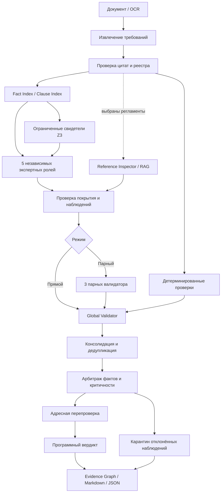

<div align="center">
  
  <h1>Spec Review</h1>
  <p><strong>Проверяем требования до начала разработки.</strong></p>
  <p>BCC-HUB × MNU FinTech Hackathon · AI-агент доказательного ревью требований</p>
  <p><a href="#быстрый-запуск-агента">Запустить агент</a> · <a href="#как-работает-агент">Архитектура</a> · <a href="#результаты-проверки">Результаты</a> · <a href="#веб-приложение">Интерфейс</a></p>
</div>

## О проекте

**Spec Review** — инструмент статического анализа технических заданий для FinTech. Он помогает бизнес-аналитику, архитектору и QA обнаруживать противоречия, недостающие правила, непроверяемые формулировки и несогласованные контракты до начала реализации.

Агент выделяет требования, проверяет **9 индивидуальных критериев**, **6 критериев набора** и **15 пунктов готовности ТЗ**, затем выпускает русскоязычный отчёт. Каждое итоговое замечание связано с проверяемыми цитатами исходного документа. Оригинальные и отклонённые наблюдения не теряются при консолидации.

Проект реализован для [официального задания BCC-HUB](https://github.com/BCC-HUB/ai-requirements-validator-task). Веб-приложение и CLI используют одно ядро, но для сдачи хакатона достаточно CLI.

## Быстрый запуск агента

Требуются Python 3.12+ и [uv](https://docs.astral.sh/uv/getting-started/installation/). Поднимать Docker, PostgreSQL, Chroma или веб-интерфейс для проверки одного документа **не нужно**.

### 1. Настройте модель

Получите API-ключ в [OpenRouter](https://openrouter.ai/settings/keys) и выполните из корня репозитория:

```bash
cp .env.example .env
```

В локальном `.env` укажите `AGENT_LLM_API_KEY`. Пример конфигурации выбирает `openai/gpt-6-luna`, OpenRouter, полный факт-профиль и Z3. Основные вызовы используют low reasoning effort, итоговый арбитр — отдельный auto-профиль (medium для Luna).

Допускается другой OpenAI-совместимый провайдер: задайте `AGENT_LLM_BASE_URL`, `AGENT_LLM_MODEL` и соответствующий ключ. Модель должна поддерживать JSON output. Контрольные измерения относятся к Luna, а не ко всем возможным моделям. Не коммитьте `.env` и API-ключи.

### 2. Получите выданное ТЗ

Скачайте [официальный документ организаторов](https://github.com/BCC-HUB/ai-requirements-validator-task/blob/main/docs/requirements.md) в `.artifacts/requirements.md`:

```bash
mkdir -p .artifacts
curl -fL https://raw.githubusercontent.com/BCC-HUB/ai-requirements-validator-task/main/docs/requirements.md -o .artifacts/requirements.md
```

### 3. Запустите проверку одной командой

```bash
uv run --project vibe/services/agent --frozen python -m agent.spec_review_cli --input .artifacts/requirements.md --output .artifacts/report.md --env-file .env --timeout-seconds 900 --checkpoint-dir .artifacts/checkpoints --wait-rate-limit
```

Готовый отчёт появится по указанному пути. Расширение `.json` в `--output` сохраняет структурированный отчёт вместе с полным Evidence Graph. Используйте `--review-mode multi_agent_direct` для прямой валидации или `--review-mode legacy` для классического режима. По умолчанию выбран `multi_agent`.

CLI принимает **PDF, Markdown, TXT, DOCX, XLSX, CSV, JPG/JPEG, PNG**. Лимиты: 25 МиБ, до 150 страниц PDF, 100 000 извлечённых символов, 500 требований. Для OCR сканов нужны Poppler и Tesseract с языковыми пакетами rus, kaz и eng. Полный список настроек и примеров — в [CLI guide](vibe/docs/SPEC_REVIEW.md).

## Как работает агент



### Экспертные роли

| Эксперт | Задача |
| --- | --- |
| Logic Inspector | Бизнес-логика, однозначность, корректность и противоречия |
| Scenario Builder | Сценарии, границы, единицы и критерии приёмки |
| Gap Hunter | Полнота, атомарность, прослеживаемость и пропущенные требования |
| Contract Inspector | API, интеграционные контракты, реализуемость и данные |
| Risk Inspector | Операционные риски, исключения, восстановление и полнота требований безопасности |
| Reference Inspector (опционально) | Сравнение с выбранными внешними нормативными источниками через RAG |

Эксперты используют одну настроенную LLM с независимыми промптами и областями ответственности. Z3 проверяет пересечение условий и несовместимость результатов в ограниченной формализованной модели, а не истинность произвольного естественного языка. Формальные свидетели — дополнительные доказательные подсказки, не автоматический дефект.

### Доказательность и устойчивость

- Точные цитаты, исходные ID, координаты документа и структурная валидация проверяются кодом.
- Детерминированные правила находят явные повторы, конфликт ID, пустые допустимые числовые диапазоны и незаполненные значения.
- Финализатор объединяет повторные наблюдения, сохраняя их происхождение. Арбитр пересматривает серьёзность, а отклонённые выводы оставляет в графе с контрдоказательствами.
- Программный вердикт различает готовность, необходимость доработки и блокирующие дефекты. Неопределённые проверки не маскируются положительным результатом.
- До девяти параллельных основных запросов к LLM; отдельный слот Reference Inspector. Проверенные контрольные точки позволяют повторить незавершённые этапы.

Подробнее: [мультиагентная архитектура](vibe/docs/MULTI_AGENT_REVIEW.ru.md), [сохранность наблюдений](vibe/docs/REVIEW_RETENTION.md), [проверка по нормативам](vibe/docs/REGULATORY_CONTEXT.md).

## Результаты проверки

Контрольные прогоны на неизменённом официальном ТЗ организаторов, 27 ноября 2026 года. Оба режима работали с GPT-6 Luna и включённым полным факт-профилем.

| Показатель | Парная валидация | Прямая валидация |
| --- | ---: | ---: |
| Выделено требований | 49 | 57 |
| Индивидуальных оценок | 441 | 513 |
| Итоговых замечаний | 19 | 19 |
| Критических замечаний | 4 | 4 |
| Замечаний с проверенными цитатами | 19/19 | 19/19 |
| Структурный аудит | **31/31** | **31/31** |
| Совпадение с подтверждёнными эталонными темами | **5/5** | 3/5 |
| Вердикт | Не готово | Не готово |

Для сдачи выбран парный режим: в этом конкретном сравнении он обнаружил все пять подтверждённых тем фиксированного поднабора. Оценка — ретроспективная смысловая вычитка, не независимое слепое тестирование и не доказательство общей precision. Смысловые дубликаты и отдельные спорные замечания остаются. Z3 включён, но не вывел формальные свидетели на данном ТЗ; его отдельные возможности проверены на синтетических примерах. Подробнее — [методика оценки качества](vibe/docs/QUALITY_EVALUATION.md) и [встроенные примеры с разметкой](vibe/docs/examples/quality-benchmark/).

Итоговый отчёт и выданное ТЗ передаются организаторам **отдельными файлами**, рядом со ссылкой на этот репозиторий. Они не заменяют исходный код агента и не зашиты в пайплайн.

## Веб-приложение

<p align="center"></p>

*Учебный пример интерфейса: исходник ТЗ, навигация по замечаниям и рекомендации в едином рабочем пространстве.*

Помимо CLI доступны история проверок, интерактивный граф доказательств, просмотр источников, предложения исправлений и чат по завершённому отчёту. Веб-агент использует очередь заданий с восстановлением по контрольным точкам.

Для полной локальной платформы нужны Bun 1.4+, Node.js 22.13+ LTS, Docker Compose. Установка описана в [руководстве приложения](vibe/README.md#quick-start).

| Приложение | Локальный адрес |
| --- | --- |
| Основное рабочее пространство | [localhost:5173/app/assistant](http://localhost:5173/app/assistant) |
| Лендинг | [localhost:4321](http://localhost:4321) |

<p align="center"></p>

## Технологии

| Слой | Стек |
| --- | --- |
| AI / API | Python 3.12+, FastAPI, LangChain, LangGraph, Pydantic, Z3 |
| Бэкенд | Bun, Hono, Zod, JOSE, Drizzle ORM, Croner |
| Интерфейс | React 19, TypeScript 6, Vite 8, TanStack Router/Query, React Flow, PDF.js, Tailwind CSS 4, Motion, Blobatar |
| Хранилища | PostgreSQL 18, SQLAlchemy, ChromaDB, BM25L |
| Документы | pypdf, Poppler, Tesseract, Office/CSV parsers |
| Наблюдаемость | OpenTelemetry, structlog, опционально Langfuse |
| Разработка | Bun workspaces, Turborepo, uv, pytest, Bun Test, Docker Compose |

## Структура репозитория

| Каталог | Назначение |
| --- | --- |
| [vibe/services/agent](vibe/services/agent) | AI-агент, CLI, LangGraph, факты, Z3, Evidence Graph, RAG |
| [vibe/backend](vibe/backend) | Аутентифицированный API, задания и прокси |
| [vibe/webapp](vibe/webapp) | Рабочий интерфейс Spec Review |
| [vibe/website](vibe/website) | Публичный лендинг |
| [vibe/packages/contracts](vibe/packages/contracts) | Общие Zod-контракты API |
| [vibe/packages/mascot](vibe/packages/mascot) | Стеклянный маскот, состояния и анимация |
| [vibe/infra](vibe/infra) | Опциональная инфраструктура развёртывания |
| [vibe/docs](vibe/docs) | Архитектура, оценка качества, документация |

## Проверки и документация

```bash
uv run --project vibe/services/agent --frozen pytest vibe/services/agent/tests/test_spec_multi_agent.py vibe/services/agent/tests/test_spec_code_checks.py vibe/services/agent/tests/test_spec_review_facts.py vibe/services/agent/tests/test_spec_review_formal.py
```

- [CLI, форматы и ограничения](vibe/docs/SPEC_REVIEW.md)
- [Мультиагентная архитектура](vibe/docs/MULTI_AGENT_REVIEW.ru.md)
- [Оценка качества](vibe/docs/QUALITY_EVALUATION.md) · [Бизнес-ценность](vibe/docs/BUSINESS_VALUE.ru.md)
- [Нормативный контекст](vibe/docs/REGULATORY_CONTEXT.md) · [Langfuse](vibe/docs/LANGFUSE.md)
- [Маскот и Blobatar](vibe/docs/BLOBATAR.md) · [Дизайн-система](vibe/design.md)

При использовании облачной LLM текст документа передаётся настроенному провайдеру. Ключи остаются на сервере. Отчёт помогает организовать ревью и согласование требований, но не заменяет решение владельца требований и не является сертификацией соответствия стандарту.

Vibe-derived application is licensed under Apache License 2.0. See [LICENSE](vibe/LICENSE) and [NOTICE](vibe/NOTICE).
