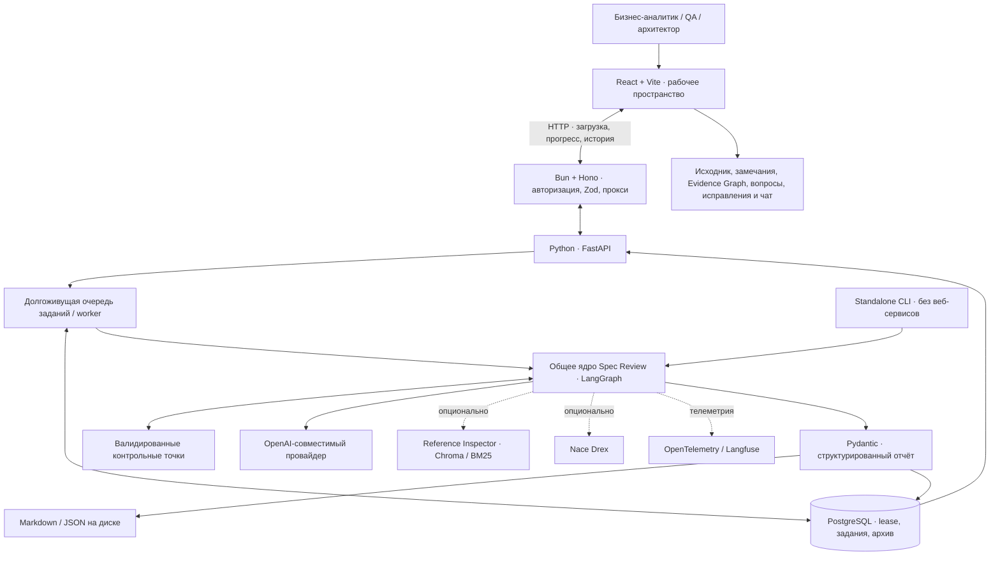
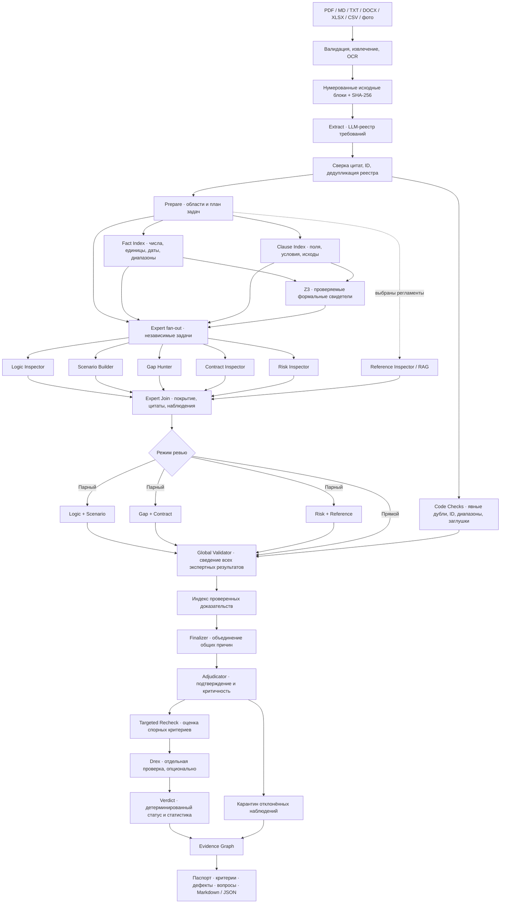
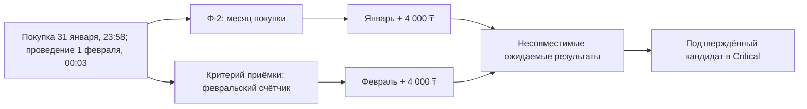
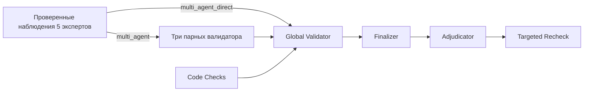
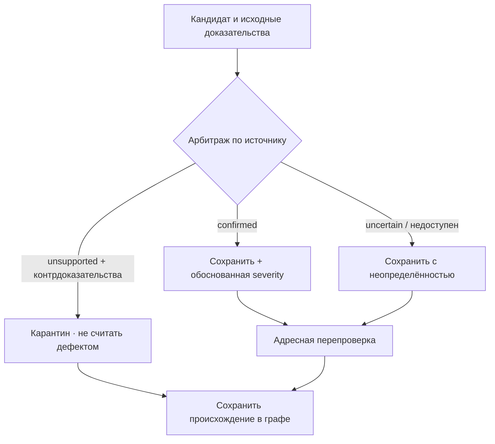
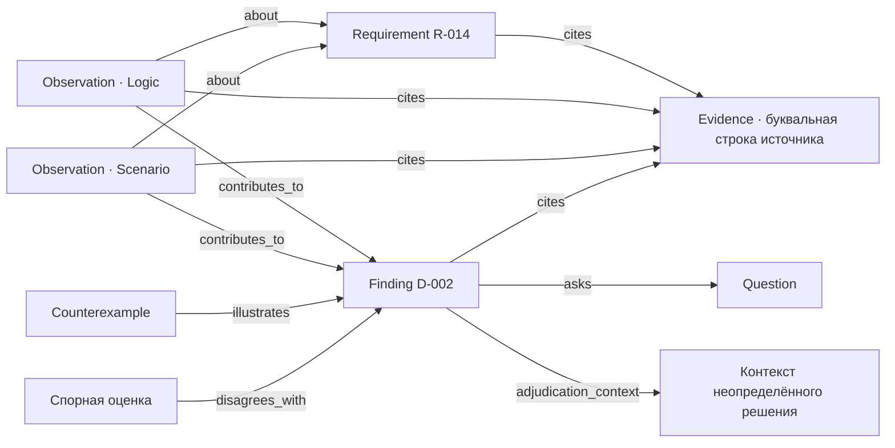
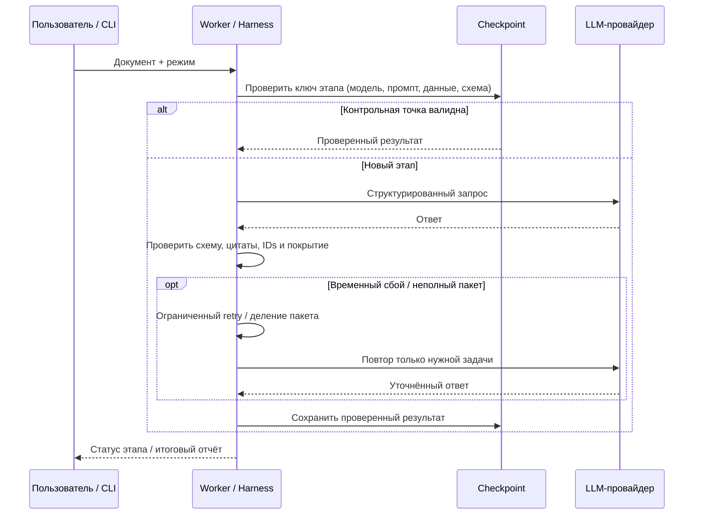
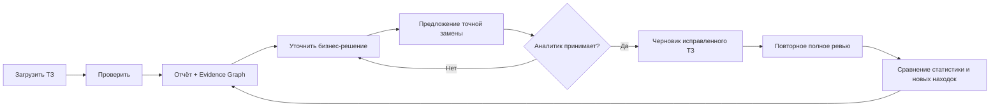

<div align="center">
  
  <h1>Spec Review</h1>
  <p><strong>Проверяем требования до начала разработки.</strong></p>
  <p>BCC-HUB × MNU FinTech Hackathon · AI-агент доказательного ревью требований</p>
  <p><a href="#быстрый-запуск-агента">Запустить агент</a> · <a href="#архитектура-системы">Архитектура</a> · <a href="#полный-пайплайн-агента">Пайплайн</a> · <a href="#результаты-проверки">Результаты</a> · <a href="#веб-приложение">Интерфейс</a></p>
</div>

## О проекте

**Spec Review** — инструмент статического анализа технических заданий для FinTech. Он помогает бизнес-аналитику, архитектору и QA обнаруживать противоречия, недостающие правила, непроверяемые формулировки и несогласованные контракты до начала реализации.

Агент выделяет требования, проверяет **9 индивидуальных критериев**, **6 критериев набора** и **15 пунктов готовности ТЗ**, затем выпускает русскоязычный отчёт. Каждое итоговое замечание связано с проверяемыми цитатами исходного документа. Оригинальные и отклонённые наблюдения не теряются при консолидации.

Проект реализован для [официального задания BCC-HUB](https://github.com/BCC-HUB/ai-requirements-validator-task). Веб-приложение и CLI используют одно ядро, но для сдачи хакатона достаточно CLI.

## Быстрый запуск агента

Требуются Python 3.12+ и [uv](https://docs.astral.sh/uv/getting-started/installation/). Поднимать Docker, PostgreSQL, Chroma или веб-интерфейс для проверки одного документа **не нужно**.

### 1. Настройте модель

Получите API-ключ в [OpenRouter](https://openrouter.ai/settings/keys) и выполните из корня репозитория:

```bash
cp .env.example .env
```

В локальном `.env` укажите `AGENT_LLM_API_KEY`. Пример конфигурации выбирает `openai/gpt-6-luna`, OpenRouter, полный факт-профиль и Z3. Основные вызовы используют low reasoning effort, итоговый арбитр — отдельный auto-профиль (medium для Luna).

Допускается другой OpenAI-совместимый провайдер: задайте `AGENT_LLM_BASE_URL`, `AGENT_LLM_MODEL` и соответствующий ключ. Модель должна поддерживать JSON output. Контрольные измерения относятся к Luna, а не ко всем возможным моделям. Не коммитьте `.env` и API-ключи.

### 2. Получите выданное ТЗ

Скачайте [официальный документ организаторов](https://github.com/BCC-HUB/ai-requirements-validator-task/blob/main/docs/requirements.md) в `.artifacts/requirements.md`:

```bash
mkdir -p .artifacts
curl -fL https://raw.githubusercontent.com/BCC-HUB/ai-requirements-validator-task/main/docs/requirements.md -o .artifacts/requirements.md
```

### 3. Запустите проверку одной командой

```bash
uv run --project vibe/services/agent --frozen python -m agent.spec_review_cli --input .artifacts/requirements.md --output .artifacts/report.md --env-file .env --timeout-seconds 900 --checkpoint-dir .artifacts/checkpoints --wait-rate-limit
```

Готовый отчёт появится по указанному пути. Расширение `.json` в `--output` сохраняет структурированный отчёт вместе с полным Evidence Graph. Используйте `--review-mode multi_agent_direct` для прямой валидации или `--review-mode legacy` для классического режима. По умолчанию выбран `multi_agent`.

CLI принимает **PDF, Markdown, TXT, DOCX, XLSX, CSV, JPG/JPEG, PNG**. Лимиты: 25 МиБ, до 150 страниц PDF, 100 000 извлечённых символов, 500 требований. Для OCR сканов нужны Poppler и Tesseract с языковыми пакетами rus, kaz и eng. Полный список настроек и примеров — в [CLI guide](vibe/docs/SPEC_REVIEW.md).

## Архитектура системы

Spec Review — гибридная архитектура: **LLM выполняет смысловой анализ**, детерминированный код контролирует источники, полноту обязательных проверок и итоговый статус, а Z3 помогает анализировать ограниченный класс формализуемых противоречий. Все режимы используют один источник документа, одну схему отчёта и общее ядро.



| Граница системы | Ответственность |
| --- | --- |
| Веб-приложение | Создание проверки, визуализация прогресса, просмотр исходника и цитат, граф доказательств, исправления и повторная проверка |
| Bun/Hono API | Авторизация, контекст пользователя, проверка контрактов, проксирование в Python |
| FastAPI / Python | Парсинг, очередь, управление выполнением, маршрутизация AI-пайплайна |
| AI-ядро | Извлечение, независимые эксперты, детерминированный анализ, арбитраж и отчёт |
| PostgreSQL | Задания, аренда worker, checkpoint-данные, архив и owner-scoped история |
| Chroma / лексический поиск | Только дополнительные нормативные источники; не обязательны для обычного ревью |
| CLI | Запуск того же ядра без HTTP, Docker, PostgreSQL и веб-приложения |
| Наблюдаемость | Метрики этапов, задержки, модель, токены, расходы и ошибки; не участник принятия решения |

Веб-приложение использует серверную очередь и архив. CLI выполняет анализ одного файла в текущем процессе и сохраняет результат локально. Evidence Graph — структура в JSON, а не отдельная графовая база. В завершённом архиве хранится извлечённый исходный текст и отчёт, а не исходный бинарный PDF/фото/Office-файл. Для повторной проверки с теми же нормативными источниками нужны их оригинальные файлы с совпадающими SHA-256.

## Полный пайплайн агента

### 1. Граф выполнения



Точные узлы `StateGraph` в [spec_multi_agent.py](vibe/services/agent/src/agent/services/spec_multi_agent.py):

```text
START → extract → prepare → expert (fan-out) → expert_join
     → [pair_validator (fan-out)] → global_validator
     → finalizer → adjudicator → targeted_recheck → verdict → END
```

Fact/Clause Index и Z3 вычисляются внутри `prepare`; граф доказательств и отчёт строятся внутри `verdict`. Парные валидаторы присутствуют только в парном режиме. Reference Inspector включается при выбранных регламентах. Это не цепочка из пяти последовательных запросов: независимые задачи экспертов выполняются параллельно с общим ограничением числа вызовов.

### 2. Контракты всех этапов

| Этап | Что поступает | Что получается |
| --- | --- | --- |
| Document parsing | Файл, формат и байты | Нумерованные исходные блоки, хеш, OCR-метаданные |
| Extraction | Первичные фрагменты и соседний контекст | Требования R-001…, исходные ID, буквальные цитаты |
| Prepare | Проверенный реестр и исходный текст | План пакетных и документных задач, индекс фактов |
| Expert fan-out | Свои критерии, требования, контекст и факты | Оценки, наблюдения, рекомендации, сценарии |
| Expert Join | Все обязательные экспертные ответы | Проверенное покрытие ролей и критериев |
| Pair Validator | Две экспертные области | Сгруппированные наблюдения без потери происхождения |
| Global Validator | Все группы, оценки и code checks | Общий индекс доказательств, кандидаты в дефекты и разногласия |
| Finalizer | Структурированные кандидаты | Консолидированные группы по общим причинам, вопросы |
| Adjudicator | Кандидат, исходные цитаты, правила и исключения | Подтверждение / отклонение / неопределённость, severity |
| Targeted Recheck | Приоритетные разногласия | Уточнённые критерии либо явная необходимость ручной проверки |
| Verdict | Валидированные требования и дефекты | Программная статистика, статус готовности, граф и отчёт |

### 3. Приём документа и извлечение требований

- Проверяем формат, размер, целостность и извлекаем текст из MD/TXT, PDF, DOCX, XLSX, CSV и изображений.
- Для сканов и нечитаемых PDF-страниц используем Poppler/Tesseract с русским, казахским и английским языками; поддерживаются встроенные изображения DOCX.
- Каждый фрагмент сохраняет координаты: строка, страница, блок документа, ячейка/строка таблицы в зависимости от формата. Вычисляется SHA-256 исходных байтов.
- LLM извлекает обязательства из небольших первичных диапазонов; соседние блоки нужны для контекста. В реестре сохраняются внутренний уникальный ID, исходный ID (если присутствует), формулировка и цитата.
- Программа сверяет буквальную цитату с исходником, валидирует идентификаторы и устраняет точные повторы. Неизвлечённые обязательства дополнительно ищет Gap Hunter.
- Нечитаемый материал не подменяется выдуманным текстом: он помечается, не используется в цитатах и блокирует положительный вердикт. Полностью нечитаемый документ отклоняется до обращения к модели.

### 4. Fact Index, Clause Index и Z3

| Уровень | Реализация | Назначение |
| --- | --- | --- |
| Числовой индекс | [spec_review_facts.py](vibe/services/agent/src/agent/services/spec_review_facts.py) | Явные количества, валюты, даты, время, диапазоны, граничные значения и сопоставимые единицы |
| Индекс условий | [spec_review_formal.py](vibe/services/agent/src/agent/services/spec_review_formal.py) | Ограниченное распознавание сущностей, полей, статусов, условий и исходов |
| Детерминированные правила | [spec_static_checks.py](vibe/services/agent/src/agent/services/spec_static_checks.py), [spec_review.py](vibe/services/agent/src/agent/services/spec_review.py) | Повторы, конфликт ID, пустой допустимый числовой домен и явные незаполненные значения |
| Формальный решатель Z3 | [spec_review_formal.py](vibe/services/agent/src/agent/services/spec_review_formal.py) | Проверка пересечения явно распознанных условий и несовместимых результатов |

Факт-индекс используется без дополнительного LLM-запроса. Например, 100 тенге и 10 000 тиын нормализуются к одному значению; разное представление одной суммы не является конфликтом. Нормализованные факты всегда связаны с буквальными цитатами. Числовые кандидаты показывают экспертам, какие границы проверить.

Профили: `off` — выключить индекс, `numeric` — числовой анализ, `full` — числовые и семантические подсказки. Z3 работает в полном профиле и только если явно включён. Условия и исключения, которые парсер не смог надёжно определить, не превращаются в формальное доказательство.

**Z3 доказывает свойство формализованной модели, а не истинность произвольной русской фразы.** Свидетель поступает эксперту и сохраняется отдельно, но не становится автоматически подтверждённым дефектом и не повышает severity сам по себе.

### 5. Пять экспертов и покрытие критериев

| Эксперт | Индивидуальные критерии | Критерии набора | Специализация |
| --- | --- | --- | --- |
| **Logic Inspector** | Необходимость, однозначность, корректность | Согласованность, связность | Бизнес-правила, состояния, зависимость условий, бизнес-процесс |
| **Scenario Builder** | Проверяемость | Проверяемость набора | Сценарии, границы, отрицательные случаи, критерии приёмки |
| **Gap Hunter** | Полнота, атомарность, прослеживаемость | Полнота набора, отсутствие дублирования | Пропущенные обязательства, структура и согласования |
| **Contract Inspector** | Реализуемость, независимость от реализации | Достижимость | API и данные, интеграции, архитектурные границы |
| **Risk Inspector** | — | — | Операционные исключения, восстановление, откат и полнота требований безопасности |
| Reference Inspector (опционально) | Отдельная проверка | Отдельная проверка | Сопоставление с выбранными нормативными источниками через RAG |

Четыре основные роли проверяют отдельные требования группами до 12, все пять работают также на уровне документа. Это пять независимых промптов и областей ответственности, а не пять разных моделей. Каждый эксперт возвращает структурированный ответ, проверяемый Pydantic и кодом.

**9 индивидуальных критериев:** необходимость, однозначность, полнота, атомарность, реализуемость, проверяемость, корректность, независимость от реализации, прослеживаемость.

**6 критериев набора:** полнота набора, согласованность, связность, достижимость, проверяемость набора, отсутствие дублирования.

**15 пунктов готовности ТЗ:** связь с бизнес-требованием, структура, sequence, UX/UI, откат, тестируемость, данные/потоки, операционные риски, архитектура, межсистемные согласования, информационная безопасность, бизнес-процесс, интеграции, версия и согласующие.

Каждая проверка имеет `pass`, `fail`, `uncertain` или `not_applicable`, комментарий и при необходимости связанное доказательство. Структурная полнота оценок не гарантирует смысловую правильность каждой из них.

### 6. Модельный сценарий и контрпример

Scenario Builder сопоставляет исходные условия, действие и ожидаемый результат. Например, на официальном ТЗ:



Здесь контрпример строится по точным строкам исходника. Это статический анализ требований, а не выполнение банковской системы или тестов её реализации. Аналогично проверяется изменение порога после уже отправленного уведомления: месячный лимит и повторное достижение могут требовать разные результаты.

### 7. Парная или прямая валидация

| Режим | Маршрут | Когда применять |
| --- | --- | --- |
| `multi_agent` (по умолчанию) | Logic + Scenario, Gap + Contract, Risk + Reference → три парных валидатора → Global Validator | Основной режим анализа; выбран для финального отчёта |
| `multi_agent_direct` | Те же проверенные экспертные результаты → Global Validator напрямую | Сравнение без промежуточной парной стадии |
| `legacy` (CLI/API) | Классическая проверка отдельных требований и набора, code checks → программный вердикт | Исторический контрольный режим; без современного факт-индекса, арбитража и Evidence Graph |



Global Validator проверяет обязательное покрытие, принадлежность критериев, ссылки на требования и исходные цитаты. Отсутствие парной стадии в прямом режиме не отменяет ни одну из пяти ролей, арбитраж или программную валидацию.

### 8. Консолидация дефектов и сохранение наблюдений

1. Объединяем точные совпадения; отдельно обрабатываем подтверждённые статические корни и одинаковые явно пустые поля.
2. Retrieval кандидатов в объединение учитывает источники, общие сущности, формулировки, условия, числовые значения и связь требований. Разные типы замечаний могут описывать одну причину; совпадение цитаты само по себе не разрешает слияние.
3. Семантический Finalizer получает структурированные группы, а не свободный текст рассуждений. При большом количестве кандидатов связанные компоненты разбиваются на малые партии, затем обрабатываются глобально.
4. Объединение принимается только для разрешённых кандидатов, требующих одного решения; раздельно действующие дефекты сохраняются.
5. Исходные наблюдения, их идентификаторы и цитаты сохраняются в Evidence Graph. `limited` означает ограничение контекста, `deterministic_fallback` — недоступный/неуспешный вспомогательный этап. Эти статусы не означают, что все смысловые повторы устранены.

Лимиты текущей реализации: до 32 групп в глобальном контексте Finalizer, до 24 пар-кандидатов на объединение за обращение; плотные компоненты обрабатываются партиями до шести групп. Это ограничивает контекст и расход токенов, но оставляет риск пропустить объединение.

### 9. Итоговый арбитраж и единая рубрика критичности

Арбитр — отдельный этап после консолидации. Он получает серьёзные наблюдения и заявленные противоречия, пропуски, непроверяемое обязательное поведение вместе с источником. Проверяет наличие дефекта, совпадение области действия, исключения и приоритет правил, возможный блокер реализации/приёмки и цитаты. Кандидаты отправляются партиями до пяти; источник ограничивается до 24 000 символов, явно маркируется неполный контекст.

| Уровень | Правило |
| --- | --- |
| 🔴 Critical | Подтверждённое противоречие, отсутствие обязательного контракта/решения, непроверяемое обязательное поведение делает невозможным единственный корректный вариант реализации или приёмки, либо создаёт тяжёлый бизнес-ущерб |
| 🟠 High | Существенный риск реализации/приёмки, требующий значимого уточнения, но блокер не доказан |
| 🟡 Medium | Локальный значимый дефект или неполнота |
| 🟢 Low | Незначительное замечание с конкретным последствием |



Уровень критичности может быть повышен или понижен по проверенным доказательствам. Наличие нескольких экспертов или банковского термина само по себе не повышает severity. Для исключения наблюдения нужны контрдоказательства; арбитр не отменяет подтверждённые статические правила. Невалидный ответ арбитра не уничтожает находку.

После арбитража `targeted_recheck` адресно проверяет до шести приоритетных групп разногласий и до 24 строк критериев. Неразрешённые расхождения остаются видимыми. Опциональный Drex добавляет своё отдельное решение — не изменяет основной программный вердикт.

### 10. Evidence Graph: объяснимость и трассировка



Узлы: `requirement`, `evidence`, `observation`, `counterexample`, `finding`, `question`, `reference`. Рёбра: `cites`, `about`, `contributes_to`, `disagrees_with`, `illustrates`, `asks`, `from_reference`, `adjudication_context`.

Граф хранит разницу между исходным наблюдением, формальным/гипотетическим сценарием и подтверждённым итоговым замечанием. Контрдоказательства и контекст неопределённого решения не маскируются под подтверждающие цитаты. В UI можно фильтровать связи, раскрывать группы и переходить к исходному фрагменту. Граф верифицируется на стороне Python и общим TypeScript/Zod-контрактом; архивные отчёты без графа остаются совместимыми.

### 11. Программный вердикт и финальный отчёт

`summarize()` считает показатели из реестра и итоговых находок, а не доверяет цифрам, написанным LLM.

| Статус | Смысл |
| --- | --- |
| `not_ready` | Есть блокирующие дефекты/риски, непрочитанные части или существенная неполнота исходного анализа |
| `needs_revision` | Остались другие замечания, неопределённые/неполные проверки или необходимость ручного решения |
| `ready` | Автоматическая проверка не выявила существенных препятствий; требуется подтверждение владельцем требований |

Русскоязычный отчёт содержит:

- паспорт: название, дата, модель, версия и SHA коммита, ID прогона, SHA-256 исходного файла, режим, факт-профиль, Z3, reasoning effort, параллельность и дополнительные источники;
- реестр извлечённых требований с девятью индивидуальными проверками, шесть оценок набора, 15 пунктов готовности;
- дефекты с категорией, критичностью, буквальными цитатами, связанными ID, рекомендациями и уточняющими вопросами;
- возможные пропуски, контрпримеры, арбитраж, разногласия, граф, статистику и итоговый статус.

JSON принимается строгими Pydantic/Zod-контрактами, Markdown формируется из тех же данных. Отдельная формальная валидация не является оценкой точности естественного языка.

### 12. Reference RAG и независимая проверка

Reference Inspector выполняет **отдельное** сравнение только с выбранными пользователем нормативными документами. Извлечённые фрагменты индексируются по хешам и контексту владельца. Chroma и BM25/локальные лексические векторы возвращают релевантные участки; learned embeddings опциональны. Каждое нормативное наблюдение связано с исходником ТЗ и точным внешним источником. Неполное извлечение явно отмечается; отсутствие совпадения поиска не означает неприменимость нормы. Нормативная оценка и Drex не подменяют основной вердикт.

Подробности: [нормативный контекст](vibe/docs/REGULATORY_CONTEXT.md), [Drex и основной CLI](vibe/docs/SPEC_REVIEW.md).

## Надёжность, управление выполнением и воспроизводимость



- Ограничение параллельности — 9 основных запросов на один review; Reference Inspector имеет отдельный слот.
- Таймаут AI-проверки — до 900 секунд для мультиагентных и больших проверок; для небольшого Legacy по умолчанию 230 секунд. CLI позволяет указать 30–900 секунд.
- При временном сетевом сбое ограниченные повторы учитывают дедлайн и `Retry-After`; ожидание освобождает слот модели. Не прошедшая валидацию индивидуальная партия может разделиться по требованиям.
- Контрольные точки связаны с провайдером, моделью, содержанием, промптом, профилем и схемой. Неуспешный обязательный эксперт не заменяется фиктивным результатом. Веб-worker использует lease/heartbeat для восстановления после рестарта.
- Документ рассматривается как данные, а не как инструкции для модели. Сервер проверяет типы, размеры, координаты, ID, права владельца и контракты. Ключи модели остаются серверными; при облачном провайдере текст отправляется выбранной LLM.
- Телеметрия фиксирует этапы, доступные токены, стоимость, задержку и ошибки; неизвестные показатели не выдаются за нулевую стоимость.
- Ограничения: 25 МиБ, 150 PDF-страниц, 100 000 извлечённых символов, 500 требований. Контекст больших документов ограничивается окнами и извлечёнными кандидатами, поэтому это не исчерпывающий перебор всех пар требований.

### Конфигурация финального профиля

| Переменная | Значение примера | Назначение |
| --- | --- | --- |
| `AGENT_LLM_BASE_URL` | OpenRouter API | OpenAI-совместимый провайдер |
| `AGENT_LLM_API_KEY` | задаётся локально | Ключ провайдера, не для Git |
| `AGENT_LLM_MODEL` | `openai/gpt-6-luna` | Одна модель для всех ролей |
| `AGENT_SPEC_REVIEW_REASONING_EFFORT` | `low` | Основные этапы |
| `AGENT_SPEC_REVIEW_ADJUDICATION_REASONING_EFFORT` | `auto` | Medium для Luna/GLM-5.3; `inherit` использует общий профиль |
| `AGENT_SPEC_REVIEW_FACT_PROFILE` | `full` | `off` / `numeric` / `full` |
| `AGENT_SPEC_REVIEW_USE_Z3` | `true` | Формальные свидетели |
| `AGENT_SPEC_REVIEW_CONCURRENCY` | `9` | Основные параллельные запросы |
| `AGENT_SPEC_REVIEW_USE_NACE` | `false` | Отдельная проверка Drex |
| `AGENT_LLM_TIMEOUT_SECONDS` | `45` | Таймаут отдельного вызова |
| `AGENT_LLM_MAX_RETRIES` | `2` | Повторы клиента LLM |

Подробные контракты, команды и ограничения: [мультиагентная архитектура](vibe/docs/MULTI_AGENT_REVIEW.ru.md), [сохранность наблюдений](vibe/docs/REVIEW_RETENTION.md), [CLI/API](vibe/docs/SPEC_REVIEW.md), [Langfuse](vibe/docs/LANGFUSE.md).

## Результаты проверки

Контрольные прогоны на неизменённом официальном ТЗ организаторов, 27 ноября 2026 года. Оба режима работали с GPT-6 Luna и включённым полным факт-профилем.

| Показатель | Парная валидация | Прямая валидация |
| --- | ---: | ---: |
| Выделено требований | 49 | 57 |
| Индивидуальных оценок | 441 | 513 |
| Итоговых замечаний | 19 | 19 |
| Критических замечаний | 4 | 4 |
| Замечаний с проверенными цитатами | 19/19 | 19/19 |
| Структурный аудит | **31/31** | **31/31** |
| Совпадение с подтверждёнными эталонными темами | **5/5** | 3/5 |
| Вердикт | Не готово | Не готово |

Для сдачи выбран парный режим: в этом конкретном сравнении он обнаружил все пять подтверждённых тем фиксированного поднабора. Оценка — ретроспективная смысловая вычитка, не независимое слепое тестирование и не доказательство общей precision. Z3 включён, но не вывел формальные свидетели на данном ТЗ; его отдельные возможности проверены на синтетических примерах.

### Смысловая вычитка актуального парного отчёта

Выполнена дополнительная ручная сверка всех 19 записей с официальным ТЗ.

| Критическая запись | Результат сверки |
| --- | --- |
| D-001 | Обоснована: контракт заявленных чтения и сохранения не определён однозначно |
| D-002 | Обоснована: правило месяца покупки противоречит февральскому результату в приёмке |
| D-003 | Пропуск контракта чтения подтверждается; перекрывается с D-001 |
| D-004 | Обоснована: месячный лимит уведомлений против повторной отправки после изменения порога |

Таким образом, **четыре записи Critical — не четыре независимых корневых дефекта**. Остальные повторяющиеся темы: неоднозначные HTTP-статусы и тела ответов, повторная доставка событий. Найдены спорные оценки, включая ошибочный положительный комментарий к корректности R-005, хотя D-002 и R-014 правильно фиксируют конфликт дат. Структурный аудит не проверяет истинность каждого такого комментария. Итоговый вердикт «Не готово» обоснован, но нужна дальнейшая смысловая согласованность оценок и дедупликация.

### Как измеряем качество

1. **Структурно:** проверка хеша исходника, цитат, полноты реестра, численности критериев, ссылок, статуса экспертов, целостности графа и паспорта.
2. **По контрольным документам:** синтетические ТЗ до и после исправления, фиксированные размеченные требования, дефекты и отрицательные контроли. Сопоставление по точным якорям и типам; эталонная разметка не передаётся агенту.
3. **Смысловая сверка:** анализ первопричин отдельно от числа формулировок и проверка лишних, пропущенных, спорных и повторяющихся замечаний. Для общей precision/recall нужна независимая экспертная разметка.
4. **Сохранность:** сопоставление наблюдений и итоговых групп при наличии независимых меток. Отдельно считаются сохранение корневых дефектов, ссылок и цитат; карантин не считается автоматически потерей полезного дефекта.

Проверить сохранённый JSON по исходнику без нового модельного запроса (при генерации укажите `--output .artifacts/report.json`):

```bash
uv run --project vibe/services/agent --frozen python vibe/services/agent/scripts/evaluate_spec_report.py \
  --input .artifacts/requirements.md --report .artifacts/report.json --output .artifacts/report-audit.json
python3 vibe/services/agent/scripts/audit_review_retention.py \
  --report .artifacts/report.json
```

Для воспроизведения benchmark, сравнения парного/прямого режимов и оценок на синтетических документах см. [методику оценки качества](vibe/docs/QUALITY_EVALUATION.md), [встроенные примеры с разметкой](vibe/docs/examples/quality-benchmark/) и [аудит сохранности](vibe/docs/REVIEW_RETENTION.md).

Итоговый отчёт и выданное ТЗ передаются организаторам **отдельными файлами**, рядом со ссылкой на этот репозиторий. Они не заменяют исходный код агента и не зашиты в пайплайн.

## Веб-приложение

<p align="center"></p>

*Учебный пример интерфейса: исходник ТЗ, навигация по замечаниям и рекомендации в едином рабочем пространстве.*

Помимо CLI доступны история проверок, интерактивный граф доказательств, просмотр источников, предложения исправлений и чат по завершённому отчёту. Веб-агент использует очередь заданий с восстановлением по контрольным точкам.

### Цикл работы аналитика



Рекомендации не переписывают исходный архив. Предложение содержит точный фрагмент до/после; принятые замены применяются к исходному тексту только при уникальных непересекающихся якорях. Неизвестные бизнес-решения задаются вопросами, а не додумываются. Новая проверка получает отдельный паспорт и архивную запись. Сравнение показывает изменившиеся оценки, но не доказывает автоматически устранение каждого старого дефекта. Чат по архиву отвечает с контекстом конкретного сохранённого отчёта.

Для полной локальной платформы нужны Bun 1.4+, Node.js 22.13+ LTS, Docker Compose. Установка описана в [руководстве приложения](vibe/README.md#quick-start).

| Приложение | Локальный адрес |
| --- | --- |
| Основное рабочее пространство | [localhost:5173/app/assistant](http://localhost:5173/app/assistant) |
| Лендинг | [localhost:4321](http://localhost:4321) |

<p align="center"></p>

## Технологии

| Слой | Стек |
| --- | --- |
| AI / API | Python 3.12+, FastAPI, LangChain, LangGraph, Pydantic, Z3 |
| Бэкенд | Bun, Hono, Zod, JOSE, Drizzle ORM, Croner |
| Интерфейс | React 19, TypeScript 6, Vite 8, TanStack Router/Query, React Flow, PDF.js, Tailwind CSS 4, Motion, Blobatar |
| Хранилища | PostgreSQL 18, SQLAlchemy, ChromaDB, BM25L |
| Документы | pypdf, Poppler, Tesseract, Office/CSV parsers |
| Наблюдаемость | OpenTelemetry, structlog, опционально Langfuse |
| Разработка | Bun workspaces, Turborepo, uv, pytest, Bun Test, Docker Compose |

## Структура репозитория

| Каталог | Назначение |
| --- | --- |
| [vibe/services/agent](vibe/services/agent) | AI-агент, CLI, LangGraph, факты, Z3, Evidence Graph, RAG |
| [vibe/backend](vibe/backend) | Аутентифицированный API, задания и прокси |
| [vibe/webapp](vibe/webapp) | Рабочий интерфейс Spec Review |
| [vibe/website](vibe/website) | Публичный лендинг |
| [vibe/packages/contracts](vibe/packages/contracts) | Общие Zod-контракты API |
| [vibe/packages/mascot](vibe/packages/mascot) | Стеклянный маскот, состояния и анимация |
| [vibe/infra](vibe/infra) | Опциональная инфраструктура развёртывания |
| [vibe/docs](vibe/docs) | Архитектура, оценка качества, документация |

## Проверки и документация

```bash
uv run --project vibe/services/agent --frozen pytest vibe/services/agent/tests/test_spec_multi_agent.py vibe/services/agent/tests/test_spec_code_checks.py vibe/services/agent/tests/test_spec_review_facts.py vibe/services/agent/tests/test_spec_review_formal.py
```

- [CLI, форматы и ограничения](vibe/docs/SPEC_REVIEW.md)
- [Мультиагентная архитектура](vibe/docs/MULTI_AGENT_REVIEW.ru.md)
- [Оценка качества](vibe/docs/QUALITY_EVALUATION.md) · [Бизнес-ценность](vibe/docs/BUSINESS_VALUE.ru.md)
- [Нормативный контекст](vibe/docs/REGULATORY_CONTEXT.md) · [Langfuse](vibe/docs/LANGFUSE.md)
- [Маскот и Blobatar](vibe/docs/BLOBATAR.md) · [Дизайн-система](vibe/design.md)

При использовании облачной LLM текст документа передаётся настроенному провайдеру. Ключи остаются на сервере. Отчёт помогает организовать ревью и согласование требований, но не заменяет решение владельца требований и не является сертификацией соответствия стандарту.

Vibe-derived application is licensed under Apache License 2.0. See [LICENSE](vibe/LICENSE) and [NOTICE](vibe/NOTICE).
