# Spec Review — Darumleye

Презентация для BCC HUB × MNU FinTech Hackathon.

[Смотреть PDF](Spec-Review-Darumleye.pdf) · [Скачать редактируемый PowerPoint](Spec-Review-Darumleye.pptx)

Для показа используйте PDF: оформление сохраняется на любом компьютере. Для редактирования PowerPoint нужен шрифт **Inter**.

13 слайдов с интерфейсом приложения, сценарием исправления ТЗ, архитектурой и командой. Цветные курсоры поясняют действия и роли. Скриншоты показывают учебный интерфейс и локальное демо конфликта дат.

Показатели 6/6, 45/45 и 81,9 с относятся к одному сохранённому запуску `official / multi_agent` в [измерениях OpenRouter Luna](../../vibe/docs/examples/quality-benchmark/openrouter-luna-low-c9.csv), а не ко всем документам или оценке жюри. Демо до/после проверяет один конфликт локально. Полное AI-ревью запускается отдельно.

## 01. Spec Review

## 02. Конфликт дат

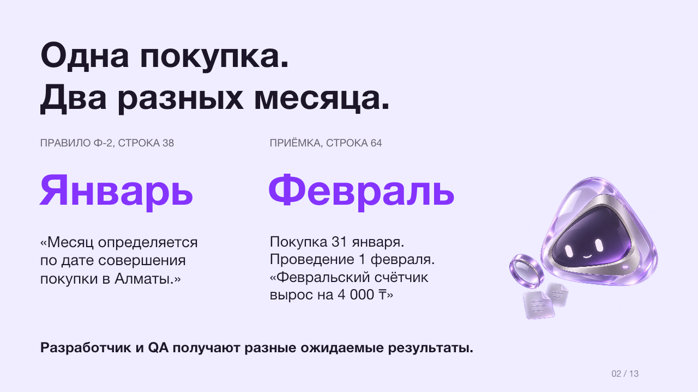

## 03. Загрузка ТЗ

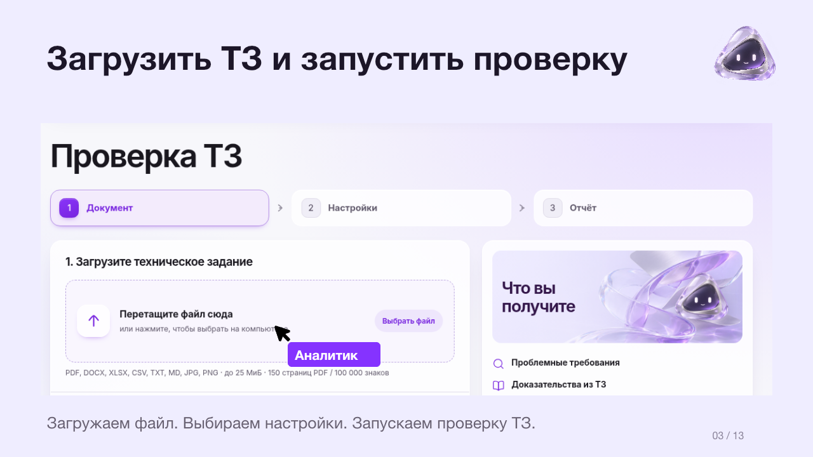

## 04. Замечание и доказательство

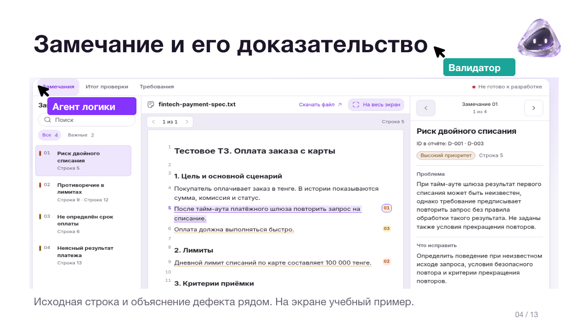

## 05. Согласование правки

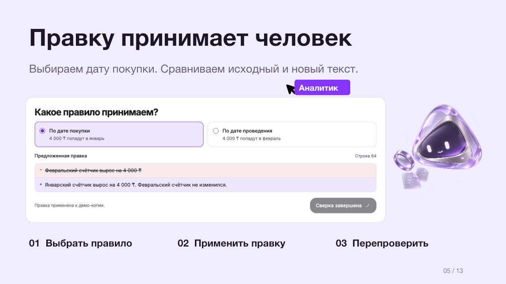

## 06. Результат до и после

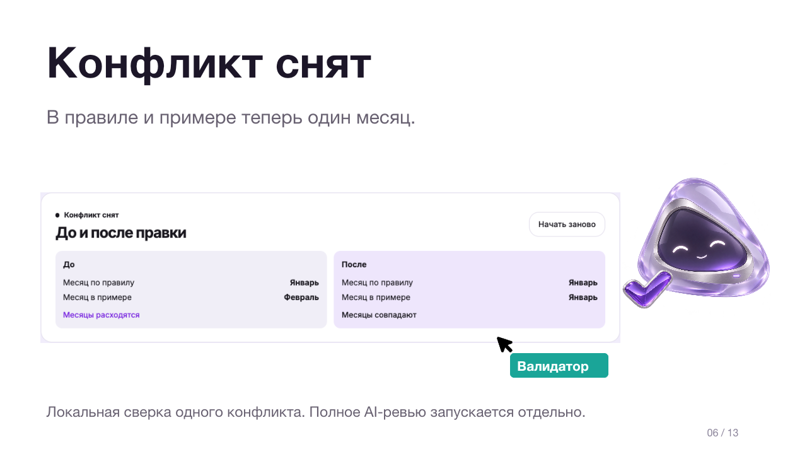

## 07. Экспертные роли

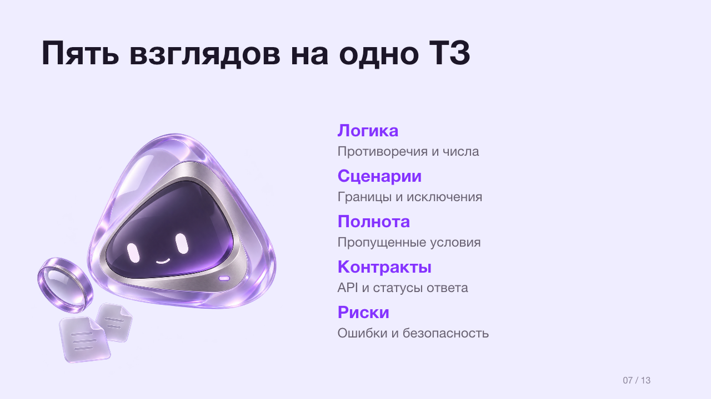

## 08. Проверка доказательств

## 09. Контрольный прогон

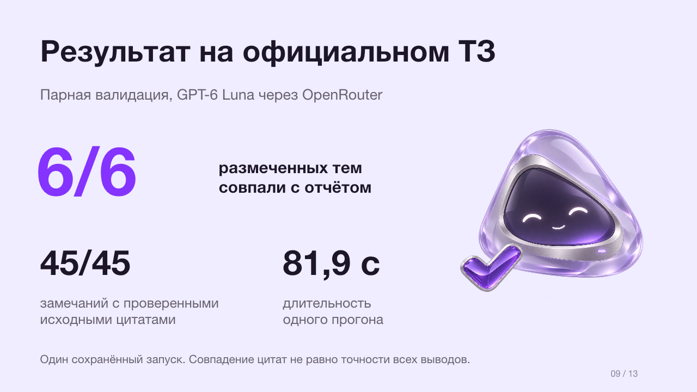

## 10. Технический стек

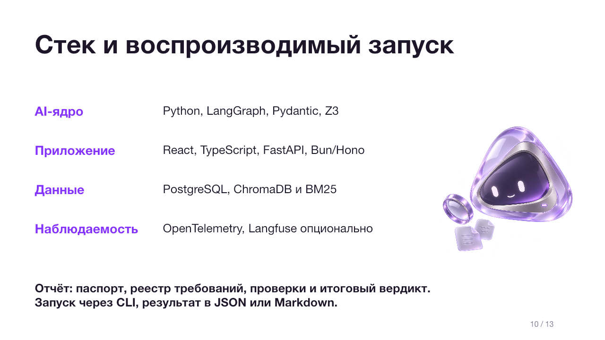

## 11. Замена модели

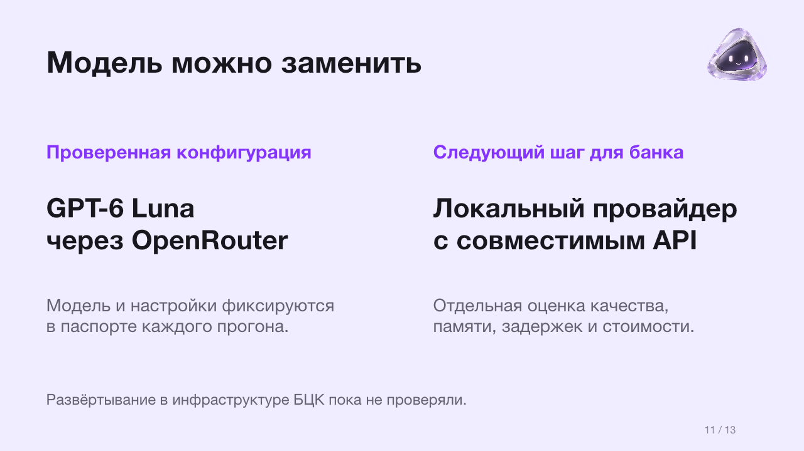

## 12. Команда Darumleye

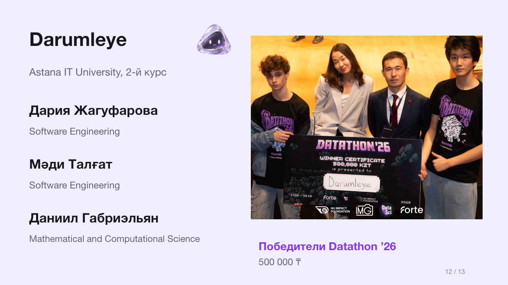

## 13. Пилот с аналитиками

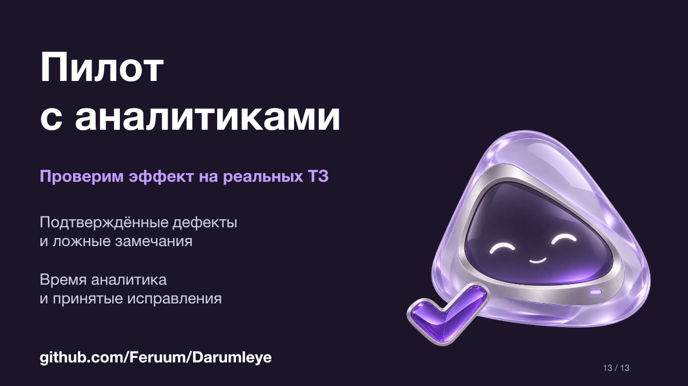

## Источники

- [Задание хакатона](https://github.com/BCC-HUB/ai-requirements-validator-task)
- [Архитектура Spec Review](../../vibe/docs/MULTI_AGENT_REVIEW.ru.md)
- [Курсор Phosphor Icons](https://github.com/phosphor-icons/core/blob/main/assets/fill/cursor-fill.svg), [MIT license](PHOSPHOR-LICENSE)
