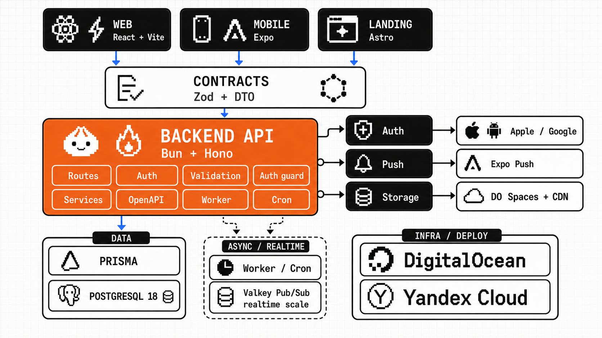

# Spec Review — application workspace

<p align="center">
  
</p>

A local-first starter for hackathon projects. React/Vite serves the pre-rendered public site, Vite provides the signed-in workspace, Bun/Hono owns authentication and API access, and a Python/LangGraph service hosts pluggable agent modules. The first module answers questions from private PDF and TXT uploads. Bun workspaces manage JavaScript dependencies, and Turborepo coordinates development tasks and caches builds locally.

[AGENTS.md](AGENTS.md) defines the development rules. The active launch path is local. Cloud infrastructure and the mobile branch are not part of this starter's first run.

This application is stored under `vibe/` in [Feruum/Darumleye](https://github.com/Feruum/Darumleye). Run the commands below from `vibe/`. Git is configured in its parent workspace. The canonical RAG agent lives in `services/agent`; the outer original reference directory has been retired. See [RAG consolidation](docs/RAG_CONSOLIDATION.md) for source reconciliation and recovery from the upstream TemplateHack history.

The agent combines owner-filtered vector and keyword retrieval, optional reranking, streaming citations, and PostgreSQL conversation state. The workspace's **Your memory** card lets each user save/delete private preferences. The model can read those notes but cannot write or delete them. Existing running agent containers need a rebuild to load the new Python routes; the [guide](docs/RAG_CONSOLIDATION.md#run-and-verify) explains it.

Optional [Nace Drex reranking](docs/NACE_RAG.md) assesses the relevance of the private RAG shortlist. It uses a separate API key and does not replace the chat LLM or the full-document specification-review pipeline.

## Interface libraries

The active public site and signed-in workspace use **Arc Free** copied MIT source for controls, forms, cards, selectors, tables, menus, loading/empty states, and FAQ. Chats remain on **assistant-ui**. Existing **shadcn/ui** supplies missing Free equivalents: Sidebar/Sheet support, Field, Item, Separator, Spinner, and specialized AlertDialog. See the [migration/fallback report](docs/ARC_MIGRATION.md) and [design.md](design.md).

Arc migration verification on 2026-10-16 passed: full `bun run check`, final **97 webapp tests**, types/lint/builds, **18 distinct workspace browser scenarios across the full run and targeted reruns**, and **7 production-site cases**. The mobile keyboard/focus regression passed three repetitions at both 390px and 700px. See [VERIFICATION.md](docs/VERIFICATION.md) for boundaries and remaining provider configuration.

The separate `/app/chat` screen uses **assistant-ui 0.15.29** LocalRuntime and primitives for the chat lifecycle. Selected **Arc Free** controls and badges surround the chat. **Motion 14.3.0** and Blobatar support status animation; assistant-ui owns suggestions, copy, and message actions. Requests still use the authenticated Bun SSE proxy; provider keys remain server-side. No assistant-ui Cloud account is required.

Earlier RAG integration checks on 2026-10-16 passed: **91 webapp tests and 4 Chromium scenarios**, including mobile, sources/tools, uploads, explicit note save/reload/delete, cancellation, and HTTP errors. Types and production builds passed. Session-scoped agent caches clear on sign-out and account replacement.

The [design guide](design.md) records the frontend libraries and visual conventions. The [chat UI guide](docs/CHAT_UI.md) explains component ownership, keyboard/cancellation behavior, citations, errors, checks, and remaining AI configuration. Preserve the [Arc MIT license and source record](webapp/src/components/arc/README.md).

## FinTech specification review

In the signed-in workspace, open **Проверка ТЗ**, select a PDF, UTF-8 TXT, Markdown, DOCX, XLSX, CSV, JPG/JPEG or PNG file, and click **Проверить ТЗ**. Choose **Парная валидация** (`multi_agent`, default) or **Прямая валидация** (`multi_agent_direct`). The pipeline registers a run ID and document SHA-256, extracts requirements with source identifiers, checks duplicates and reused IDs in code, assesses nine individual criteria, six set criteria and the readiness checklist, validates evidence, and produces a verdict and priorities. The direct route connects the experts to the global evidence validator. The paired route adds three intermediate model checks. Both produce an interactive Evidence Graph. New repeats preserve a paired or direct passport mode. A legacy passport or an absent mode selects direct validation for the repeat. The workspace shows the requirement index, checks, findings and source quotations. Use **Скачать отчёт** to save the generated Markdown file.

Set `AGENT_LLM_BASE_URL`, `AGENT_LLM_API_KEY`, and `AGENT_LLM_MODEL` in `vibe/.env`. The example configuration selects GPT-6 Luna (`gpt-6-luna`) through WikiVibe. Multi-agent extraction and experts use low reasoning effort, while paired validators, Finalizer and targeted re-review use medium. The selected default is a product decision; preliminary comparative evidence does not establish universal superiority in review quality, time or cost. Alternative providers must support the required JSON output and have enough context for the extracted document and report. Review does not require an embedding model. If the agent container is already running, recreate it with `docker compose up -d --build agent` from `vibe/`.

The primary specification can contain up to 25 MiB, 100,000 extracted characters, 150 PDF pages, and 500 extracted requirements. The default AI review deadline is 230 seconds for small documents and 900 seconds for large ones. The agent image includes Poppler and Tesseract for local OCR of scanned PDF pages, photos and embedded Office images in Russian, Kazakh and English. The primary OCR budget is 180 seconds. The report identifies recognized and unreadable pages or image units; unreadable units prevent a ready verdict, and a fully unreadable document is rejected. Verify OCR quotations against the original image. The configured model receives the extracted text across bounded stages. Use files that you are authorized to send to the model provider.

On successful web review, the service archives the extracted primary specification and generated report in owner-scoped PostgreSQL for the separate `/app/chat` workspace. The report is not added to personal notes or the general upload index. Explicitly selected reference documents are cached in a separate owner-scoped Chroma index. References retain separate limits: up to eight files, 5 MiB and 24,000 characters/60 PDF pages each, and 10 MiB and 48,000 characters total.

The Russian report includes a run passport, requirement-to-source table, individual and set checks, a 15-point readiness checklist, clarification questions, statistics, severity-ranked findings with checked quotes, recommendations, and readiness verdict. A quote must appear within the cited extracted source units. Missing requirements can be reported without a quote if no corresponding text exists. The report is a review aid for the specification author. See [SPEC_REVIEW.md](docs/SPEC_REVIEW.md) for the standalone command, design, and limits, and [QUALITY_EVALUATION.md](docs/QUALITY_EVALUATION.md) for the paired benchmarks and evidence limits.

Optional independent Drex verification uses `AGENT_SPEC_REVIEW_USE_NACE=true` and a server-side `NACE_API_KEY`. It checks every core finding and separately audits RF-* observations against both originals, then adds model support probabilities to the report and web inspector. The primary verdict and findings stay intact; disagreements are highlighted for review. Selected regulations use Chroma-based vector/keyword retrieval and optional Drex reranking, with explicit retrieval coverage and two verified citations per observation. Local lexical features work without a separate embedding API; configured models enable learned embeddings. Reference observations remain separate from the official document-only verdict.

Try the [synthetic payment specification](docs/examples/fintech-payment-spec.txt). It leaves the retry behavior after a timeout undefined and specifies two different daily limits.


## Datathon data workflow

Use [datathon/](datathon/README.md) for local tabular loading, EDA charts, classification/regression baselines, quality metrics, and optional predictions. It is independent of Docker and AI credentials. With Python 3.12+ installed:

```powershell
bun run datathon:setup
bun run datathon:test
bun run datathon:demo
```

The isolated environment is pinned in `datathon/requirements.lock`. Demo creates HTML reports for two deterministic synthetic tasks. Keep real data in ignored `datathon/data/` and experiments in ignored `datathon/runs/`. Follow the [guide](datathon/README.md) to choose the official target/metric and a valid random, group, or chronological split. Competition rules and hidden-test performance still require the official brief.

## Current status and stack

The datathon preparation check passed on 2026-10-16: 24 datathon Python tests, 547 Bun tests, 2 build-contract checks, workspace type checks, lint, builds, and the Bun dependency audit. Both synthetic data demos completed with measured dummy/linear comparisons and HTML reports. Python dependency installation and `pip check` passed in the separate virtual environment.

The React/Vite migration check on 2026-10-12 also verified the website Storybook build and public-site browser behavior: desktop/mobile navigation, FAQ controls, hydration, and JavaScript/reduced-motion/WebGL fallbacks. These browser checks were not rerun for the standalone data workflow. The public site and workspace use the same React/Vite framework stack.

The broader 2026-10-07 audit also passed 34 Python tests and 10 account/workspace Chromium scenarios. Registration, sessions, profile/avatars, user/admin access, and the local API/scheduler were covered by that audit. These older results retain their date; the migration did not rerun the Python or RAG suites.

The complete local stack was restarted on 2026-10-16. The site, workspace, API health, and agent liveness returned HTTP 200. Agent readiness still returned HTTP 503 without embedding settings. Development data volumes were preserved.

The RAG module is implemented and passed 12 runtime checks for PDF/TXT, indexing, streaming, citations, conversation persistence, and owner isolation with a controlled AI provider. The current local `.env` has no real LLM or embedding settings: chat returns `LLM_NOT_CONFIGURED`, and full agent readiness returns HTTP 503 until embeddings are configured. Password-reset mail defaults to disabled. Real cloud integrations, payments, and mobile are outside this verified local launch.

The active stack is TypeScript/Bun/Hono/Drizzle/PostgreSQL for the API; React 19/Vite 8/TanStack/Tailwind 4 for the workspace; React 19/Vite 8/Three.js for the public site; and Python 3.12/FastAPI/LangChain/LangGraph/SQLAlchemy/Chroma for the agent. Docker Compose, uv, Bun workspaces, and Turborepo manage the local environment. The [workspace README](https://github.com/Feruum/TemplateHack#technology-stack) contains the complete stack and capability-status tables; [VERIFICATION.md](docs/VERIFICATION.md) contains the check details.

## Applications

| Path and guide | Purpose |
| --- | --- |
| [backend](backend/README.md) | Bun/Hono, Drizzle/PostgreSQL, sessions, and the trusted agent proxy |
| [webapp](webapp/README.md) | React/Vite, TanStack; CSR with registration and sign-in |
| [website](website/README.md) | React/Vite with pre-rendered HTML; public pages and content |
| [services/agent](services/agent/README.md) | FastAPI/LangGraph, module registry, RAG, local Chroma and file storage |
| [mobile/README.md](mobile/README.md) | Guide to the Expo application on the `mobile` branch |
| [packages/contracts](packages/contracts/README.md) | Shared Zod schemas and TypeScript API types |

## Choose between `webapp` and `website`

- `website`: public pages, SEO, link previews, and catalog. Use React/Vite with pre-rendered HTML by default. Use SSR or hybrid rendering when needed.
- `webapp`: screens after sign-in, user accounts, administration, and checkout without SEO.

A marketplace usually needs both. Do not move SEO into CSR or the entire account area into the public website. See [ARCHITECTURE.md](docs/ARCHITECTURE.md#contracts-and-web-apps) for framework selection.

Before work on data, carts, orders, or payments, read [WEB_SURFACES.md](docs/WEB_SURFACES.md). The authenticated webapp and backend own the single browser checkout. Website can pass an anonymous selection. Backend is the data source. Mobile has separate native payments. Store subscriptions are disabled on the `mobile` branch. Add other payment methods according to product needs and platform rules.

## Quick start

Requirements: Bun 1.4+, Node.js 22.13+ LTS, and Docker Desktop with the engine running. An OpenAI-compatible chat and embedding provider is required for AI answers and document indexing. Direct Python development requires Python 3.12+ and `uv`.

From PowerShell in `vibe/`:

```powershell
bun install --frozen-lockfile
if (-not (Test-Path .env)) { Copy-Item .env.example .env }
```

Edit `.env`. Set a random `JWT_SECRET` of at least 32 characters and a private `AGENT_API_KEY`. Set `AGENT_LLM_BASE_URL`, `AGENT_LLM_API_KEY`, `AGENT_LLM_MODEL`, and `AGENT_EMBEDDING_MODEL` to enable AI. Set separate embedding URL/key values only if your provider needs them. Keep this file local. The chat and embedding requests, including retrieved text snippets, go to that provider.

Without model settings, the applications and account features still start, but chat returns `LLM_NOT_CONFIGURED`. Indexing also needs valid embedding settings.

```powershell
bun run dev
```

Turborepo first runs the shared setup task once: Docker Compose starts PostgreSQL, Chroma, and the Python agent, then Drizzle applies migrations. After setup succeeds, Turbo starts the Bun API/scheduler, Vite app, and React/Vite site in parallel. Ctrl+C stops the app processes. The Docker services stay running, and Docker volumes retain the database, vectors, and uploaded files between runs.

Open the local apps here:

- Public React/Vite site: <http://localhost:4321>
- Signed-in workspace: <http://localhost:5173>
- Bun API: <http://localhost:3000>
- Internal agent service: <http://localhost:8001> (called by Bun; the browser uses `/api/agent`)

Register an account, complete a verification in “Проверка ТЗ”, then open “Чат по проверкам” and select the completed review. The original file text and report are already available; no extra upload is required.

Use `bun run build` to build the workspaces with dependency ordering and a local `.turbo` cache. Remote caching is disabled. See [COMMANDS.md](docs/COMMANDS.md#turborepo) for filtered tasks, cache controls, and standalone development commands.

## Port configuration

Keep each public URL aligned with the service port in `.env`:

| Service | Settings |
| --- | --- |
| Bun API | `PORT` and `VITE_API_URL` must use the same port |
| Python agent | `AGENT_PORT` and the port in `AGENT_SERVICE_URL` must match |
| PostgreSQL | `POSTGRES_PORT` and the port in `DATABASE_URL` must match |
| Workspace link on the public site | `PUBLIC_WEBAPP_URL` must point to the Vite app |

For example, use `PORT=3100` and `VITE_API_URL=http://localhost:3100` when another project occupies port `3000`. The local audit configuration uses this alternative. Change only this project's settings; keep other projects running.

To stop infrastructure and preserve data, run `docker compose stop agent chroma postgres`. Do not use `docker compose down -v` unless you intend to delete the database, document index, and uploaded files.

## Checks

Select focused checks using [AGENTS.md](AGENTS.md#testing-and-verification) and [TESTING.md](docs/TESTING.md). Open a browser only on explicit request. Run full `bun run check` for a release, a system-wide audit, or a change across the system. It requires Docker and package registry access. Check Terraform separately.

See [VERIFICATION.md](docs/VERIFICATION.md) for the local audit results and remaining limits. The application dependency audit passes with no known vulnerabilities. Both frontends use the unchanged shared [shadcn CSS and MIT license](styles/vendor/shadcn/README.md). The pinned component generator runs separately on demand; its unpatched `braces` advisory remains relevant when using that optional development tool.

## Documentation

The guides contain implementation details:

| Area | Guide |
| --- | --- |
| Development, build, test, database, and release commands | [COMMANDS.md](docs/COMMANDS.md) |
| Dependency updates and temporary audit exceptions | [TESTING.md](docs/TESTING.md#inactive-checks) |
| Modules, processes, authentication, clients, and Drizzle | [ARCHITECTURE.md](docs/ARCHITECTURE.md) |
| Schedules, jobs, and outbox | [BACKGROUND_JOBS.md](docs/BACKGROUND_JOBS.md) |
| PostgreSQL, test databases, and resets | [LOCAL_DATABASE.md](docs/LOCAL_DATABASE.md) |
| Email and files | [EMAIL.md](docs/EMAIL.md), [STORAGE.md](docs/STORAGE.md) |
| Agent modules and local configuration | [services/agent/README.md](services/agent/README.md) |

## License

Apache License 2.0. When distributing a copy, fork, or derived project, keep [LICENSE](LICENSE) and [NOTICE](NOTICE). Preserve the attribution to Dima Sukharev, his GitHub account, and the source repository.
