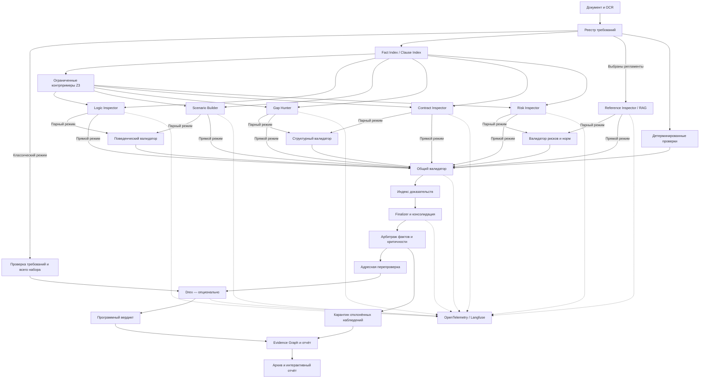

# Spec Review 2.0 — мультиагентное ревью с графом доказательств

В двух мультиагентных режимах пять экспертов независимо анализируют реестр требований. Если выбраны регламенты, Reference Inspector добавляет наблюдения со ссылками на ТЗ и внешний источник. Один эксперт может выполнять несколько запросов по партиям требований или разделам документа. Во всех трёх режимах `AGENT_SPEC_REVIEW_CONCURRENCY` по умолчанию разрешает до девяти одновременных основных вызовов модели на одну проверку. У Reference Inspector есть отдельный слот. Если выбраны регламенты и достаточно готовых задач, одновременно могут выполняться десять вызовов.

| Режим новой проверки | Как проверяются требования |
| --- | --- |
| `multi_agent` — «Парная валидация», по умолчанию | Три парных валидатора группируют наблюдения и передают сводки в общий валидатор. |
| `multi_agent_direct` — «Прямая валидация» | Общий валидатор получает наблюдения экспертов напрямую. |
| `legacy` — через CLI и API | Модель проверяет группы требований и набор в целом. Программа проверяет цитаты и формирует итоговый отчёт. |



## Принципы

Профиль OpenRouter использует `openai/gpt-6-luna` и `AGENT_SPEC_REVIEW_REASONING_EFFORT=low` для основных этапов. Отдельная настройка арбитража `AGENT_SPEC_REVIEW_ADJUDICATION_REASONING_EFFORT=auto` выбирает medium для Luna. В мультиагентных режимах `AGENT_SPEC_REVIEW_FACT_PROFILE=full` подключает числовой индекс, семантические подсказки и, при `AGENT_SPEC_REVIEW_USE_Z3=true`, ограниченные вычислимые контрпримеры. Формальный свидетель относится к распознанной модели, не автоматически к истинности исходного требования. Прямой режим пропускает три парных валидатора. Глобальную проверку целостности, подсчёт покрытия и итоговый вердикт выполняет код. Отдельная проверка Drex опциональна и в этом профиле отключена. Значимые настройки записываются в паспорт прогона.

- Специалисты работают независимо. Парный маршрут формирует группы после экспертного анализа. Отдельный управляемый `StateGraph` выполняет параллельные задания и собирает результаты. Существующая PostgreSQL-очередь и проверенные контрольные точки остаются единственным механизмом долговременного выполнения.
- Каждое наблюдение проходит программную проверку исходных цитат и идентификаторов. Если повторный корректирующий ответ всё ещё содержит непроверяемые наблюдения, они и связанные с ними контрпримеры исключаются, а затронутые обязательные оценки остаются неопределёнными. Остальные проверенные результаты сохраняются; неподтверждённые оценки не допускают вердикт «Готово». Попарные валидаторы группируют близкие результаты, не удаляя исходное происхождение. Глобальная проверка устраняет межгрупповые дубли и контролирует покрытие всех обязательных критериев.
- Finalizer получает структурированные группы, не общие тексты рассуждений. На больших отчётах сначала группируются связанные кандидаты, затем выполняется общая консолидация. До 12 оставшихся пар-кандидатов проверяются отдельно по общему решению об исправлении; объединение не считается транзитивным. Ограниченный контекст (`limited`) отличается от сбоя (`deterministic_fallback`). После консолидации отдельный арбитр перепроверяет существенные замечания и заявленные противоречия, пропуски и непроверяемые требования по исходнику, применяет единую рубрику критичности. Для отклонения нужны проверенные контрдоказательства; исходные наблюдения и разногласия остаются в графе. Невалидный или недоступный арбитраж не удаляет замечания. Нормативные наблюдения и Drex не подменяют основной вердикт.
- Эксперты выделяют одну независимо исправляемую причину на замечание. Кандидаты на объединение включают более узкие пересказы при вложенных исходных цитатах и близком решении об исправлении, но не объединяются автоматически. Для противоречий связываются полностью процитированные требования с обеих сторон; по каждой спорной оценке сохраняется окончательный статус и новое обоснование. Объединение не создаёт новые связи критериев со всеми ID группы: адресная проверка сохраняет конкретные пары. Положительная оценка сохраняется только при релевантном проверенном контрдоказательстве, если она оспорена. Исходный положительный комментарий не переносится в итоговую отрицательную оценку и остаётся доступен в графе.
- Evidence Graph входит в архивированный JSON: требования, наблюдения, цитаты, замечания, вопросы и моделируемые сценарии. На веб-экране графа можно просмотреть связи и перейти к исходной цитате. Исторические отчёты работают без графа. Отдельное графовое хранилище не требуется.
- Мультиагентный AI-анализ использует общий дедлайн до 900 секунд, с резервом для финализации; исходные форматы, ограничения файлов и owner-scoping сохраняются.
- Подробности установки наблюдаемости, безопасных атрибутов, операторских дашбордов и расследования инцидентов: [Langfuse](LANGFUSE.md).

## Восстановление экспертной задачи

При временном сетевом сбое Harness повторяет один запрос того же эксперта. Первичная попытка и исправление ответа делят один дополнительный сетевой повтор. Базовая пауза — одна секунда. При наличии `Retry-After` учитывается задержка провайдера. Ожидание освобождает слот модели и входит в дедлайн этапа. Если повторами уже управляет SDK или для HTTP 429 явно включён CLI-режим ожидания лимита, Harness учитывает политику клиента.

Если индивидуальный пакет дважды нарушает правила проверки, Harness делит его по идентификаторам требований. Для каждой половины заново проверяются цитаты, идентификаторы, принадлежность критериев и полнота покрытия. Контрольная точка хранит проверенный ответ, а отдельная метка сохраняет решение разделить пакет. При возобновлении Harness читает сохранённые части и запрашивает недостающие. Проверки набора целиком сохраняют свою область анализа. После исчерпания попыток обязательного эксперта другие эксперты могут сохранить свои результаты до дедлайна, а финальный отчёт требует полного покрытия.

## Запуск

В форме проверки по умолчанию выбрана «Парная валидация». Второй вариант — «Прямая валидация». Следующая команда запускает прямой маршрут через CLI.

```bash
uv run --project vibe/services/agent --frozen python -m agent.spec_review_cli \
  --input .artifacts/requirements.md --output .artifacts/multi-agent-report.json \
  --review-mode multi_agent_direct --timeout-seconds 900 --env-file .env \
  --metrics-output .artifacts/multi-agent-usage.json
```

Без флага режима CLI использует `multi_agent`. Формы HTTP принимают необязательное поле `review_mode` с теми же значениями. Значение `legacy` запускает классический пайплайн. Очередь и паспорт сохраняют выбранный идентификатор режима.

Архивные отчёты сохраняют свои паспорта. Повтор использует режим из паспорта. Если в старом паспорте режим отсутствует, повтор запускается в `legacy`. Возобновление прерванной задачи использует сохранённый режим. Для старой записи очереди без режима это исходный пайплайн `legacy`.

## Проверка эффективности

Прямой маршрут устраняет одну параллельную стадию из трёх модельных вызовов. На итоговое время влияют размер сводки, задержка провайдера и объём адресной перепроверки. Скорость, расход токенов и долю найденных дефектов сравнивайте на одинаковых входах, модели и дедлайне. Для повторения эксперимента на четырёх синтетических спецификациях и исходнике организаторов (если он скачан) используйте:

```bash
uv run --project vibe/services/agent --frozen python vibe/services/agent/scripts/compare_review_modes.py \
  --output-dir .artifacts/review-ab --env-file .env --repetitions 3
```

Добавьте `--dry-run`, чтобы получить матрицу без вызовов модели, или `--case defective --repetitions 1` для короткого проверочного эксперимента. Каждый запуск имеет отдельный отчёт и метрики, а `comparison.json` содержит результаты структурной и аннотационной оценки, ошибки, затраченное время и попарные сравнения. Сопоставимость токенового бюджета в сводке означает разницу не более 10% суммарных входных и выходных токенов; она не подменяет ограничение бюджета или оценку качества. Прогоны используют реальные запросы к настроенному провайдеру и могут занимать значительное время. Отсутствующая информация о токенах/цене представлена `null`, а не нулевой себестоимостью.

Если процесс прервался, повторите команду с тем же каталогом и флагом `--resume`. Файл `experiment.json` фиксирует версии реализации, входов, разметки и настройки. Возобновление пропускает все записанные попытки, включая завершившиеся ошибкой.

Для утверждения о превосходстве нового режима необходима независимая экспертная оценка пропущенных и лишних замечаний на сопоставимых бюджетах. Разметка учебных примеров измеряет совпадение с заранее выбранными дефектами. Новый продуктовый default не заменяет такую оценку.

### Исторический smoke-тест legacy и парного маршрута

На вымышленном `defective.md` оба режима завершились при одинаковой модели `gpt-6-luna` и 900-секундном лимите. Это ранний интеграционный прогон в процессе разработки (не полная матрица и не замер окончательно замороженной версии).

| Метрика | Legacy | Multi-agent |
| --- | ---: | ---: |
| Структурная валидация | 23/23 | 30/30 |
| Размеченные дефекты | 4/4 | 4/4 |
| Извлечённые требования | 6 | 6 |
| Найденные замечания с точной цитатой | 12/12 | 16/16 |
| Время процесса, с | 192,762 | 158,416 |
| Входные + выходные токены | 20 192 | 43 585 |
| Узлы / связи Evidence Graph | — | 94 / 258 |

Артефакты: локальный игнорируемый каталог `.artifacts/review-ab-smoke-v2`. Дополнительные замечания не были независимо проверены экспертами: их нельзя автоматически считать улучшением или ложными срабатываниями. Токеновые бюджеты не сопоставимы; фактическая стоимость не измерена. Эти исторические результаты отражают ранний этап оценки, а не доказательство превосходства нового продуктового default.

### Полный официальный документ

В отдельном реальном прогоне новой архитектуры с той же LLM (`gpt-6-luna`) успешно проанализирован оригинал `requirements.md` организаторов (198 строк), без внешних нормативных источников. Первые две попытки выявили таймаут отдельного вызова провайдера и повторно некорректную привязку замечания к требованию. После исправления обработки непроверяемых наблюдений и изменения временных параметров конкретного запуска (120 секунд на вызов, 3 одновременных вызова) последняя попытка завершилась за **5:37**, переиспользовав семь контрольных точек. Сумма продолжительностей трёх попыток приблизительно **9:25**, без пауз между ними; это не непрерывный контрольный benchmark.

| Метрика | Официальное ТЗ, Multi-agent |
| --- | ---: |
| Требования / индивидуальные проверки | 60 / 540 |
| Проверки набора / чек-листа | 6 / 15 |
| Замечания с подтверждёнными исходными цитатами | 52/52 |
| Уточняющие вопросы | 63 |
| Evidence Graph | 347 узлов / 864 связи |
| Неразрешённые разногласия | 5 |
| Drex | 38 поддержано, 10 сомнительно, 4 не поддержано |
| Структурная валидация | 31/31 |
| Вердикт | Не готово |

Локальные артефакты: `.artifacts/review-v2-final-official/report.json`, `report.md`, `evaluation.json`, `quality-audit.json`, `retrospective-comparison.json`, `usage-attempt3.json`. Строгий TypeScript-контракт отчёта также прошёл. Последняя попытка зафиксировала 228 783 входных и 49 297 выходных токенов; это не расход всех трёх попыток и не стоимость.

Ретроспективная разметка совпала по 26/26 выбранным обязательствам и 5/6 размеченным темам (строгий поиск одной находки с требуемыми якорями). Предыдущий сохранённый legacy-отчёт совпадал по 26/26 и 1/6 соответственно. Это сравнение исторического и нового отчётов, не контролируемый A/B и не оценка всеми организаторами. Описанные измерения не составляют полной матрицы из трёх повторов каждого режима на всех пяти документах и не включают независимую экспертную проверку новых замечаний. Принятый впоследствии default `multi_agent` на GPT-6 Luna не превращает эти предварительные данные в доказательство универсального улучшения.
