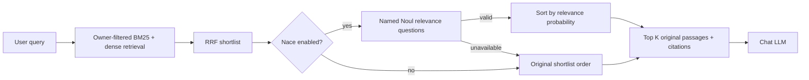

# Nace Drex as a RAG reranker

Nace's Drex decision API is compatible with the Jev System One request shape. The application uses Nace, not TypeSafe, as the optional decision-model provider. See the [migration guide](https://console.nace.ai/docs/drex/guides/migrate-from-typesafe), [model catalog](https://console.nace.ai/docs/drex/reference/models), and [question API](https://console.nace.ai/docs/drex/guides/questions).

## Retrieval path



Each call submits the query and candidate passage texts as the shared state and asks one Noul relevance question per candidate. The provider returns a probability for each named question. Stable sorting preserves original order for equal scores. Only the original `Document` objects are returned; source metadata, owner filters, and citation formatting remain local. An exact set of valid probabilities is required, so incomplete or malformed answers do not create a partial ranking. No external retry is attempted; calls fail open to the original top K. A missing key, an empty input, more than 32 candidates, or more than 32,000 state characters avoids the provider call entirely. These are conservative application bounds, not the provider's model capacity.

## Configure

Create a separate key in the [Nace Console](https://console.nace.ai/dashboard). Set these values in the ignored `vibe/.env` file:

```dotenv
AGENT_USE_RERANKER=true
AGENT_RERANK_PROVIDER=nace
NACE_API_KEY=
AGENT_NACE_MODEL=drex-latest
AGENT_NACE_TIMEOUT_SECONDS=8
```

Fill `NACE_API_KEY` with your key. The example does not include a secret. If the key has access to `drex-max-finance`, compare it with `drex-latest` for FinTech questions. The `GET /v1/models` endpoint lists the available models for the account. Rebuild/recreate the local agent from `vibe/`:

```bash
docker compose up -d --build agent
```

The existing chat model and embedding configuration remain required. The Nace provider receives retrieved text and the question, so enable it only for documents that may be sent to that provider. Nace usage consumes its separate credit balance. The default `AGENT_USE_RERANKER=false` makes no decision-API calls. `AGENT_RERANK_PROVIDER=generic` restores the existing reranker selection.

## Scope and validation

Spec Review still scans the full submitted document rather than discarding low-ranking requirements. Drex ranks evidence for the separate RAG question-answering tool. It may also provide a separately enabled independent assessment of the completed findings; it is not a generative LLM and does not write the specification report. See [SPEC_REVIEW.md](SPEC_REVIEW.md). Exa web search is not part of the official review pipeline: external material cannot substitute for source-document evidence. An independently labeled reference-search mode could be added later.

Run the controlled-provider tests from `vibe/services/agent`:

```bash
uv run pytest -q tests/test_nace_reranker.py tests/test_tools.py
```

These tests check request/response mapping, ordering, fallback and owner-filtered citations without a live API key. To claim a quality or latency improvement, compare retrieval on labeled questions with and without Nace on the same source documents.

## Independent support review (distinct from reranking)

Create a key in the Nace Console dashboard (project API keys), copy it to the ignored `.env` and enable `AGENT_SPEC_REVIEW_USE_NACE=true` to audit final D-ID support and, when selected, reference RF-ID support. This switch is independent of `AGENT_USE_RERANKER`. The final official run on 2026-11-27 deliberately left independent decision review disabled; the primary verdict and audit did not depend on a second key. Limits, thresholds and unavailable behavior are documented in [Spec Review](SPEC_REVIEW.md#independent-decision-review-with-nace-drex).
