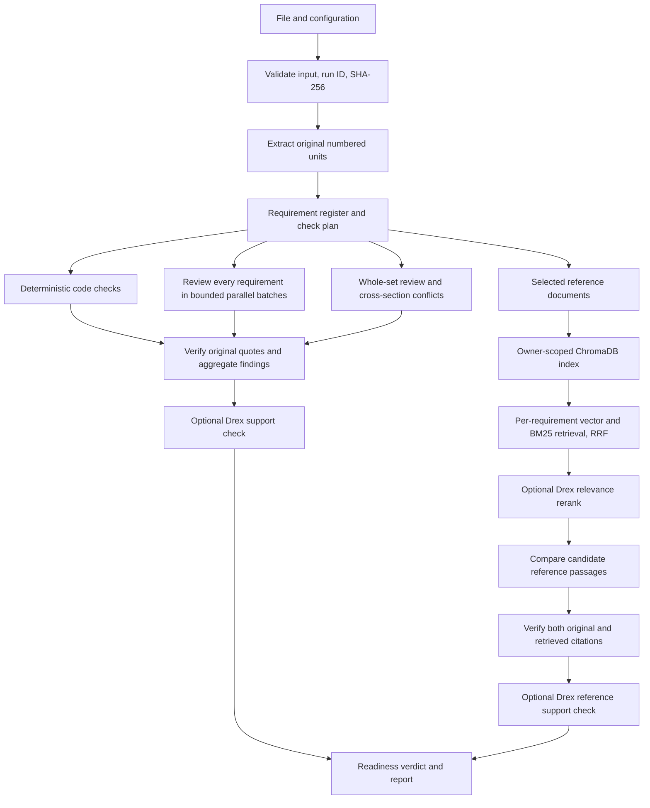

# Spec Review

Spec Review is the FinTech requirements validator built for the [BCC-HUB × MNU FinTech Hackathon task](https://github.com/BCC-HUB/ai-requirements-validator-task). It analyzes requirements before implementation; it does not execute a system under test or certify legal or standards compliance.

## Pipeline

The current system is described in [multi-agent architecture](MULTI_AGENT_REVIEW.ru.md); the diagram below depicts the retained **legacy** core pipeline rather than the default routes. For the default paired and direct routes, see the [current pipeline diagram](uml/spec-review-pipeline.svg).

New reviews use the **`multi_agent` workflow by default**, on GPT-6 Luna in the selected configuration. Five independent experts, the optional Reference Inspector, three paired validators, global evidence consolidation and the Finalizer produce a verified Evidence Graph; see the [current Spec Review 2.0 architecture](MULTI_AGENT_REVIEW.ru.md). Select `multi_agent_direct` to pass observations directly from the experts to global validation. Both multi-agent routes include the Finalizer and downstream checks. The CLI and API also accept `legacy` for the classic pipeline shown below, which uses the same document parser and citation checks.

All three modes default to at most nine simultaneous primary model calls per review. Set `AGENT_SPEC_REVIEW_CONCURRENCY` to a positive integer to change that limit. When reference documents are selected, the Reference Inspector has one independent slot, allowing up to ten simultaneous calls at the default setting. Actual concurrency depends on how many tasks are ready.



- Input extraction validates the source and saves its original SHA-256 and run UUID in the report passport. Extraction scans every numbered source unit in bounded ranges, retains source citations, and assigns stable report IDs. No requirement is discarded by retrieval.
- Deterministic code checks flag repeated verbatim requirements and reused explicit identifiers across distinct source ranges. They contribute original citations; model-based set checks cannot mark those verified criteria as passed.
- Individual review checks every extracted requirement against the nine quality characteristics. Validated individual results return in source order.
- For short source documents (up to 5,000 characters including unit separators) with exactly seven extracted requirements, individual review uses one seven-requirement batch instead of batches of six and one. The same prompts, criteria, evidence checks and concurrency limit apply. If the combined response fails validation, the reviewer falls back to the normal six-plus-one batches with their correction budget; provider or network errors still fail normally. Larger documents retain the original batching.
- Set review independently evaluates the full original document, extracted requirements, and verified code findings using six set characteristics; it shares the configured primary concurrency limit with individual review. Code aggregates the findings after both branches.
- The optional normative branch runs concurrently with the primary review after extraction and uses a dedicated ChromaDB index for explicitly selected source versions; BM25 and vector retrieval are fused per requirement; Drex optionally reranks the candidates. Only original retrieved passages go to the comparison model. Coverage counts and both source citations are reported. The comparison prompt prioritizes up to three actionable observations per source in this bounded sample instead of claiming an exhaustive legal audit.
- Pydantic validates each stage. Code checks exact quotes, requirement IDs, complete criterion coverage, deduplicates findings, and derives statistics/readiness. A malformed or deterministically invalid model result gets at most one correction request within the same deadline; retry never relaxes evidence rules and does not retry authentication, filtering, or network failures. Drex independently evaluates core findings and separate normative observations; neither score changes the primary verdict.
- The criteria are inspired by ISO/IEC/IEEE 29148; this is not certification or legal advice.

## Readiness checklist, extraction coverage and clarification questions

The set assessment includes a 15-item readiness checklist alongside the six set criteria and nine individual criteria. It covers business traceability, functional structure, system interactions, UX/UI, rollback, testability, data flows, risk and security, architecture, cross-system coordination, business processes, integrations, versioning and approvals. It assesses what the supplied specification actually documents. It cannot establish external approvals or compliance without evidence from the source.

Each new report contains exactly 15 distinct checklist criterion IDs in `readiness_checklist`. Each row identifies a criterion, availability (`present`, `missing`, `uncertain`, `not_applicable`), assessment status (`pass`, `fail`, `uncertain`, `not_applicable`), explanation, original citations and an optional clarification question. A present, passing, or not-applicable result requires checked source evidence. Empty approval fields or headings do not confirm a decision. Unassessed checklist rows are marked uncertain, including rows that the bounded large-document comparison cannot establish from its source scope. A failed or uncertain checklist item prevents a ready verdict. An individual criterion that the model cannot associate with a verified finding after its correction attempt is explicitly marked uncertain, not passed or silently asserted as a defect.

The optional `extraction_gaps` field lists source evidence for explicitly declared or technical requirement candidates outside the extracted requirement spans. These candidates identify potential gaps for manual review, not automatically invented requirements or an exhaustive proof of extraction coverage. A nonempty gap list prevents a ready verdict.

For a document within the full-context review limits, an explicit acceptance-scenario table activates a focused second comparison of its input/action/expected-result examples against the original business rules (dates, units, boundaries, states and outcomes). Only additional observations with verified source-scenario links enter the report. If this optional comparison cannot complete, it does not erase the baseline; unsupported global conclusions are marked uncertain.

`clarification_questions` collects decision questions from findings and unresolved checklist rows. The questions use `Q-###` IDs, priority, links to their originating `D-###` finding or checklist criterion, and relevant requirement IDs/citations. They are deduplicated and sorted by priority. The analyst can use them to obtain missing decisions before requesting corrections. They are not additional facts or proof of a defect. Historical archived reports remain readable without the three new optional fields; their absence is not a successful checklist evaluation. Re-run the original specification to generate those sections.

## Reproduce a run

Install Python 3.12+ and uv. Copy the repository-root `.env.example` to `.env` and set `AGENT_LLM_API_KEY` to the key issued for the configured endpoint. The example uses `openai/gpt-6-luna` on OpenRouter and defaults to `multi_agent` for new reviews. Set `AGENT_SPEC_REVIEW_REASONING_EFFORT=low` for inexpensive extraction, expert review, paired validators, finalization and re-review. The final evidence adjudicator has its own `AGENT_SPEC_REVIEW_ADJUDICATION_REASONING_EFFORT` setting (`auto` selects low for complete routine low-severity batches and medium for contested cases on Luna and GLM-5.3, while `inherit` uses the common setting). All calls still share the same concurrency limit and deadline.

Both multi-agent modes send every consolidated observation to an independent counterevidence search. The search returns source excerpts for exceptions, superseding rules, ownership and scope. The adjudicator verifies each observation against the source and the retrieved passages. When the search times out, the adjudicator reviews the available source directly. Only confirmed defect roots enter `findings`, severity counts, Drex and the fix workflow. A withdrawn contradiction requires a source-grounded explanation showing how both rules apply to the same case. The final root comparison selects findings with a common requirement or overlapping source units, validates both citations and retains all original observations. When there are no eligible pairs, it skips the model call.

The independent reader can flag a required choice among equally ranked candidates, or a claim that adds validation duties to an operation with an already recognized input. Overruling that reading requires a governing phrase independently located in the source for the same case. The arbiter checks whether that phrase resolves the choice, permits discretion or assigns validation to the component. A split batch reuses the original search result, including an unavailable result.

To withdraw a contradiction based on an explicit exception or precedence rule, the adjudicator identifies which obligation prevails. It quotes an identifier, condition or outcome from each obligation that also appears in the governing clause. A general reference to possible exceptions leaves the conflict open.

For a confirmed finding the adjudicator cites the source and describes the effect and its scope. The service derives severity from that assessment. Incompatible actions or a missing required outcome in a bounded branch are high. An unresolved acceptance detail is generally medium. A blocked operation as a whole or a substantiated severe business impact can be critical. If the impact assessment is missing, malformed or lacks a verified citation, the service preserves the finding and marks its severity as provisional in the JSON, Markdown and web interface. Provisional ratings are high for conflicts and medium for other findings. Older reports can omit `severity_provisional`.

The optional `review_notes` array holds recommendations and questions. Each note includes its original observation IDs, requirement IDs, original evidence, adjudication context and rationale. An unreviewed claim receives status `unreviewed` and requires analyst review. Unresolved questions prevent a ready verdict. Source-refuted observations remain in the evidence graph with their counterevidence. Historical reports use the disposition and counts recorded at generation.

The deterministic checks additionally recognize explicit unfilled values and impossible scalar ranges (including comparable units such as tenge and tiyn); dates and clock intervals are not treated as scalar ranges. An explicitly admissible empty domain is a critical defect because no compliant value exists. The fact profile (`AGENT_SPEC_REVIEW_FACT_PROFILE=off|numeric|full`) supplies source-bound numeric or semantic context, and `AGENT_SPEC_REVIEW_USE_Z3=true` enables bounded formal witnesses in the full profile. The passport records these settings, model effort policy, concurrency, references and the optional Drex setting. These checks are general rules, not an embedded answer key for the organizer document.

The full profile can build a shared-input witness for explicit count and Boolean conditions. For example, two rules for the same entity can overlap at twelve places when one uses `не менее 12` and the other uses `не более 12`. Z3 models named counts as nonnegative integers and preserves the case of named Boolean fields. The parser checks the complete source unit so an omitted trailing exception cannot enter a proof. Experts receive each witness with both original excerpts.

From the repository root, run the agent on the [included organizer specification](https://github.com/Feruum/Darumleye/blob/main/docs/requirements.md).

```bash
uv run --project vibe/services/agent --frozen python main.py --input docs/requirements.md --output report.md --env-file .env --timeout-seconds 900 --checkpoint-dir .artifacts/checkpoints --wait-rate-limit
```

The command writes a new `report.md` at the repository root. The [submitted report](https://github.com/Feruum/Darumleye/blob/main/docs/report.md) was generated from the same input by agent revision `300fee8`. The example above uses paired validation, allows up to 15 minutes for the review and saves validated stage outputs in `.artifacts/checkpoints` so the same command can resume an interrupted run.

Pass `--review-mode multi_agent_direct` for direct validation or `--review-mode legacy` for classic review. Set the mode explicitly in each comparison trial. Choose a `.json` output path to save the structured report and Evidence Graph. Document-only review runs locally with the configured LLM. When reference files are selected, the CLI uses a persistent Chroma index at `.artifacts/reference-chroma` by default. Override it with `--reference-index PATH`. The CLI writes the report after validating the stages and returns a nonzero exit status on model or input errors.

## Complete organizer evaluation

The [organizers' README](https://github.com/BCC-HUB/ai-requirements-validator-task) gives the quality criteria and required report sections. This project provides the structural evaluation script and publishes the generated Markdown report. To run the structural audit on a new review, first generate your own JSON report from the included specification. This example uses one primary model call at a time and writes the checkpoints and JSON under `.artifacts/`.

```bash
AGENT_SPEC_REVIEW_CONCURRENCY=1 AGENT_LLM_TIMEOUT_SECONDS=120 AGENT_LLM_MAX_RETRIES=0 \
  uv run --project vibe/services/agent --frozen python main.py \
  --input docs/requirements.md --output .artifacts/official-report.json \
  --env-file .env --review-mode multi_agent --timeout-seconds 900 \
  --checkpoint-dir .artifacts/official-checkpoints --wait-rate-limit
```

Checkpoints are opt-in, local files containing only accepted stage outputs. A key covers the provider, model, original prompt, input and output schema; each reused answer is validated again. Failed stage results are not saved. `--wait-rate-limit` honors Retry-After or waits 60 seconds after a transient 429, up to three retries per stage within the overall deadline; it does not retry explicit billing/quota errors. The web deadline is unchanged.

Use a separate report path and checkpoint directory per route. The passport records the selected mode for all three routes. To reproduce a historical legacy experiment, use its recorded software revision and settings.

Independently audit a completed JSON report against the original:

```bash
uv run --project vibe/services/agent --frozen python vibe/services/agent/scripts/evaluate_spec_report.py \
  --input docs/requirements.md --report .artifacts/official-report.json \
  --output .artifacts/official-eval.json --official
```

This checks exact source identity, complete criterion matrices, evidence, references, recomputed statistics, readiness, Russian report structure, and Drex ID coverage when enabled. It does not claim semantic precision/recall without a labeled gold set.

### Current result (27 November 2026)

The final organizer report in paired mode contains 49 requirements, 441 individual checks, 6 set checks and 15 readiness checks. There are 17 findings (2 critical, 2 high, 10 medium, 3 low), 17/17 checked citations and 33/33 structural checks. The arbiter resolved 10 candidates, rejecting one with verified counterevidence; three criterion assessments remain uncertain. The outcome is `not_ready`. This is not a measured precision/recall score. See [evaluation and source identity](QUALITY_EVALUATION.md#final-organizer-run-27-november-2026).

## Independent decision review with Nace Drex

Set `AGENT_SPEC_REVIEW_USE_NACE=true` and `NACE_API_KEY` in the same `.env` used by the command (or in `vibe/.env` for the web service). Keep the chat-model settings in place. The default decision model is `drex-latest`; optionally select `drex-max-finance` if available to the account. `AGENT_NACE_TIMEOUT_SECONDS` defaults to 8 seconds.

The decision model receives the numbered source and final findings, and evaluates the evidence for each `D-001`, `D-002`, and subsequent finding. It returns one Noul probability per finding. The app labels scores of at least 0.8 as supported, scores below 0.4 as unsupported, and intermediate scores as uncertain. These are review-triage thresholds, not measured accuracy or regulatory certification. Keep all original findings, severity, and primary readiness verdict; disagreements identify items for human review. The report identifies the decision model and explicitly states when the assessment was unavailable or not applicable. A missing key, invalid response, unavailable provider, or exhausted time budget must not lose the completed primary review. The optional stage uses one request, bounded to 128 findings and 512,000 UTF-8 bytes. If either limit is exceeded, it returns an explicit unavailable status instead of a partial audit. It shares the overall review deadline and reserves time to render the primary report.

The same opt-in setting enables Drex reference reranking and a separate RF-* observation support evaluation against both original documents. It never merges RF-* findings into the primary statistic. The decision API receives source text when this setting is enabled; do not enable it for documents that cannot be sent to the provider. See [Nace answer semantics](https://console.nace.ai/docs/drex/guides/reading-answers) and [model catalog](https://console.nace.ai/docs/drex/reference/models). The RAG reranking switch is independent and not required for Drex to check the findings.

## Standards and regulations

The official review is grounded only in the supplied requirements document. The quality rubric is not a regulatory compliance assessment. The optional reference-comparison mode accepts up to eight selected standards, bank policies, API/testing standards, public payment/data legislation and security regulations. It indexes original chunks in a dedicated Chroma collection and ranks them against extracted requirements. A source register, retrieval coverage, and separately cited potential discrepancies are added without changing the original quality verdict. Pass `--reference-manifest PATH` in the CLI or add the source files in the web workspace. See [REGULATORY_CONTEXT.md](REGULATORY_CONTEXT.md) for the official source catalog, limits and manifest examples.

## Web workspace

An active primary verification belongs to the authenticated workspace, not its review route or a specific agent process. The job API commits a bounded input payload, owner-scoped UUID, selected mode and pending state to PostgreSQL (`agent_spec_review_jobs`) before returning HTTP 202. New uploads default to `multi_agent`. Submit `review_mode=multi_agent_direct` for direct validation. Submit `review_mode=legacy` for the classic pipeline. The queue stores the submitted mode. Jobs accepted by older releases retain their original execution mode, including historical records without an explicit mode. Workers claim jobs with renewable, fenced database leases. There is one active job per owner and at most two across all agent processes, with a 24-minute active-processing budget (the existing per-review/model timeouts still apply). On graceful shutdown unfinished work is returned to pending; after an abrupt stop it becomes claimable when the lease expires (up to 90 seconds). Time spent waiting for the server to restart does not consume the remaining budget; an abrupt stop may charge up to one heartbeat interval of unconfirmed active time. Validated LLM stages are checkpointed under `AGENT_UPLOAD_DIR/spec-review-checkpoints/<job-id>` and reused when their input, provider, model, prompt and schema match. An interrupted or unvalidated stage may run again. Preserve both the PostgreSQL database and the agent data volume across restarts (Docker Compose mounts `agent_local_data:/data`).

The web client polls the same UUID, retries temporary server/network failures with bounded backoff and retains only the opaque job ID and explicit cancellation intent in per-owner session storage; uploaded files are not stored in the browser. Explicit cancellation is durable and prevents a late result from being archived. Successful terminal state and the completed archive are committed together with the original job UUID. On terminal completion, failure or cancellation, binary input and temporary metadata are cleared; stage checkpoints are removed once the worker has stopped. Up to 128 terminal job records are retained for one hour, and committed completed reports remain recoverable from the archive afterwards. A repeated web review enters the same durable queue as a new job. Repeats use the original report’s selected mode. A report without mode metadata repeats in `legacy`. Leaving its correction screen stops its local polling, not the server job; the saved result is available in the archive. The correction draft and comparison view itself remain session-local. The synchronous CLI and direct POST remain available and are not automatically resumed by this dispatcher.

Set the same `AGENT_LLM_BASE_URL`, `AGENT_LLM_API_KEY` and `AGENT_LLM_MODEL` in `vibe/.env`, then start the application using `bun run dev` from `vibe/`. If the agent container is already running, rebuild it with `docker compose up -d --build agent`. Open the authenticated `/app/assistant` route. Follow the three steps: choose the source document, optionally add reference standards to the default quality review, then start and inspect the report. The waiting view shows elapsed time, not guessed backend progress. The report starts with prioritized findings and offers priority filters, requirement and set views, the readiness checklist and clarification questions, optional technical details (including the Drex assessment and run passport), references, and Markdown download. “Посмотреть пример отчёта” shows a labeled local sample derived from a previous synthetic core review; “Взять это ТЗ” inside that report loads the corresponding synthetic source. Neither action calls an AI provider. Running a new review does. The reference RAG runs inside specification review when references are selected. Open the separate sidebar item “Чат по проверкам” at `/app/chat` after a successful review; the source text and generated report are available automatically.

For a submission from a committed checkout, pass that commit to the agent build; on Bash use `GIT_COMMIT=$(git rev-parse HEAD) docker compose up -d --build agent` from `vibe/`. The standalone CLI detects the local commit and indicates a working-tree review when its implementation has uncommitted changes.

The approved ImageGen mockup establishes a compact dark-violet sidebar, a warm-gray workspace, white functional panels, clear typography, and one primary violet action. The current implementation follows that palette with a guided setup, separate waiting view, and full-width report. It is a responsive, interactive React interface, not a static image. [Approved visual reference](assets/spec-review-approved.png). Generated with the built-in ImageGen tool from the user's structural screenshot and BCC-inspired palette. [Exact generation prompt](assets/spec-review-approved.prompt.md).

## Optional correction and re-review

After a completed live web review with findings, or after reopening a saved review, select **Начать доработку** in the report header. This opens a dedicated workspace for the same review, with a compact finding list and a selected correction editor. **Назад к отчёту** returns to the original report; draft state is retained while switching between these two views of the same review. Select a finding by its D-ID and request a correction. The agent uses the immutable archived original and that finding. It returns either a specific question for the analyst or up to four exact original-text replacements. Unknown business decisions require clarification; the analyst can supply an answer and regenerate the proposal. Check each before/after fragment before accepting it.

Accepted proposals are applied together against the same original text. Exact, unique anchors and non-overlapping ranges are required. An empty replacement explicitly deletes the displayed excerpt. The user can reject a proposal or undo acceptance. Neither the archived source nor the original report changes. Download the revised text or run **Проверить повторно** to perform a new full-document review. The original reference attachment binaries are not saved in the archive. The full extracted snapshots used for citation viewing are stored separately from each new archived report and fetched on demand by the owner; old archives have no snapshot. To repeat the review, choose the byte-identical original files to restore their metadata and order by the archived SHA-256 hashes. A mismatch is rejected locally and not uploaded; without all original files, the user must explicitly choose a document-only comparison. Hashing requires WebCrypto (a secure browser context). The second run has its own passport, archive entry and downloadable report. The workspace compares the core counts and verdict, and lists the new findings. This is a comparison of independent assessments, not proof that each old finding is resolved.

Source TXT/Markdown is exported as normalized extracted text; PDF, DOCX, XLSX, CSV, JPG/JPEG and PNG are exported as TXT without original layout or spreadsheet structure. Correction is unavailable when PDF pages or image units were unreadable. Proposals and accepted selections live only in the open browser workspace; download the draft before leaving. The correction endpoint uses the configured chat provider, authenticates the owner, and has a bounded 120-second deadline. The official CLI and original document-only submission remain unchanged.

### Date conflict demo

Open `/demo/date-conflict` in the web application, or select the demo link in the review setup. Choose the purchase date or posting date, apply the proposed text replacement, and run the comparison. The public route verifies the month in two original excerpts and in the revised copy. The demo runs locally without an account or model key and covers the one displayed conflict.

### Synthetic quality benchmark

The examples under `vibe/docs/examples/quality-benchmark/` contain two fictional specification pairs: a service-information screen (`defective.md`/`revised.md`) and a museum booking workflow (`workflow.md`/`workflow-revised.md`). Each original has four deliberately annotated defects; the paired revisions remove those labeled defects. The annotations also identify distinct obligation occurrences, including obligations that share an ID or have no explicit ID. These are training examples, not representative held-out data or the organizer document. Generate JSON reports with the normal CLI, then compare each report with its corresponding gold annotation:

```bash
uv run --project vibe/services/agent --frozen python -m agent.spec_review_cli \
  --input vibe/docs/examples/quality-benchmark/defective.md \
  --output .artifacts/benchmark-defective.json --review-mode multi_agent --env-file .env
uv run --project vibe/services/agent --frozen python vibe/services/agent/scripts/evaluate_quality_benchmark.py \
  --gold vibe/docs/examples/quality-benchmark/defective.gold.json \
  --report .artifacts/benchmark-defective.json
```

Run the same input with `--review-mode legacy`, `--review-mode multi_agent` and `--review-mode multi_agent_direct`. Use separate output files for each trial.

Repeat for all four source/annotation pairs using distinct report paths. The offline scorer verifies source SHA-256 and matches defect labels one-to-one by accepted kind, line range and exact literal quotation anchors. It also matches distinct extracted requirements one-to-one against annotated obligations by original ID and quote anchors, and checks citation and criterion coverage. The comparison command reports before/after changes; fewer findings alone do not prove a better specification. These small, non-exhaustive annotations measure agreement with the labels, not semantic precision or general model accuracy. Unmatched observations need expert review; recall is undefined for an empty gold set. See [QUALITY_EVALUATION.md](QUALITY_EVALUATION.md) for benchmark commands, observed official-run limits, and controlled manual/assisted effort and cost measurements. The extended, separately labeled live pilot and its limitations are recorded in [quality evaluation](QUALITY_EVALUATION.md#extended-fact-and-formal-profile-pilot).

## Limits and verification

- Input formats: PDF, UTF-8 TXT, Markdown, DOCX, XLSX, CSV, JPG/JPEG and PNG. DOCX paragraphs/table/image blocks and XLSX sheet/row/cell coordinates are retained in the extracted text; CSV uses logical records. Office files are parsed as inert ZIP/XML and spreadsheet formulas are not executed. The original Office layout is not rendered; the review pane shows the server-extracted source, and a live upload remains downloadable.
- 25 MiB source file, up to 100,000 extracted characters, 150 PDF pages or embedded DOCX images, and 500 extracted requirements. Raster images are bounded to 30 megapixels and 16,000 pixels per edge. Reference files keep their separate limits: eight files, 5 MiB and 24,000 characters/60 PDF pages or embedded DOCX images each, 10 MiB and 48,000 characters total.
- PDF pages without readable embedded text, including pages with damaged content streams, use local Poppler/Tesseract OCR in the agent Docker image. Tesseract also recognizes standalone JPG/JPEG/PNG photos and embedded Office image units. The Docker image includes Russian, Kazakh and English language packs. For standalone CLI OCR, install `tesseract` and the language packs; PDF OCR also requires `pdftoppm` on PATH. `pdfinfo` enables a fallback when the primary PDF parser cannot determine the page count. The fallback accepts only an independently readable, unencrypted page count and checks the page limit before OCR. OCR has a bounded 180-second primary budget and 30 seconds per reference. The image limit is 30 million pixels and 16,000 pixels per edge. Remaining unreadable pages or image units are reported, prevent a positive readiness verdict, and cannot be included in citation ranges. Recognized units are listed separately; check potentially incorrect OCR quotes against the original image. A fully unreadable document is rejected before the model is called. Damaged Office archives and invalid text that cannot be read reliably are rejected rather than silently truncated.
- Mixed PDFs can have only a native footer and a dominant raster scan. The detector sends sparse, image-dominant pages and obviously garbled extraction to OCR rather than accepting a few searchable characters as complete text. Native-only short pages and small decorative images do not trigger OCR solely because the text is short. A sparse scanned page is accepted after OCR only when additional meaningful text is recovered; otherwise the page remains explicitly unreadable. This is a conservative detection heuristic, not a guarantee that all image content in an arbitrary PDF is recognized. Language selection prefers `kaz+eng+rus` when all packs are available; the mixed-language and mixed-raster cases were checked with native Tesseract in disposable Docker.
- Direct JPG/JPEG and PNG files use local Tesseract OCR without a PDF conversion. Embedded local JPG/PNG pictures in DOCX paragraphs, tables, notes and referenced headers/footers are recognized as separate numbered blocks. Inline pictures split the surrounding text into distinct blocks in source order; header/footer parts are appended once per referenced part. The parser does not fetch external linked images or execute Office content. `ocr_units` identifies recognized blocks; `unreadable_units` identifies missing or unrecognized pictures. Incomplete primary documents cannot be marked ready, cited across an unreadable block, or edited through the correction workflow. A live image report can switch between the original photo and extracted text. Archives retain the extracted text, not the original image binary.
- Default AI review deadline: 230 seconds for small documents and 900 seconds for large ones (`AGENT_SPEC_REVIEW_LARGE_TIMEOUT_SECONDS`). The Bun review proxy has a bounded 24-minute upstream deadline including extraction and OCR; the native idle timeout is disabled only for that POST route. Long documents are extracted in source ranges, reviewed with bounded relevant context, and checked in sections plus cross-section candidate groups. Candidate retrieval is not an exhaustive all-pairs comparison, so unresolved global relations are marked uncertain. Provider throughput and context/output limits matter; the maximum configuration is not a measured completion-time guarantee. Configure per-call `AGENT_LLM_TIMEOUT_SECONDS`, `AGENT_LLM_MAX_RETRIES`, and `AGENT_SPEC_REVIEW_CONCURRENCY` consistently for web and CLI. Provider HTTP 429 is reported as a rate limit, not as an invalid report.
- Existing installations need agent migrations through `20261126_0008` (widened source format field in `0006`, durable review jobs in `0007`, and nullable original reference snapshots in `0008`) and a rebuilt agent image. From `vibe/`, use `docker compose up -d --build agent`, then the normal migration command in the local development workflow (`docker compose exec agent alembic upgrade head`).
- The primary specification and report are not stored in Chroma; successful authenticated web reviews archive the extracted source text and generated report in owner-scoped PostgreSQL for opening a saved report from the overview and for follow-up chat. Archived PDFs show the extracted text per page; the original PDF binary is not retained. Reference citations in the Evidence Graph and reference panel open the exact numbered extracted context of the selected source, not a reconstructed quote list. Prior archives without a snapshot explicitly show that the full source is unavailable; the user may attach the byte-identical original to recover its extracted context after hash and citation verification, without rewriting the report or calling an LLM. Selected reference chunks are persistently cached under the authenticated owner (or local CLI index); only explicitly selected document hashes are searched. No learned embedding model is required: local lexical feature vectors plus BM25 are the fallback; explicitly configure `AGENT_EMBEDDING_MODEL` and its endpoint/key for learned embeddings. Download the report for submission. Earlier runs made before archive support and standalone CLI runs are not automatically recoverable in web chat.
- The optional reference comparison has at most 85 seconds within the shared deadline. Its RAG context contains at most 12,000 original reference characters, and repeated documents reuse their indexed content. Incomplete coverage is explicit; it is not proof of absence or non-applicability. A synchronous Chroma HTTP operation that hangs can outlive the async comparison timeout; the report returns an unavailable status, but the worker does not stop until its call returns.
- Program checks verify the model's citations and complete review of extracted requirements. Extraction coverage and the semantic correctness of judgments still depend on the configured LLM; review them on the official case.

Local focused checks:

```bash
cd vibe/services/agent
uv run pytest -q tests/test_spec_review.py
```

```bash
cd vibe
bun test packages/contracts/src/agents.test.ts backend/src/modules/agent/transport/routes.test.ts webapp/tests/spec-review.test.ts
bun run typecheck:webapp
bun run --cwd webapp test
```

The full official live run on 2026-11-25 completed with 56 extracted requirements, 504 individual checks, six set checks, 44 findings with verified source quotes, and Drex assessment of all 44. The independent structural audit passed 18/18 checks and the JSON passed the shared TypeScript contract. This is historical evidence from before the readiness checklist, extraction gap and clarification question sections were added, not a live measurement of those sections. The source/report and evaluation are local artifacts under `.artifacts/organizer-eval/`, not tracked competition data. An independent manual checklist found all six primary target conflicts and interface issues; this is not an organizer-provided score. The synthetic reference run also completed with 7 requirements, 8 core and 3 reference observations and both Drex audits. Before submission, record the exact repository revision; the live report identifies the current working tree over its base commit.
