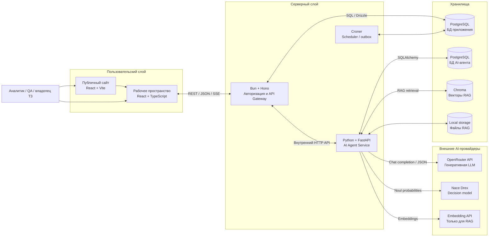
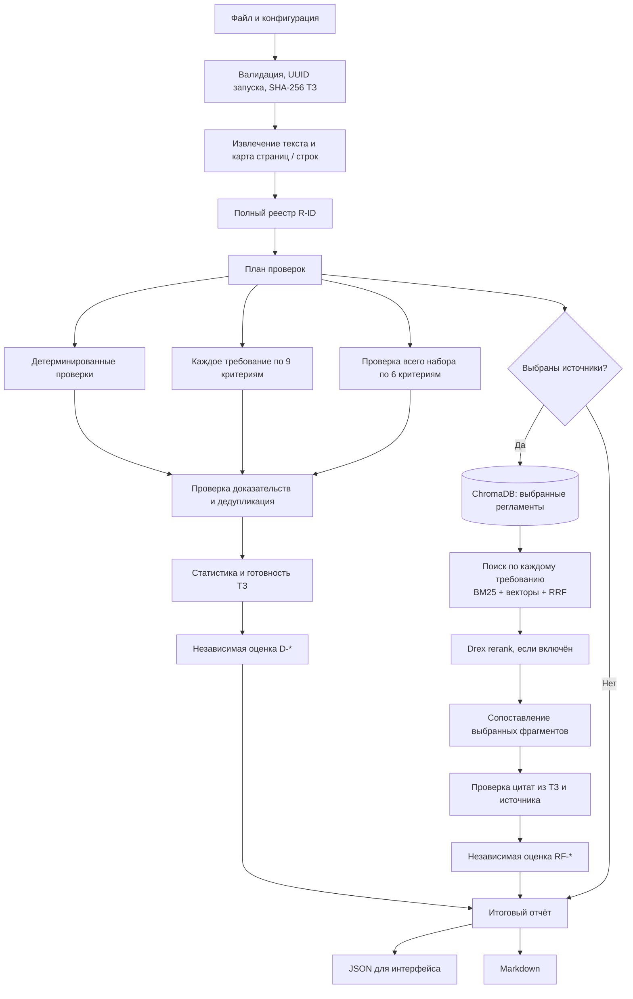
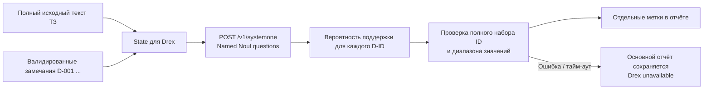
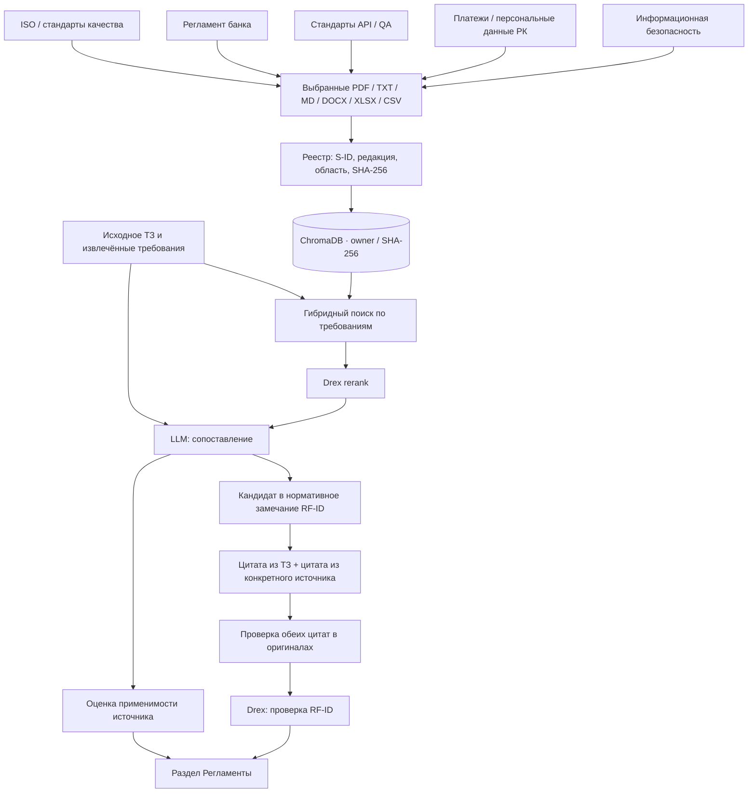
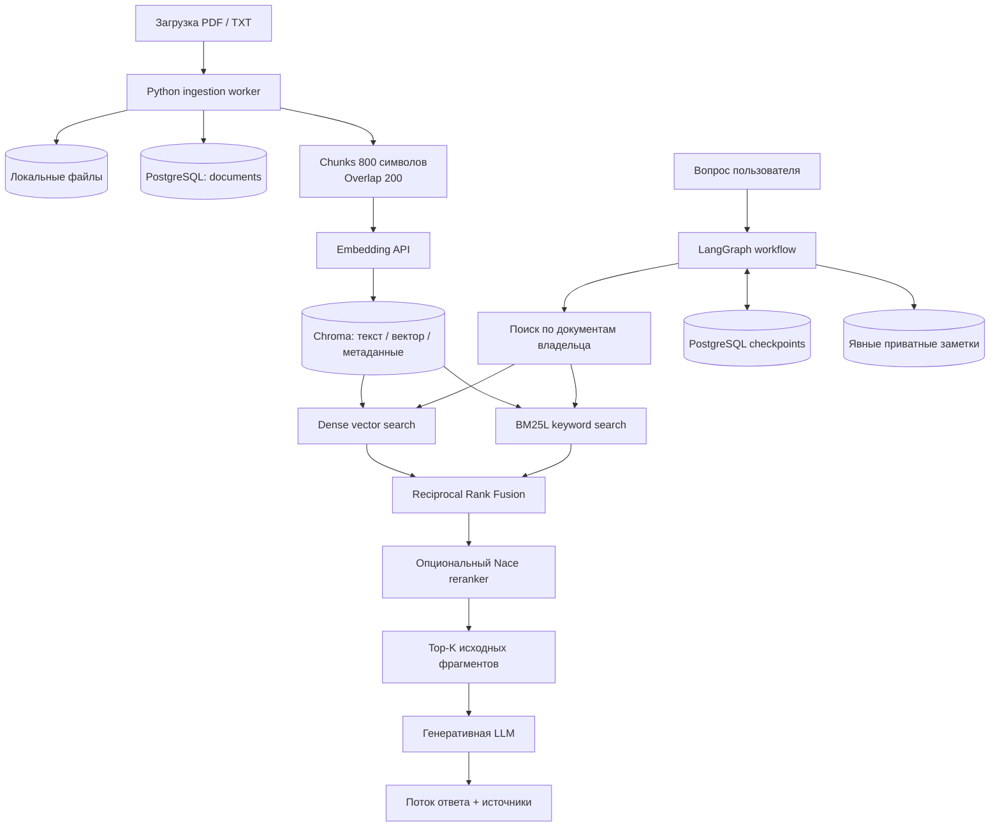
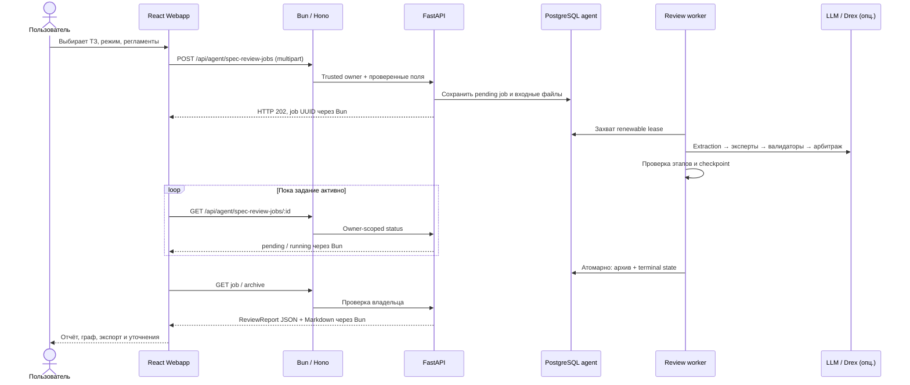
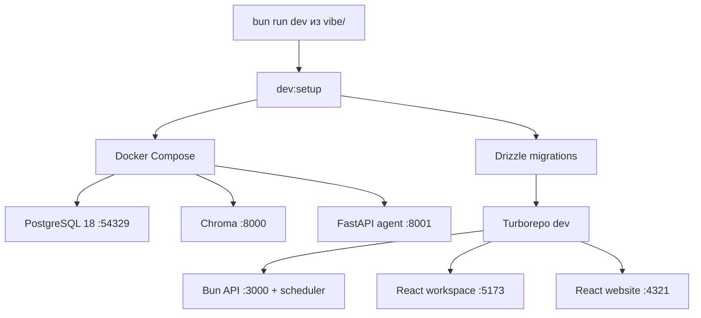

# Spec Review — полная архитектура системы

**BCC-HUB × MNU FinTech Hackathon** · Архитектурное руководство, обновлено 27 ноября 2026 г. (первоначальный пайплайн сохранён как описание `legacy`).

Spec Review — AI-система статической проверки технических заданий для финансовых продуктов. Она помогает бизнес-аналитику, системному аналитику и QA найти неоднозначные, противоречивые, неполные и непроверяемые требования **до начала разработки**. Каждое замечание сопровождается источником и рекомендацией. Дополнительные контуры оценивают обоснованность замечаний и сопоставляют ТЗ с предоставленными регламентами.

Главная особенность: **основную проверку выполняет многоэтапный пайплайн с проверкой доказательств в коде, а не одно обращение к чат-боту или поиск по нескольким случайным фрагментам ТЗ.**

Документ описывает первоначальный пайплайн и общую инфраструктуру. Новые проверки используют GPT-6 Luna и один из трёх маршрутов. Классический режим `legacy` запускает описанный здесь первоначальный пайплайн. В `multi_agent` (по умолчанию) работают три парных валидатора. В `multi_agent_direct` наблюдения поступают сразу в общий валидатор. Повтор отчёта использует режим из паспорта или `legacy`, если поле отсутствует. Ранее принятое задание при восстановлении сохраняет прежний режим. [Действующая архитектура](MULTI_AGENT_REVIEW.ru.md)

## 1. Общая архитектура (System Context)



Веб-приложение не обращается напрямую к LLM, Drex, PostgreSQL, Chroma или внутреннему агенту. Доверенная граница — Bun API: он проверяет сессию и передаёт подтверждённую личность пользователя в FastAPI.

### Назначение основных компонентов

| Компонент | Что делает | Чего не делает |
| --- | --- | --- |
| Website | Представляет продукт, ведёт пользователя в приложение | Не анализирует ТЗ |
| Webapp | Загружает документы, показывает отчёт, цитаты и замечания, позволяет скачать Markdown | Не хранит секреты моделей и не рассчитывает вердикт |
| Bun API | Авторизация, проверка входных данных, маршрутизация, API-контракты | Не формирует AI-замечания |
| Python Agent | Извлекает требования, запускает анализ, валидирует результаты, формирует отчёт | Не делегирует пользователю управление сервисными ключами |
| OpenRouter / LLM | Генерирует структурированный анализ требований и предоставленных источников | Не является единственным источником истины; результат проходит проверки кода |
| Nace Drex | Независимо оценивает, подтверждает ли исходный текст конкретное замечание; опционально ранжирует фрагменты RAG | Не генерирует основной отчёт и не выносит юридический вердикт |
| PostgreSQL | Учётные записи, сессии, метаданные, история RAG, приватные заметки, фоновые задания | Не является векторным индексом; содержит архив завершённых web-проверок и durable-очередь |
| Chroma | Векторный индекс для RAG-чата | Не участвует в обязательной проверке полного ТЗ |

## 2. Технологический стек

| Слой | Технологии | Зачем |
| --- | --- | --- |
| Языки | TypeScript 6, Python 3.12+ | Типизированные API и UI, обработка документов и AI-логика |
| Публичный frontend | React 19, Vite 8, Tailwind CSS 4; Three.js / React Three Fiber для опциональной 3D-сцены | Статический лендинг, быстрый запуск интерфейса |
| Рабочий frontend | React 19, Vite 8, TanStack Router / Query / Form | Маршрутизация, запросы, состояние и формы |
| Компоненты UI | Arc Free, shadcn/ui, Radix / Base UI, Motion, Hugeicons | Компонентная система, адаптивная вёрстка, визуальные состояния |
| RAG UI | `@assistant-ui/react` LocalRuntime | Отдельный потоковый чат с источниками и инструментами |
| Backend | Bun 1.4+, Hono 4 | HTTP API, middleware, проксирование запросов к AI-сервису |
| Контракты | Zod 4, общий TypeScript-пакет `@web-app-demo/contracts`; Pydantic в Python | Валидация входов и результатов между слоями |
| Аутентификация | JOSE, JWT, серверные сессии, RBAC | Доступ к закрытому workspace, API и пользовательским данным |
| SQL | PostgreSQL 18, Drizzle ORM, `pg` | Реляционные данные веб-приложения и миграции |
| SQL в агенте | SQLAlchemy, asyncpg, psycopg | Документы, состояние потоков и приватная память RAG |
| AI-сервис | FastAPI, Uvicorn, LangChain (`ChatOpenAI`), httpx, Pydantic | Python API, вызовы LLM и Drex, оркестрация и проверка схем |
| Извлечение документов | `pypdf`, Poppler/Tesseract, ZIP/XML, Python `csv`, UTF-8 parser, LangChain Text Splitters для RAG | PDF/TXT/MD/DOCX/XLSX/CSV; страницы, абзацы, листы и строки |
| RAG | LangGraph, Chroma 1.3.7, `rank-bm25` (BM25L), RRF | Контекстный поиск и чат по базе знаний |
| Фоновые задачи | Croner, PostgreSQL task outbox | Планирование и повторное выполнение задач приложения |
| Инфраструктура | Docker Compose, uv, Bun Workspaces, Turborepo | Локальные сервисы, lock-файлы, сборка и порядок запуска |
| Проверка качества | pytest, Bun test, Zod contract tests, TypeScript, ESLint, Ruff, Playwright | Unit-, API-, контрактные и браузерные проверки |
| Наблюдаемость | structlog, OpenTelemetry-инструментация, health endpoints | Диагностика сервиса; внешний сборщик трасс не требуется для локального запуска |

Версии взяты из `package.json`, `pyproject.toml` и `docker-compose.yml`; точные разрешённые зависимости фиксируются lock-файлами. Не все библиотеки шаблона участвуют в основном сценарии хакатона.

## 3. Основной AI-пайплайн проверки ТЗ

Следующие схемы подробно описывают классический маршрут. Актуальный `multi_agent` и `multi_agent_direct` используют общий реестр, Fact/Clause Index, Z3-свидетели, пять независимых экспертов, валидацию и арбитраж, с проверкой спорных пар «R-ID — критерий». См. [актуальный AI-пайплайн](uml/spec-review-pipeline.svg) и [роли](MULTI_AGENT_REVIEW.ru.md).



### 3.1. Разбор входного документа

`services/agent/src/agent/services/spec_document.py`

- Поддерживаются PDF (включая OCR пустых текстовых страниц), TXT, Markdown, DOCX, XLSX и CSV.
- PDF делится на страницы, текстовые файлы — на строки. Все единицы нумеруются с 1, даже пустые.
- Извлечение идёт блоками с целевым размером 5 000 символов, без разрыва исходной страницы или строки; добавляются две единицы соседнего контекста с каждой стороны.
- Проверяется тип, расширение, размер, кодировка и наличие текста. Паспорт содержит UUID запуска, дату, SHA-256 исходного файла, модель и версию агента. OCR в агенте распознаёт страницы PDF без текста на русском, казахском и английском; распознанные и нечитаемые страницы отмечаются отдельно.

### 3.2. Извлечение и индивидуальная проверка

`services/agent/src/agent/services/spec_review.py`

LLM получает каждый диапазон текста и возвращает JSON с формулировкой и точной цитатой. Python присваивает идентификаторы `R-001`, `R-002` и т. д.; оригинальный номер требования, если присутствует в ТЗ, сохраняется отдельно. Извлечение не ограничивается наиболее релевантными фрагментами.

Затем все извлечённые требования оцениваются партиями до 6 с сохранением исходного порядка. До LLM-проверки выполняются детерминированные проверки дословных повторов и повторно присвоенных явных ID в разных исходных диапазонах. Для малых ТЗ модель получает полный текст, для больших — цитируемые, соседние и релевантные исходные единицы с ограниченным контекстом. Результат — матрица проверок, где каждая строка имеет состояние `pass`, `fail`, `uncertain` или `not_applicable` и объяснение.

Для короткого документа (до 5 000 символов с учётом разделителей) с семью требованиями индивидуальная проверка выполняется одним запросом вместо двух. Критерии и проверка цитат не меняются. Если ответ не проходит валидацию, система возвращается к партиям 6 + 1; сетевые ошибки и лимит провайдера не запускают повторную проверку.

| Девять индивидуальных критериев | Что оценивается |
| --- | --- |
| Необходимость | Связано ли требование с целью продукта |
| Однозначность | Можно ли понять его без нескольких противоречивых толкований |
| Полнота | Хватает ли условий, ограничений и ожидаемого результата |
| Атомарность | Описано ли одно самостоятельное обязательство |
| Реализуемость | Можно ли реализовать требуемое поведение в заданных условиях |
| Проверяемость | Можно ли сформулировать тест или измеримую приёмку |
| Корректность | Соответствует ли формулировка предоставленным бизнес-условиям |
| Независимость от реализации | Не навязано ли техническое решение без необходимости |
| Прослеживаемость | Можно ли связать требование с источником и его назначением |

Рубрика основана на характеристиках качества требований ISO/IEC/IEEE 29148:2018. Это реализация критериев качества, а не формальная сертификация по полному тексту стандарта.

### 3.3. Проверка набора

Анализ уровня документа выполняется независимо от индивидуальной ветки. Малый файл проверяется по полному тексту; большой — по всем непустым разделам и группам межраздельных кандидатов, выбранных по текстовым признакам. Результаты объединяются кодом; неполный перебор связей не считается подтверждённым глобальным соответствием. Оба контура используют общий лимит основных вызовов модели. Во всех трёх режимах `AGENT_SPEC_REVIEW_CONCURRENCY` задаёт максимум таких одновременных вызовов на одну проверку. По умолчанию он равен 9. Для сравнения с выбранными регламентами предусмотрен один дополнительный слот. Шесть критериев: полнота набора, согласованность, связность, достижимость, проверяемость набора и отсутствие дублирования.

Типы замечаний: `missing` — пробел, `ambiguous` — неоднозначность, `conflict` — противоречие, `untestable` — непроверяемость, `other` — другой дефект. Уровни серьёзности: `critical`, `high`, `medium`, `low`.

### 3.4. Проверка доказательств и расчёт вердикта

**LLM предлагает содержательный анализ; код проверяет формальную корректность и определяет итог.** Каждый ответ стадии разбирается Pydantic. Невалидный ответ модели получает один корректирующий запрос с теми же исходными данными и проверками, в пределах общего срока. При повторном сбое недостоверный результат отклоняется. Для каждой цитаты проверяются номера страниц/строк и наличие процитированного фрагмента в указанном диапазоне после нормализации пробелов. Проверяются ID требований, присутствие всех критериев, полнота результатов по партии и наличие замечаний для неуспешных проверок. Для противоречия нужны как минимум две разные цитаты. Замечания дедуплицируются. Для отсутствующего требования цитируется контекст, если он доступен: отсутствующее правило нельзя процитировать буквально.

Статистика вычисляется из валидированных записей, а не из чисел, придуманных LLM:

- `requirements` — количество извлечённых требований;
- `violations` — количество итоговых замечаний;
- `critical` — количество критических замечаний;
- `passed` — требования без связанных замечаний, с критериями `pass` или `not_applicable`;
- `needs_revision` — остальные требования.

| Вердикт | Условия |
| --- | --- |
| `not_ready` | Нет требований, есть нечитаемые страницы или замечания уровня `critical` / `high` |
| `needs_revision` | Есть другие замечания, неуспешные/неопределённые проверки или требования, нуждающиеся в доработке |
| `ready` | Принятые алгоритмом критерии удовлетворены, замечаний нет и текст доступен; владелец требований подтверждает готовность |

Проверка точного совпадения цитаты не доказывает правильность её смысловой интерпретации. Именно для этого добавлена независимая модель и предусмотрено экспертное подтверждение.

## 4. Nace Drex — второй независимый взгляд

`services/agent/src/agent/services/spec_decision_review.py` и `infrastructure/nace.py`



Используется API `https://console.nace.ai/v1/systemone`. Drex получает полный текст ТЗ, финальные замечания, их типы и доказательства. Для каждого замечания отправляется отдельный именованный вопрос типа `noul` в одном запросе: действительно ли текст поддерживает заявленный дефект?

| Вероятность | Метка |
| --- | --- |
| ≥ 0,80 | `supported` — подтверждено моделью |
| ≥ 0,40 и < 0,80 | `uncertain` — требуется дополнительное внимание |
| < 0,40 | `unsupported` — вторая модель не поддержала замечание |

Пороговые значения — эвристика сортировки, не измеренная точность модели. При расхождении моделей исходное замечание, его серьёзность и основной вердикт сохраняются. В отчёте рядом появляется оценка Drex. Нет замечаний — `not_applicable`; нет полного валидного ответа — `unavailable`.

Независимый запрос ограничен 128 замечаниями и 512 000 байт. Настройка `AGENT_SPEC_REVIEW_USE_NACE` управляет этим этапом отдельно от RAG reranking. В актуальном примере настроек используется `drex-latest`; исторический прогон применял `drex-max-v1.1`. Модель можно заменить без изменения кода. Drex проверяет основные замечания `D-*` и отдельным ограниченным вызовом оценивает `RF-*` по исходному ТЗ и оригиналам процитированных источников. При включённой проверке Drex также выполняет опциональное ранжирование нормативных фрагментов.

## 5. Регламенты, ISO, стандарты API и законодательство

`services/agent/src/agent/services/spec_reference_review.py`

Это отдельный режим сопоставления с **реально предоставленными текстами источников**, не web-поиск и не обращение к воображаемой базе правил.



Пять категорий источников в протоколе:

| Код | Описание |
| --- | --- |
| `quality_standard` | Стандарты инженерии требований |
| `bank_policy` | Утверждённая внутренняя политика банка |
| `api_testing` | OpenAPI, правила тестирования, приёмки и интеграций |
| `payments_data` | Законодательство о платежах и персональных данных |
| `security_regulation` | Требования по информационной безопасности и непрерывности инфраструктуры |

Каждый источник имеет название, орган/владельца, редакцию, область действия, необязательный URL, идентификатор `S-001` и SHA-256 фактически загруженного файла. Поиск ограничен владельцем и выбранными хешами. До 12 000 знаков исходных фрагментов попадают в LLM; отдельно отображается охват каждого источника. Без настроенной embedding-модели используются детерминированные локальные лексические векторы и BM25, а не обученные семантические embeddings. Нормативная ветка начинается одновременно с индивидуальной после формирования реестра. Проверка разделяет `relevant`, `unclear` и `not_applicable`; в случае незавершения используется `not_reviewed`.

Замечания `RF-001` и последующие содержат тип (`potential_discrepancy`, `missing_evidence`, `unclear_applicability`), описание, рекомендацию, связанные требования и две обязательные цитаты. SHA-256 обеспечивает идентификацию выбранного файла, а не удостоверяет его официальный статус. URL нужен для ссылки на источник; сервис автоматически его не скачивает.

В проекте есть фрагмент OpenAPI 3.1.1, шаблон манифеста и синтетические демонстрационные источники. В локальной `.artifacts/regulatory-sources/` также подготовлены фрагменты четырёх публичных актов Казахстана (платежи, персональные данные, финансовая информационная безопасность и непрерывность цифровой инфраструктуры) с записью происхождения. Они не включены в Git; редакцию, действительность и применимость необходимо подтвердить. Настоящие внутренние документы BCC и полные лицензированные ISO-стандарты предоставляет владелец.

Регуляторный отчёт не меняет основной вердикт ТЗ, не подтверждает соответствие закону и не подменяет заключение специалистов. Exa не подключена к основному пайплайну: источники выбираются явно, поэтому результат можно воспроизвести.

## 6. Дополнительный режим RAG-чата

RAG — это поиск и диалог по ранее загруженным пользовательским документам. Он полезен для уточнения контекста, но **не используется для отбора требований в основном Spec Review**: иначе можно потерять требования, которые не попали в top-K.



Текст дробится на пересекающиеся фрагменты с целевыми значениями 800/200 символов. Оба поисковых пути ограничены владельцем (`owner_id`). RRF объединяет два ранжирования по позициям, не смешивая напрямую векторные расстояния с BM25-баллами. При превышении лимита лексического корпуса (по умолчанию 2 000 фрагментов) используется только dense retrieval. Опциональный Drex reranker задаёт вопросы о релевантности кандидатов; при сбое сохраняет исходное ранжирование. По умолчанию параметры shortlist/final — 8/4 при применимости reranker, а сами результаты зависят от запрошенного количества.

LangGraph управляет инструментами, сообщениями, ограничением циклов и сохранением состояния чата. Приватные заметки пользователь создаёт сам; агент может только читать их как контекст. Они не считаются доказательством из документа. RAG-чату и индексации нужен соответственно chat/embedding-провайдер. Основной полный аудит не использует retrieval; нормативная ветка поддерживает локальные лексические признаки без отдельного embedding API.

## 7. Сетевой протокол и движение данных



Основная web-проверка — durable-очередь с HTTP 202, опросом и отменой по UUID. Синхронный совместимый POST и CLI доступны отдельно; SSE применяется для review chat / RAG. Обязательное поле формы проверки — `file`; дополнительные поля — повторяемый `reference_files` и один `reference_manifest` (JSON-массив метаданных в том же порядке, что и файлы).

| Внешний Bun API | Внутренний FastAPI | Назначение |
| --- | --- | --- |
| `POST /api/agent/spec-review-jobs` | `POST /api/v1/spec-review-jobs` | Асинхронная проверка с выбранным режимом и опциональными регламентами |
| `GET` / `DELETE /api/agent/spec-review-jobs/:id` | `GET` / `DELETE /api/v1/spec-review-jobs/{job_id}` | Статус / отмена |
| `POST /api/agent/spec-reviews` | `POST /api/v1/spec-reviews` | Синхронный совместимый маршрут |
| `GET /api/agent/spec-reviews` / `GET /api/agent/spec-reviews/:id` | `GET /api/v1/spec-reviews` / `GET /api/v1/spec-reviews/{review_id}` | Список архива / отчёт владельца |
| `POST /api/agent/spec-reviews/:id/fix` | `POST /api/v1/spec-reviews/{review_id}/fix` | Предложить изменение без перезаписи |
| `GET /api/agent/modules` | `GET /api/v1/modules` | Доступные модули агента |
| `GET /api/agent/documents` | `GET /admin/documents` | Список личных документов RAG |
| `POST /api/agent/documents` | `POST /admin/ingest` | Индексация PDF/TXT |
| `GET /api/agent/documents/:id` | `GET /admin/documents/{document_id}` | Статус индексации |
| `DELETE /api/agent/documents/:id` | `DELETE /admin/documents/{document_id}` | Удаление документа и его индекса |
| `POST /api/agent/chat/stream` | `POST /api/v1/chat/stream` | Потоковый ответ с инструментами и ссылками на источники |
| `GET /api/agent/memories` | `GET /api/v1/memories` | Приватные заметки |
| `POST /api/agent/memories` | `POST /api/v1/memories` | Явное создание заметки |
| `DELETE /api/agent/memories/:id` | `DELETE /api/v1/memories/{memory_id}` | Удаление заметки |

## 8. Структура результата и интерфейс

```text
ReviewReport
├── filename / source / unreadable_pages
├── passport: название, дата, модель, версия, run UUID, SHA-256, режим и профиль
├── summary
├── requirements[]: R-ID, текст, исходный ID, цитата, проверки
├── set_checks[]: критерий набора, оценка, комментарий, цитаты
├── findings[]: тип, severity, проблема, рекомендация, ID, цитаты
├── statistics: requirements, violations, critical, passed, needs_revision
├── verdict: status, reason, priorities
├── decision_review?: модель Drex, статус, оценки D-ID
├── reference_review?: реестр источников S-ID, замечания RF-ID
├── readiness_checklist / clarification_questions / extraction_gaps
├── evidence_graph?: наблюдения, узлы, связи, сценарии и решения
└── report_markdown: полностью сформированный Markdown
```

Рабочий экран `/app/assistant` открывает проверку ТЗ. `SpecReviewCard.tsx` отвечает за форму загрузки, состояние запроса, статистику, матрицу требований, вкладки проверки набора и замечаний, паспорт прогона и экспорт. `ReferenceSourcesInput.tsx` позволяет прикладывать регламенты; `ReferenceReview.tsx` показывает их применимость и двойные цитаты. `DecisionReview.tsx` выводит оценки независимой модели. Интерфейс выполнен в утверждённой минималистичной стилистике с фиолетовой навигацией и нейтральной рабочей областью.

## 9. Данные, хранение и защита

| Хранилище | Что находится внутри |
| --- | --- |
| PostgreSQL, база `web_app_demo` | `users`, `auth_sessions`, `password_reset_tokens`, `user_avatars`, `task_outbox`, `rate_limit_buckets`; схемой и миграциями владеет Drizzle |
| PostgreSQL, база `agent` | `documents`, `thread_ownership`, `agent_checkpoints`, `agent_checkpoint_writes`, `agent_memories`, `agent_completed_reviews`, `agent_spec_review_jobs`; владельцем схемы является Python/SQLAlchemy |
| Chroma | Векторы и текстовые chunks с метаданными владельца и документа |
| `agent_local_data` volume | Исходные файлы режима RAG и локальные данные агента |
| Storage приложения | Приватное файловое хранилище по умолчанию; S3-совместимый адаптер опционален |
| Spec Review | ТЗ и отчёт не индексируются; выбранные нормативные фрагменты хранятся в отдельной Chroma-коллекции с фильтром владельца и точного хеша. CLI пишет файл; web-проверка сохраняет извлечённое ТЗ, отчёт и Evidence Graph в `agent_completed_reviews`. Первичный документ не индексируется для review chat. Исходные бинарные вложения не архивируются. |

Границы доверия:

- Сессии и полномочия контролирует Bun API. FastAPI принимает внутренний `X-API-Key` и идентификатор `X-User-ID`, устанавливаемый сервером после проверки сессии, а не браузером.
- Владение документами, чатами, заметками и векторами RAG проверяется на стороне сервиса; смена пользователя сбрасывает приватный клиентский кеш.
- Ключи OpenRouter и Drex находятся в локальном `.env`, исключённом из Git, и не выдаются браузеру.
- Исходный текст и метаданные обрабатываются как данные, а не инструкции. Промпты направляют модель к проверяемым цитатам, но сами по себе не гарантируют защиту от содержательных ошибок или инъекций в документе.
- Загруженный текст передаётся выбранным внешним AI-провайдерам. Локальный запуск хранилищ не означает полностью офлайн-анализ. Для настоящих банковских документов необходимо согласовать допустимость такой передачи, версии источников и финальное экспертное решение.

## 10. Надёжность и технические ограничения

| Ограничение | Значение в коде |
| --- | --- |
| ТЗ | До 25 МиБ, 100 000 извлечённых символов, 150 страниц PDF, 500 требований |
| Регламенты | До 8 файлов, по 5 МиБ, 10 МиБ суммарно, 24 000 символов и 60 страниц на документ, 48 000 символов суммарно |
| Основной тайм-аут | 230 секунд для малого ТЗ, до 900 секунд для большого |
| Тайм-аут Bun для проверки | 24 минуты для прокси с учётом OCR; стандартный idle-timeout отключён только на POST проверки |
| Дополнительная проверка регламентов | Не более 85 секунд в общем бюджете; запускается параллельно основной проверке |
| Независимая проверка Drex | От 1 до 20 секунд по конфигурации, с резервом общего дедлайна |
| Загрузка в RAG | До 25 МиБ; PDF/TXT |

Некорректный файл/метаданные останавливают запрос до содержательного анализа. Если модель основного этапа возвращает недопустимую структуру, неверные цитаты или анализ не укладывается в отведённый срок, API сообщает об ошибке, а не выдаёт ложный успешный отчёт. Сбой необязательного этапа обрабатывается отдельно: отчёт возвращается с явным статусом `unavailable` соответствующей проверки.

Преимущества такого подхода — воспроизводимость входных источников, контролируемая схема, проверяемые доказательства и диагностика. Ограничения — LLM может пропустить выраженное требование или неправильно интерпретировать действительную цитату; многократные вызовы чувствительны к задержке внешнего провайдера. Это не полноценная формальная верификация и не замена аналитика.

## 11. Развёртывание и конфигурация



Порты локального запуска по умолчанию:

| Компонент | Адрес |
| --- | --- |
| Лендинг | `http://localhost:4321` |
| Workspace | `http://localhost:5173/app/assistant` |
| Bun API | `http://localhost:3000` |
| FastAPI | `http://127.0.0.1:8001` (в контейнере порт 8000) |
| PostgreSQL | `127.0.0.1:54329` |
| Chroma | `127.0.0.1:8000` |

Compose хранит данные в именованных volumes. `postgres_test` используется для отдельного тестового контура, а SeaweedFS — только при явном использовании локального S3. Terraform и облачные адаптеры присутствуют в шаблоне, но не входят в подтверждённое локальное развёртывание. Мобильное приложение не является частью этого сценария.

### Конфигурация AI-провайдеров

В `.env` в корне репозитория (CLI) и `vibe/.env` (Compose/Web) используются следующие переменные. Пример содержит только несекретные значения и имена ключей:

```dotenv
AGENT_LLM_BASE_URL=https://openrouter.ai/api/v1
AGENT_LLM_MODEL=openai/gpt-6-luna
AGENT_SPEC_REVIEW_REASONING_EFFORT=low
AGENT_SPEC_REVIEW_ADJUDICATION_REASONING_EFFORT=auto
AGENT_SPEC_REVIEW_FACT_PROFILE=full
AGENT_SPEC_REVIEW_USE_Z3=true
AGENT_LLM_TIMEOUT_SECONDS=45
AGENT_LLM_MAX_RETRIES=2
AGENT_LLM_API_KEY=
AGENT_SPEC_REVIEW_USE_NACE=false
NACE_API_KEY=
AGENT_NACE_MODEL=drex-latest
AGENT_NACE_TIMEOUT_SECONDS=8
AGENT_SPEC_REVIEW_TIMEOUT_SECONDS=230
AGENT_SPEC_REVIEW_CONCURRENCY=9
AGENT_USE_RERANKER=false
AGENT_RERANK_PROVIDER=nace
AGENT_USE_HYBRID_SEARCH=true
```

Для новых проверок выбран парный режим `multi_agent`. Основные этапы используют `openai/gpt-6-luna` с общим усилием `low`. Отдельный арбитраж регулируется `AGENT_SPEC_REVIEW_ADJUDICATION_REASONING_EFFORT`, `auto` выбирает medium для Luna. Для RAG отдельно задаются `AGENT_EMBEDDING_BASE_URL`, `AGENT_EMBEDDING_API_KEY`, `AGENT_EMBEDDING_MODEL`. Для reranking — `AGENT_USE_RERANKER` и провайдер. Веб-авторизация использует собственные настройки `JWT_SECRET` и `AGENT_API_KEY`, не ключи внешних моделей.

### Запуск без UI и баз данных

CLI запускает тот же пайплайн, что и FastAPI. При выборе регламентов CLI создаёт локальный индекс ChromaDB в `.artifacts/reference-chroma`. Путь можно изменить через `--reference-index PATH`. Следующая команда проверяет ТЗ организаторов из корня репозитория.

```bash
uv run --project vibe/services/agent --frozen python -m agent.spec_review_cli \
  --input docs/requirements.md \
  --output .artifacts/report.md \
  --env-file .env
```

Добавление явно выбранных регламентов: `--reference-manifest vibe/docs/examples/reference-manifest.template.json` после заполнения шаблона и подготовки файлов. Путь `.artifacts/regulatory-sources/public-reference-manifest.json` подходит для уже подготовленных локальных публичных фрагментов. Расширение результата `.json` вместо `.md` сохраняет полную структуру отчёта.

Команда запускает парную валидацию. Для прямой валидации передайте `--review-mode multi_agent_direct`, для классической проверки — `--review-mode legacy`. При сравнении указывайте режим явно.

## 12. Карта исходного кода

```text
vibe/
├── website/                     # публичный лендинг
├── webapp/                      # React workspace
│   └── src/features/agent/
│       ├── SpecReviewCard.tsx   # проверка и отчёт
│       ├── DecisionReview.tsx   # оценки Drex
│       ├── ReferenceSourcesInput.tsx
│       ├── ReferenceReview.tsx  # нормативные источники, замечания
│       ├── api.ts               # HTTP transport / multipart
│       └── AgentThread.tsx      # RAG chat (отдельный режим)
├── backend/                     # Bun / Hono API
│   ├── src/modules/auth/        # учётные записи и сессии
│   ├── src/modules/agent/       # защищённый proxy
│   ├── src/db-schema.ts         # Drizzle schema
│   └── drizzle/                 # SQL migrations
├── packages/contracts/          # Zod request/response schemas
├── services/agent/
│   ├── pyproject.toml / uv.lock
│   └── src/agent/
│       ├── routes/spec_review.py
│       ├── services/spec_document.py
│       ├── services/spec_review.py
│       ├── services/spec_decision_review.py
│       ├── services/spec_reference_review.py
│       ├── services/spec_report.py
│       ├── infrastructure/nace.py
│       ├── spec_review_cli.py
│       ├── graphs/workflow.py   # LangGraph для RAG
│       ├── retrieval/          # dense + BM25L + RRF + reranker
│       ├── knowledge/          # Chroma
│       └── infrastructure/     # SQL / ingestion / checkpoints
├── docs/                        # технические материалы
├── docker-compose.yml
└── turbo.json
```

## 13. Что реализовано и что нужно подтвердить

| Возможность | Состояние |
| --- | --- |
| PDF/TXT/MD/DOCX/XLSX/CSV/JPG/JPEG/PNG, локальный OCR, многоэтапный анализ и отчёт | Реализовано в коде, есть автоматические тесты |
| Независимый анализ Drex основных и нормативных замечаний | Реализовано и проверено на демонстрационном ТЗ с реальным API |
| Отдельное сопоставление с пятью категориями источников через Chroma/RAG | Реализовано; подтверждено на пяти публичных фрагментах |
| Аутентифицированный интерфейс и экспорт Markdown | Реализовано |
| RAG, гибридный retrieval, приватная память и история чатов | Нормативный RAG встроен в проверку, общая Q&A-база остаётся отдельной; обученные embeddings требуют конфигурации |
| Автоматическое обновление законов, Exa | Не включены в основной пайплайн; OCR и история Spec Review реализованы |
| Исторический live-прогон на официальном ТЗ | Подтверждён 25.11.2026: 56 требований, 504 индивидуальные и 6 общих проверок, 44 замечания с цитатами; 18/18 структурных проверок, Drex оценил все 44. Артефакты в локальном `.artifacts/organizer-eval/`. |
| Продуктивное развёртывание, юридическое подтверждение соответствия или нагрузочные измерения | Не заявляются как выполненные |

Архитектуру и контракты проверяют тесты Python, общих схем Zod, прокси на Bun и веб-интерфейса. В раннем прогоне официального ТЗ 25 ноября контрольный список подтвердил шесть ключевых дефектов, а Drex оценил все 44 замечания. JSON этого прогона прошёл проверку по общей схеме. В отдельном демонстрационном примере Drex оценил восемь основных и три нормативных замечания по семи требованиям. Семантическую полноту и ложные срабатывания оценивают отдельно. Организаторы не публиковали исчерпывающую эталонную разметку официального ТЗ.

### Финальный отчёт по официальному ТЗ — 27.11.2026

Режим `multi_agent`, модель `openai/gpt-6-luna`, `fact_profile=full`, Z3 включён, общий reasoning `low`, арбитраж `auto`, Drex отключён, внешних регламентов нет. Паспорт опубликованного результата относится к коммиту `300fee84a59800a709def0728be67dd101277251`.

| Показатель | Результат |
| --- | ---: |
| Реестр / индивидуальные проверки | 49 / 441 |
| Проверки набора / готовности | 6 / 15 |
| Замечания | 17 |
| Critical / High / Medium / Low | 2 / 2 / 10 / 3 |
| Проверенные исходные цитаты | 17/17 |
| Структурный аудит | 33/33 |
| Подтверждённые контрольные темы | 5/5 |
| Evidence Graph (узлы / связи) | 218 / 463 |
| Кандидаты арбитража | 10/10: 9 подтверждены, 1 отклонён |
| Адресные неопределённые оценки | 3 |
| Вердикт | `not_ready` |

Два Critical: отсутствует однозначный контракт чтения настроек (строки 52, 103–120), и месяц учёта покупки конфликтует с критерием приёмки (38, 64). Высокие риски: контракт ответа при ошибке суммы и лимит push при изменении порога. Формального свидетеля Z3 на этом документе нет; его работу подтверждают синтетические тесты. Пять контрольных тем — ограниченная смысловая сверка, а не исчерпывающая разметка. Дополнительные пробелы могут остаться. См. [паспорт, методику и воспроизведение](QUALITY_EVALUATION.md#final-organizer-run-27-november-2026).

## 14. Ключевая идея для защиты решения

> Мы внедряем AI не как простой чат с инструкцией проверить ТЗ, а как управляемый конвейер инженерии требований. LLM читает исходный документ полностью и предлагает замечания; программный слой проверяет структуру и цитаты и формирует воспроизводимый вердикт. Независимый Drex оценивает обоснованность замечаний, а отдельный нормативный контур сверяет два конкретных источника. Результат — объяснимый, проверяемый и пригодный для работы аналитика отчёт, а не непрозрачная оценка.

### Дополнительные материалы

- [Описание продукта и основного пайплайна](SPEC_REVIEW.md)
- [Базовая архитектура Vibe](ARCHITECTURE.md)
- [Регламенты и источники](REGULATORY_CONTEXT.md)
- [Интеграция Nace Drex](NACE_RAG.md)
- [RAG и изоляция данных](RAG_CONSOLIDATION.md)
- [Локальные команды проекта](COMMANDS.md)
- [Задание BCC-HUB](https://github.com/BCC-HUB/ai-requirements-validator-task)
