# Spec Review — полная архитектура и пайплайны

**BCC-HUB × MNU FinTech Hackathon** · Архитектурный разбор на 25 ноября 2026 года.

Spec Review — AI-система статической проверки требований к FinTech-продуктам. Она помогает бизнес-аналитику, системному аналитику и QA обнаруживать дефекты ТЗ до начала разработки, сопоставлять требования с выбранными регламентами, обсуждать результаты и дорабатывать документ.

Ключевое отличие от обычного чат-бота — **многоэтапная проверка всего ТЗ с программной валидацией доказательств, независимой оценкой второй моделью и отдельным нормативным RAG-контуром**.

Ниже сохранены схемы и измерения первоначального пайплайна. Для новых проверок используются `multi_agent` с парной валидацией (по умолчанию) и `multi_agent_direct` с прямой валидацией. Оба работают на GPT-6 Luna через WikiVibe. Ранее созданные отчёты сохраняют исходный паспорт, ранее поставленные задания сохраняют свой режим. [Действующая архитектура](MULTI_AGENT_REVIEW.ru.md)

## 1. Общая архитектура

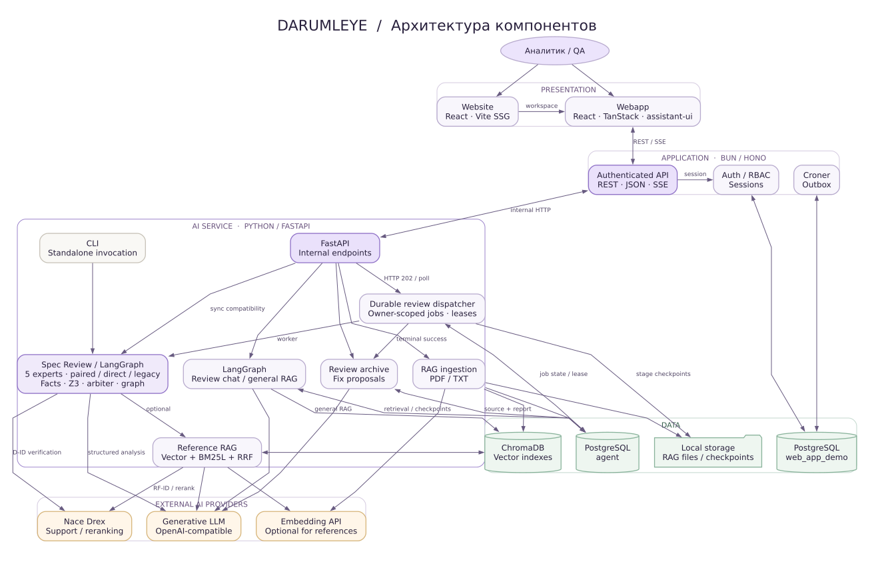

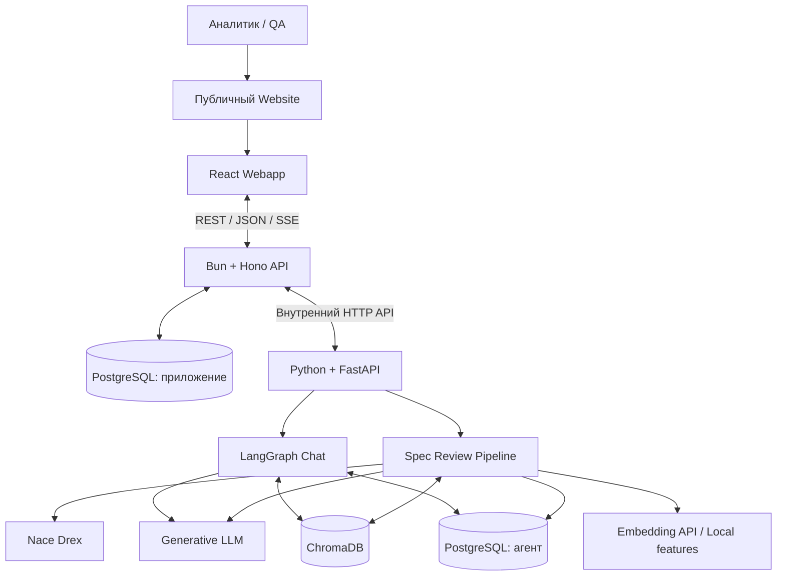

Архитектура — модульный монолит на Bun с отдельным Python AI-сервисом. Все приложения находятся в одном монорепозитории.

| Слой | Ответственность |
| --- | --- |
| Presentation | Лендинг, закрытое рабочее пространство, отчёт, чат, редактор исправлений |
| Application | Авторизация, HTTP API, валидация запросов, маршрутизация, фоновые задачи |
| AI | Извлечение требований, проверка качества, независимая оценка, нормативный поиск и чат |
| Data | Аккаунты, архивы, документы, векторные индексы, история разговоров |

Браузер не обращается напрямую к LLM, Drex, PostgreSQL и Chroma. Bun API проверяет пользовательскую сессию и передаёт подтверждённую личность в FastAPI.

## 2. Технологический стек

| Слой | Технологии |
| --- | --- |
| Публичный frontend | React 19, Vite, Tailwind CSS 4, Three.js, React Three Fiber |
| Webapp | React 19, TypeScript, Vite, TanStack Router, Query, Form |
| UI | Arc Free, shadcn/ui, Motion, Hugeicons |
| Чат UI | assistant-ui |
| Backend | Bun, Hono |
| Контракты API | Общий Zod-пакет `@web-app-demo/contracts`, Pydantic |
| AI-сервис | Python 3.12+, FastAPI, Uvicorn |
| Работа с LLM | LangChain, ChatOpenAI, OpenAI-compatible API |
| AI-оркестрация чата | LangGraph |
| Модель официального прогона | `gpt-6-luna` через WikiVibe |
| Независимая проверка официального прогона | Nace `drex-max-v1.1` |
| Реляционные данные | PostgreSQL 18, Drizzle ORM, SQLAlchemy, asyncpg, psycopg |
| Vector Database | ChromaDB |
| Поиск | Vector Search, BM25L, Reciprocal Rank Fusion (RRF) |
| Парсинг документов | pypdf, Poppler/Tesseract, ZIP/XML, CSV, UTF-8, LangChain Text Splitters (общий RAG) |
| Фоновые задачи | Croner, PostgreSQL task outbox |
| Инфраструктура | Docker Compose, Terraform, Bun Workspaces, Turborepo, uv |
| Тестирование | pytest, Bun Test, TypeScript, ESLint, Ruff, Playwright |
| Наблюдаемость | structlog, OpenTelemetry, health endpoints |

Модели не зашиты в код. Основная генеративная модель выбирается через конфигурацию OpenAI-compatible API; embedding-провайдер и Drex настраиваются отдельно. Указанные модели — фактически использованные в официальном прогоне, а не обязательные значения.

## 3. Основной AI-пайплайн проверки ТЗ

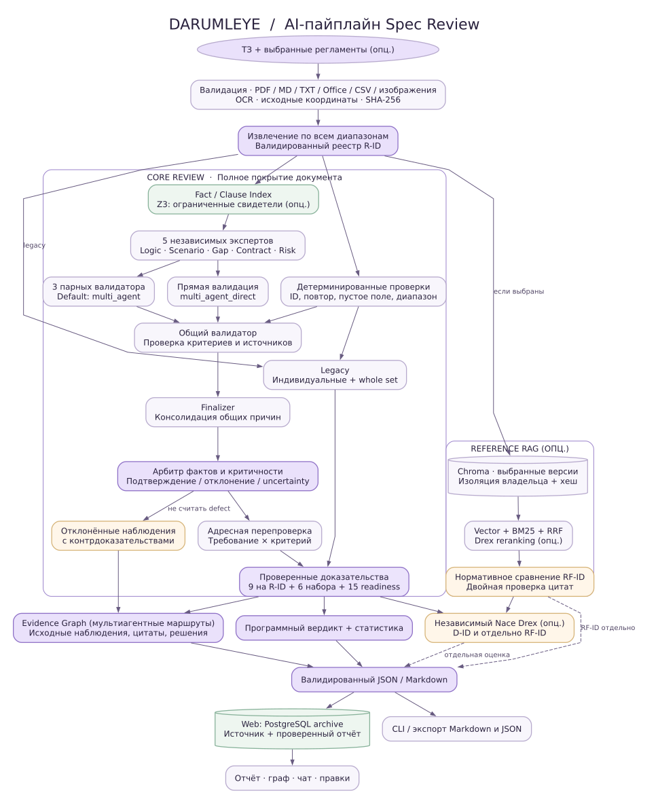

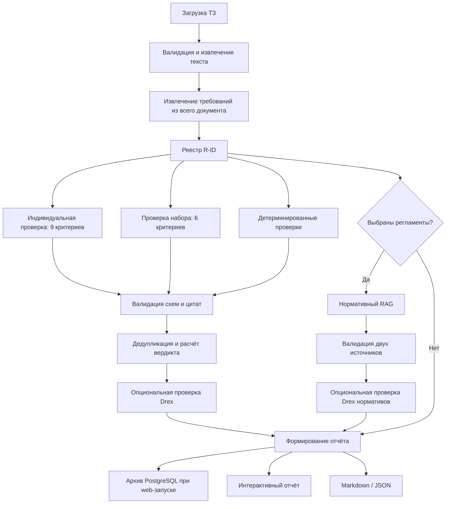

### 3.1. Загрузка документа

Форматы: PDF (включая OCR страниц без текстового слоя), TXT, Markdown, DOCX, XLSX, CSV, JPG/JPEG и PNG. Дополнительно можно выбрать нормативные документы.

Webapp отправляет `multipart/form-data` на `POST /api/agent/spec-reviews`. Bun проверяет сессию, значения и размер запроса, затем передаёт файл и опциональные `reference_files`/`reference_manifest` на `POST /api/v1/spec-reviews` внутри Python-сервиса.

### 3.2. Разбор исходного текста

Python превращает документ в пронумерованные единицы: страницы PDF, строки TXT/Markdown, блоки DOCX, строки XLSX/CSV и текст изображений. Для Excel сохраняются лист, номер строки и адреса ячеек. Проверяются расширение, тип, размер, кодировка и наличие текста. PDF без встроенного текста обрабатывается локальным OCR (Poppler и Tesseract); Tesseract также распознаёт отдельные JPG/PNG и встроенные фотографии DOCX. При ошибке чтения отдельной страницы агент сохраняет остальные страницы и пытается распознать повреждённую. Если основной парсер не может открыть PDF, независимый `pdfinfo` определяет число страниц незашифрованного файла и позволяет попробовать OCR. Распознанные и нечитаемые страницы или изображения указываются в отчёте; неполный документ не может получить вердикт `ready`. Полностью нечитаемые документы отклоняются до вызова LLM. Фотографии DOCX в абзацах, таблицах, примечаниях и используемых колонтитулах получают отдельные номера блоков; внутри абзацев сохраняется порядок текста и изображений.

```json
[
  {"index": 1, "text": "Требования к уведомлениям"},
  {"index": 2, "text": "Клиент должен получать уведомление"}
]
```

Паспорт результата фиксирует UUID запуска, SHA-256 исходного файла, имя документа, время, модель и версию агента. Это задаёт проверяемую идентичность исходника и запуска.

### 3.3. Извлечение требований (Requirement Extraction)

Документ разбивается на диапазоны целевого размера 5 000 символов. Строки и страницы не разрываются; по две соседние единицы с каждой стороны дают дополнительный контекст. Модель получает все диапазоны, а не только найденные поиском фрагменты.

LLM возвращает JSON с формулировкой и цитатой; Python валидирует координаты и цитаты, удаляет повторные записи, сортирует результат по источнику и присваивает идентификаторы `R-001`, `R-002` и далее. Явный исходный ID требования сохраняется отдельно, если он есть в тексте.

```json
{
  "id": "R-001",
  "text": "Клиент должен получать уведомление",
  "source_id": null,
  "evidence": {
    "start": 2,
    "end": 2,
    "quote": "Клиент должен получать уведомление"
  },
  "checks": []
}
```

Результат этапа — единый реестр требований, привязанный к оригиналу. Полнота самого извлечения зависит от модели.

### 3.4. Детерминированный анализ

Python без вызова LLM выявляет дословно повторяющиеся обязательства и повторно присвоенные явные идентификаторы в разных местах документа. Эти замечания содержат проверяемые ссылки на источник. Модель не может оставить положительную оценку соответствующего критерия набора, если код обнаружил противоречащий ей дефект.

### 3.5. Индивидуальная проверка (9 критериев)

Требования проверяются по характеристикам качества, основанным на ISO/IEC/IEEE 29148. Это не сертификация по стандарту.

| Критерий | Что оценивается |
| --- | --- |
| Необходимость | Нужно ли обязательство для достижения цели |
| Однозначность | Можно ли понять его однозначно |
| Полнота | Достаточно ли условий, ограничений и ожидаемых результатов |
| Атомарность | Описано ли одно самостоятельное обязательство |
| Реализуемость | Можно ли выполнить требуемое поведение |
| Проверяемость | Можно ли сформулировать тест или критерий приёмки |
| Корректность | Соответствует ли формулировка заданным бизнес-условиям |
| Независимость от реализации | Не навязано ли необоснованное техническое решение |
| Прослеживаемость | Связано ли требование с источником и назначением |

Каждый критерий получает `pass`, `fail`, `uncertain` или `not_applicable` и объяснение. Партия содержит до шести требований. Индивидуальная и глобальная ветки совместно ограничены тремя одновременными вызовами по умолчанию (настройка 1–3). Для малого ТЗ модель получает полный текст, для большого — ограниченный контекст цитируемых, соседних и релевантных единиц. Для короткого ТЗ с ровно семью требованиями предусмотрена оптимизация одним пакетом с возвратом к схеме 6+1 при недопустимом ответе.

### 3.6. Проверка набора (6 критериев)

Глобальная ветка малого документа независимо получает полный текст, реестр требований и проверенные кодом замечания. В большом документе она проверяет каждый непустой раздел и группы межраздельных кандидатов, а Python объединяет худшие оценки и подтверждённые замечания. Это выборочный поиск связей, а не исчерпывающий перебор всех пар.

| Критерий | Назначение |
| --- | --- |
| Полнота набора | Поиск отсутствующих сценариев |
| Согласованность | Поиск противоречий между требованиями |
| Связность | Проверка взаимосвязей и идентификаторов |
| Достижимость | Проверка совместной реализуемости |
| Проверяемость набора | Возможность проверить поведение системы целиком |
| Отсутствие дублирования | Поиск повторных обязательств |

Например, правило «не более одного уведомления в месяц» конфликтует с правилом «отправлять новое уведомление при каждом изменении порога». Индивидуально оба обязательства могут выглядеть разумными, но совместная проверка обнаружит необходимость согласования.

### 3.7. Чек-лист и вопросы для аналитика

К матрицам девяти индивидуальных и шести общих критериев добавлен чек-лист готовности из 15 фиксированных пунктов. Каждый пункт сообщает наличие необходимой информации, результат оценки, объяснение и исходные цитаты. Неподтверждённые согласования не считаются состоявшимися. Код отдельно выявляет кандидаты на пропущенные требования по явным идентификаторам и техническим ограничениям; такие кандидаты требуют ручной проверки и блокируют вердикт `ready`. Вопросы `Q-###` связаны с замечаниями `D-###` или пунктами чек-листа. Старые архивные отчёты могут не содержать новых полей; для получения этих разделов необходимо повторить проверку. См. [схему полей отчёта](SPEC_REVIEW.md#readiness-checklist-extraction-coverage-and-clarification-questions).

## 4. Evidence Validation

**LLM предлагает содержательный анализ; программный слой проверяет допустимость структурированных результатов.**

Каждый ответ стадии проходит:

1. Разбор JSON и Pydantic-валидацию.
2. Проверку существования идентификаторов требований.
3. Проверку полного набора критериев и результатов по партии.
4. Проверку координат строк и страниц.
5. Сопоставление точных цитат с исходным текстом после нормализации пробелов.
6. Проверку связанных замечаний для неуспешных индивидуальных проверок.
7. Проверку наличия двух разных цитат для противоречия.
8. Дедупликацию замечаний с объединением связей и доказательств.

Отсутствующее правило невозможно процитировать буквально. Для замечаний `missing` система использует исходный контекст, если он доступен. Некорректный структурированный ответ получает не более одного корректирующего запроса в пределах дедлайна. Сетевые ошибки, ошибки авторизации и rate limit не считаются исправлением структуры. При повторной недопустимой выдаче основной пайплайн останавливается вместо формирования ложного успешного отчёта.

Точное совпадение цитаты не доказывает правильность её смысловой интерпретации.

## 5. Nace Drex: независимая оценка

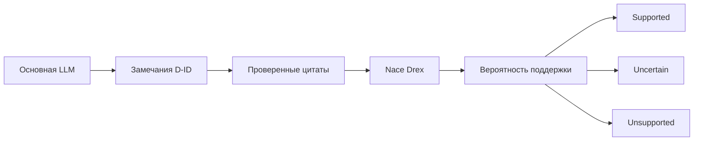

Drex получает исходный текст и финальные замечания `D-001`, `D-002` и т. д. Он независимо оценивает, насколько оригинал подтверждает каждое замечание. Результат — вероятность Noul для каждого ID.

| Вероятность | Статус |
| --- | --- |
| ≥ 0,8 | `supported` |
| ≥ 0,4 и < 0,8 | `uncertain` |
| < 0,4 | `unsupported` |

Три уровня проверки: генеративная LLM, программная валидация Python и независимая оценка Drex. Drex не удаляет исходные замечания, не меняет их серьёзность или основной вердикт. При сбое необязательной стадии сохраняется основной отчёт, а оценка получает явный статус недоступности. Один запрос ограничен 128 замечаниями и 512 000 UTF-8 байтами; превышение даёт статус недоступности вместо частичного аудита. Пороги — эвристика для приоритизации экспертной проверки, а не измеренная точность модели.

## 6. Нормативный RAG

Контур применяется только к явно выбранным источникам: стандартам качества, банковским регламентам, API/QA-документам и нормативным текстам. Он начинает работу после извлечения реестра и выполняется параллельно основной проверке.

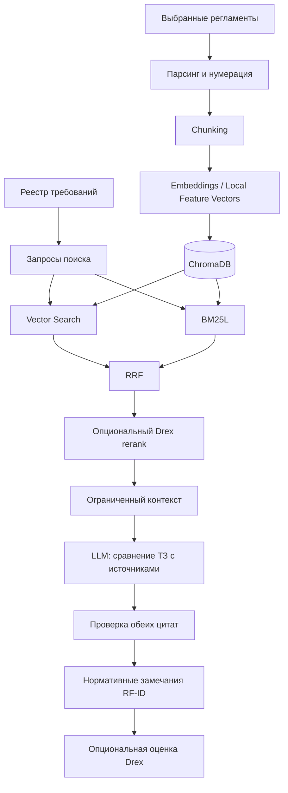

### 6.1. Индексация

Регламент разбивается на фрагменты целевого размера 750 символов. Chroma хранит векторы, текст и метаданные: владельца, ID документа, SHA-256 версии, порядковый номер фрагмента и исходные координаты. Индекс повторно используется при совпадении содержимого. Поиск ограничен владельцем и выбранными версиями источников.

### 6.2. Гибридный поиск

- Vector Search: модель embeddings при наличии конфигурации. Иначе — локальные хешированные лексические признаки размерности 512, а не обученные семантические embeddings.
- BM25L: лексический поиск по терминам.
- Reciprocal Rank Fusion: объединение рангов, `RRF(d) = Σ 1 / (60 + rank_i(d))`.
- При включённой независимой проверке Drex: опциональное перераспределение ранга первых 32 кандидатов. При сбое остаётся исходный порядок поиска.

Контекст ограничен 12 000 исходных символов. Алгоритм сохраняет хотя бы один фрагмент от каждого выбранного источника, если позволяют ограничения, и сообщает покрытие (выбранные и общие фрагменты/символы). Если контекст не охватывает весь источник, это не доказательство отсутствия нормы.

### 6.3. Сравнение с источниками

LLM сопоставляет требования с выбранными фрагментами и возвращает оценку применимости источников и отдельные наблюдения:

- `potential_discrepancy` — потенциальное несоответствие;
- `missing_evidence` — недостаточно доказательств;
- `unclear_applicability` — применимость требует уточнения.

Каждое наблюдение должно иметь точную цитату из ТЗ и точную цитату из переданного фрагмента нормативного документа. Python проверяет обе цитаты, включая соответствие исходным координатам и наличие в реально извлечённом контексте. Модель ориентирована на максимум три значимых наблюдения на источник. Нормативный контур не является юридической экспертизой и не изменяет основную статистику и вердикт качества ТЗ.

**RAG не заменяет основной анализ: ТЗ проверяется целиком, а RAG отбирает дополнительный контекст.**

## 7. Итоговый отчёт и расчёт готовности

```text
ReviewReport
├── filename / source / unreadable_pages
├── passport: дата, модель, версия, run_id, sha256
├── summary
├── requirements[]: R-ID, source_id, текст, доказательство, checks[]
├── set_checks[]: критерии, оценки, комментарии, доказательства
├── findings[]: тип, severity, issue, recommendation, evidence, requirement_ids
├── statistics
├── verdict
├── decision_review?   (Drex, оценки D-ID)
├── reference_review?  (реестр S-ID, наблюдения RF-ID, покрытие, Drex)
└── report_markdown
```

| Тип замечания | Значение |
| --- | --- |
| `missing` | Отсутствующее требование или условие |
| `ambiguous` | Неоднозначность |
| `conflict` | Противоречие |
| `untestable` | Непроверяемость |
| `other` | Другой дефект |

Уровни серьёзности: `critical` — критическое бизнес-влияние; `high` — существенный риск реализации/приёмки; `medium` — локальный значимый дефект; `low` — небольшое замечание.

Статистика рассчитывается из валидированных записей: число требований, итоговых замечаний, критических замечаний, прошедших и нуждающихся в доработке требований. `passed` означает отсутствие связанных замечаний и оценки `pass` или `not_applicable` по всем индивидуальным критериям.

| Вердикт | Условие |
| --- | --- |
| `not_ready` | Нет требований, есть нечитаемые страницы или замечания `critical`/`high` |
| `needs_revision` | Есть другие замечания, непройденные или неопределённые проверки |
| `ready` | Все обязательные критерии удовлетворены, исходник читаем, замечаний нет; готовность подтверждает владелец требований |

Отчёт выводится в интерактивном интерфейсе; Markdown доступен для скачивания, JSON — в API и CLI. Основная web-проверка запускается асинхронно: API сохраняет задание и файлы в PostgreSQL до ответа HTTP 202, браузер опрашивает статус по неизменному UUID. Worker захватывает задание с обновляемой арендой, действующей 90 секунд, и сохраняет принятые этапы LLM в контрольные точки. При штатной остановке незавершённое задание возвращается в очередь, при аварийной — восстанавливается после истечения аренды. Бюджет активной работы (24 минуты) не расходуется за произвольное время простоя сервера; при аварии учитывается до одного интервала heartbeat неопределённого активного времени. Принятые этапы с совпадающими входом, провайдером, моделью, промптом и схемой не вызываются повторно; незавершённый этап может быть повторён. Клиент повторяет опрос при временной недоступности API, сохраняет намерение отмены и не загружает ТЗ заново. Отмена хранится на сервере; просроченная аренда или отменённое задание не могут записать результат. Архив и завершение фиксируются одной транзакцией PostgreSQL. Повторная web-проверка доработанного текста использует ту же очередь. Уход с экрана доработки прекращает локальный опрос, но не серверное задание; результат доступен в архиве. Синхронный CLI и legacy POST не используют эту очередь.

## 8. Архив проверок и чат по отчётам

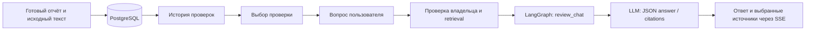

На `/app/chat` пользователь выбирает свою завершённую проверку. Сервер извлекает источник, сводку и релевантные замечания из таблицы `agent_completed_reviews`. BM25L с лексической нормализацией выбирает до трёх фрагментов отчёта и до четырёх фрагментов исходника; приоритет имеют доказательства связанных замечаний. Для короткого документа (до 8 000 символов пронумерованного текста) добавляется исходник целиком. LangGraph вызывает модель с этим контекстом и ожидает JSON с ответом и выбранными ID источников. Источники берутся из серверного списка. История потока сохраняется в PostgreSQL checkpoints. Ответ, статус инструмента и источники выводятся через SSE.

`review_chat` не повторяет проверку ТЗ и не нуждается в повторной индексации в Chroma. LangGraph использует отдельный граф для этого модуля: retrieval выполняется сервером перед вызовом модели, без циклов вызова инструментов моделью.

### 8.1. Общий RAG-чат (шаблонный модуль)

Модуль `rag` работает с пользовательской базой PDF/TXT-документов, независимой от архива Spec Review.

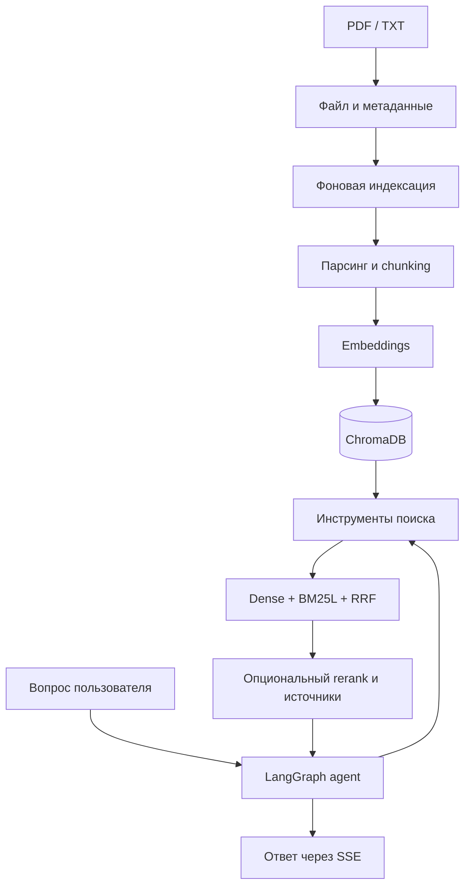

Загрузка сохраняет файл и статус в БД: `PENDING`/`QUEUED` → `PROCESSING` → `COMPLETED` или `FAILED`. Незавершённые задания могут возобновляться при старте агента. Для общего RAG требуются настроенные embeddings. LangGraph связывает LLM и инструменты поиска; число раундов ограничено. Инструмент приватной памяти читает только явно сохранённые пользователем заметки; они не становятся источниками доказательств.

## 9. Исправление ТЗ и повторная проверка

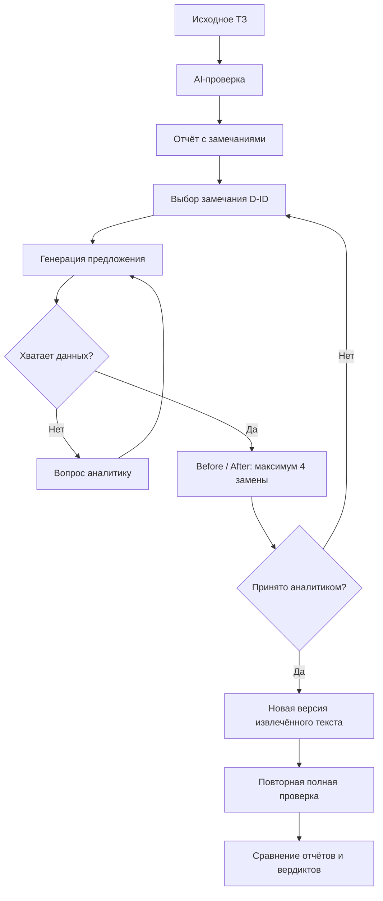

Bun API `POST /api/agent/spec-reviews/:id/fix` вызывает внутренний FastAPI. Сервер использует неизменяемый архивный источник и конкретное замечание. Ответ — `patch` или `clarification`. При недостающем бизнес-решении модель задаёт вопрос, а не должна самостоятельно придумывать условия.

Для предложения проверяются точные уникальные исходные якоря и непересечение диапазонов. Пользователь принимает, отклоняет или отменяет предложения. Принятые изменения применяются к одному оригиналу; оригинальный отчёт и источник не перезаписываются. Черновики правок живут в открытом workspace, поэтому их следует экспортировать до выхода. PDF экспортируется текстом без исходной вёрстки, а нечитаемые страницы исключают возможность исправления. Повторный запуск создаёт новый паспорт и архивную запись. Архив не хранит бинарные вложения нормативов: при повторной загрузке исходные файлы восстанавливаются по точному SHA-256, исходным метаданным и порядку. Несовпадающие файлы не отправляются; проверка без всех исходных нормативов требует явного выбора. Сравнение двух AI-оценок не доказывает автоматически, что каждый старый дефект устранён.

## 10. Backend и API

Backend следует DDD-lite: `transport` отвечает за HTTP, `application` — координацию, `domain` — правила, `infrastructure` — доступ к данным и SDK. Контексты находятся в `backend/src/modules/`. Webapp использует `src/features/` и `src/platform/`. Общие схемы Zod находятся в `packages/contracts/`; FastAPI использует Pydantic.

| Метод | Публичный Bun API | Внутренний FastAPI / назначение |
| --- | --- | --- |
| POST | `/api/agent/spec-reviews` | `/api/v1/spec-reviews` — полная проверка |
| POST | `/api/agent/spec-review-jobs` | `/api/v1/spec-review-jobs` — запуск фоновой проверки с UUID |
| GET / DELETE | `/api/agent/spec-review-jobs/:id` | `/api/v1/spec-review-jobs/{job_id}` — статус или отмена |
| GET | `/api/agent/spec-reviews` | `/api/v1/spec-reviews` — архив |
| GET | `/api/agent/spec-reviews/:id` | `/api/v1/spec-reviews/{review_id}` — отчёт |
| POST | `/api/agent/spec-reviews/:id/fix` | `/api/v1/spec-reviews/{review_id}/fix` — исправление |
| POST | `/api/agent/chat/stream` | `/api/v1/chat/stream` — чат |
| GET | `/api/agent/modules` | `/api/v1/modules` — каталог модулей |
| GET | `/api/agent/documents` | `/admin/documents` — список RAG-документов |
| POST | `/api/agent/documents` | `/admin/ingest` — индексация |
| GET/DELETE | `/api/agent/documents/:id` | `/admin/documents/{document_id}` — статус / удаление |
| GET/POST | `/api/agent/memories` | `/api/v1/memories` — заметки |
| DELETE | `/api/agent/memories/:id` | `/api/v1/memories/{memory_id}` — удаление заметки |

Основные страницы workspace: `/app` (обзор), `/app/assistant` (новая или сохранённая проверка), `/app/chat` (чат по проверке), профиль и настройки. Отдельные маршруты администратора закрыты RBAC.

## 11. Хранение данных

| Хранилище | Содержание |
| --- | --- |
| PostgreSQL `web_app_demo` | `users`, `auth_sessions`, `password_reset_tokens`, `user_avatars`, `task_outbox`, `rate_limit_buckets`; схема Drizzle |
| PostgreSQL `agent` | `agent_completed_reviews`, `agent_spec_review_jobs`, `documents`, `thread_ownership`, `agent_checkpoints`, `agent_checkpoint_writes`, приватные заметки; схема Python/SQLAlchemy |
| ChromaDB | Индекс общего RAG и отдельная коллекция нормативных фрагментов |
| Local Storage | Файлы общего RAG, приватные файлы приложения, временные контрольные точки web-проверок (`AGENT_UPLOAD_DIR/spec-review-checkpoints`, том Compose `agent_local_data`) |
| `.artifacts/` | Локальные CLI-отчёты, evaluation, opt-in checkpoints (вне Git) |

Один локальный PostgreSQL-сервер размещает две отдельные базы. Архив `agent_completed_reviews` хранит ID и владельца проверки, имя файла, исходный формат, дату, готовность, счётчики, извлечённые `source_units` и JSON отчёта. Оригинальный бинарный PDF проверки и исходные файлы регламентов в архив не помещаются. Временные входные файлы и метаданные ожидающих/выполняемых задач сохраняются в `agent_spec_review_jobs` (миграция Alembic `20261125_0007`), ограничение — одна активная задача на владельца и две на все процессы. После терминального состояния входные файлы удаляются из записи, контрольные точки очищаются после остановки worker; итоговый архив сохраняется. Восстановление требует сохранения базы PostgreSQL и тома `agent_local_data`, а не только контейнера. Первичный документ и отчёт не индексируются в Chroma; там сохраняются только RAG-коллекции. CLI без регламентов не требует базы данных, CLI с регламентами может использовать локальную persistent Chroma.

## 12. Авторизация и изоляция

Регистрация, вход, JWT, серверные сессии, роли user/admin, защитные middleware, rate limiting и лимиты загрузки реализуются в Bun. Аутентифицированная личность передаётся FastAPI доверенным серверным запросом. Приватные SQL-операции, индексы и потоки привязаны к владельцу. Ключи LLM и Drex находятся в локальной конфигурации, а не в браузере. Смена аккаунта очищает приватный клиентский кеш. Текст документа обрабатывается как данные, а не инструкции.

Локальные хранилища не означают полностью офлайн-анализ: нужный исходный текст отправляется настроенным внешним AI-провайдерам. Проверки цитат снижают риск необоснованной выдачи, но не гарантируют смысловую корректность.

## 13. Запуск и разработка

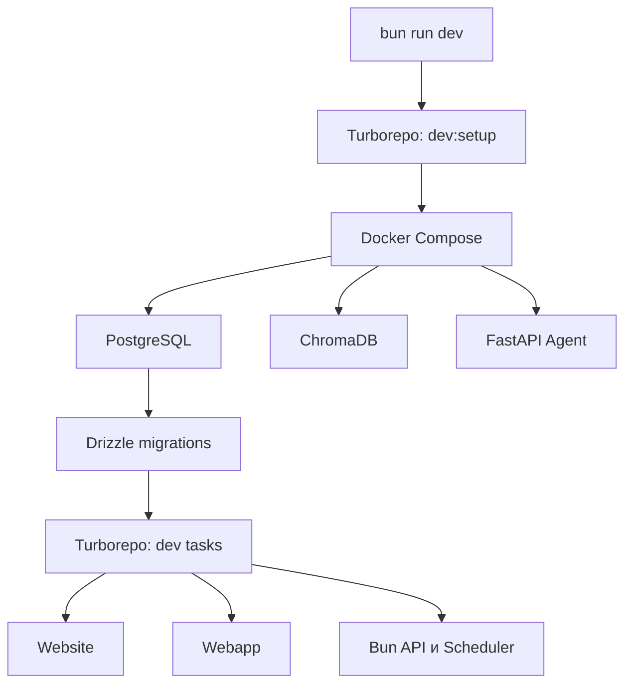

Из `vibe/`:

```bash
bun install --frozen-lockfile
# Создать .env из .env.example при отсутствии и настроить секреты и модель.
bun run dev
```

| Сервис | Порт по умолчанию |
| --- | ---: |
| Website | 4321 |
| Webapp | 5173 |
| Bun API | 3000 |
| FastAPI | 8001 |
| ChromaDB | 8000 |
| PostgreSQL | 54329 |
| Тестовый PostgreSQL | 54330 |

Compose сохраняет данные в локальных именованных volumes. Дополнительный SeaweedFS — опциональное S3-совместимое хранилище. Турборепозиторий координирует запуск приложений и кеширование сборок; удалённый кеш отключён. Croner и PostgreSQL outbox обрабатывают фоновые задачи приложения, а не основной Spec Review.

CLI запускает тот же основной AI-пайплайн напрямую. Из корня репозитория, после подготовки `.env` и исходного документа:

```bash
uv run --project vibe/services/agent --frozen python -m agent.spec_review_cli \
  --input .artifacts/requirements.md \
  --output .artifacts/report.json --env-file .env
```

Команда запускает парную валидацию. Для прямого маршрута передайте `--review-mode multi_agent_direct`. Для длительного evaluation доступны `--timeout-seconds` до 900, `--checkpoint-dir` и `--wait-rate-limit`; завершённые валидированные этапы могут переиспользоваться. При ошибке не записывается новый отчёт. Документ-only режим не требует Docker, PostgreSQL, Chroma и embeddings.

## 14. Тестирование и evaluation

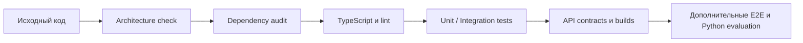

`bun run check` запускает проверки шаблона, архитектуры, зависимостей, типов, линтинга, тестов и build contracts. Python pytest и браузерные Playwright-проверки запускаются отдельно. Проверяются парсинг, точность цитат, детерминированные проверки, устойчивость к некорректному ответу модели, расчёт вердикта, RAG, Drex, архив и правки.

Evaluation использует основной CLI. Независимый скрипт `evaluate_spec_report.py` перепроверяет готовый JSON по исходному ТЗ, идентичность SHA-256, полноту матриц критериев, источники, статистику и вердикт. Синтетический quality benchmark содержит две пары исходных и исправленных спецификаций. Он сопоставляет замечания и извлечённые обязательства по типам, координатам и точным цитатам один к одному. Его метрики характеризуют совпадение с разметкой, а не общую семантическую точность системы. См. [методику оценки качества и трудозатрат](QUALITY_EVALUATION.md).

## 15. Результаты полного прогона официального ТЗ

Сохранённый отчёт от **25 ноября 2026 года** получен на полном документе организаторов, без дополнительных регламентов. Модели: `gpt-6-luna` и `drex-max-v1.1`. Это исторический прогон до добавления чек-листа готовности, кандидатов на пропущенные требования и вопросов уточнения; его результаты не являются новой проверкой этих разделов.

| Показатель | Результат |
| --- | ---: |
| Извлечено требований | 56 |
| Индивидуальные проверки | 504 |
| Проверки набора | 6 |
| Замечания | 44 |
| Critical | 0 |
| High | 11 |
| Medium | 28 |
| Low | 5 |
| Требования, прошедшие проверку | 13 |
| Требования к доработке | 43 |
| Замечания с точными цитатами | 44/44 |
| Структурные проверки | 18/18 |
| Вердикт | `not_ready` |

Независимая оценка Drex:

```text
Поддержано       28  ████████████████████████████
Сомнительно      12  ████████████
Не поддержано     4  ████
```

Найдены все шесть основных дефектов независимо составленного контрольного списка. Некоторые дополнительные дефекты пропущены или покрыты частично; встречаются близкие по смыслу замечания. 18/18 — структурная проверка, а не 100% семантическая точность. Организатор не предоставил размеченный gold dataset. Прогон записан для изменённого рабочего дерева поверх базового коммита `d53f0a9`.

Локальные доказательства (не отслеживаются Git): `official-eval-summary.md`, `official-eval.json` и `official-report.md` в `.artifacts/organizer-eval/` от корня репозитория. Они не входят в чистую копию репозитория. См. [инструкцию повторного прогона и независимой оценки](SPEC_REVIEW.md#complete-organizer-evaluation).

## 16. Deployment

В шаблоне присутствует Terraform для DigitalOcean и Yandex Cloud, а также единый скрипт `infra.mjs`. Исторический облачный конвейер: опубликованный Git revision → Terraform plan → Docker build → registry → миграции PostgreSQL → переключение API/jobs → публикация статики → health checks.

**Текущий поддерживаемый путь — локальный Compose.** Облачная инструкция относится к предыдущей архитектуре; адаптация для обновлённого AI-сервиса и production-развёртывание не подтверждены. Провайдер размещения не выбран. Автоматический cloud CI/CD не используется в текущем проекте; проверки выполняются локально.

## 17. Ограничения и надёжность

| Параметр | Ограничение |
| --- | --- |
| Размер исходного ТЗ | 25 МиБ |
| Извлечённый текст ТЗ | 100 000 символов |
| PDF | 150 страниц |
| OCR | 180 секунд на основное ТЗ, 30 секунд на каждый регламент |
| Требования | 500 |
| Регламенты | До 8 файлов, 5 МиБ каждый, 10 МиБ суммарно |
| Извлечённый текст регламентов | 24 000 символов на файл, 48 000 суммарно |
| Нормативный контекст | 12 000 символов |
| Основная проверка | По умолчанию 230 секунд для малого ТЗ, 900 секунд для большого |
| Bun для проверки ТЗ | 24 минуты на проксирование, включая OCR |
| Нормативное сравнение | До 85 секунд в общем бюджете |
| Предложение исправления | До 120 секунд |
| Независимая проверка Drex | 1–20 секунд по конфигурации с учётом дедлайна |
| Общий RAG | PDF/TXT до 25 МиБ |

При ошибке обязательной стадии отчёт не выдаётся как завершённый. Необязательные стадии могут вернуть `unavailable`, сохранив основной отчёт. Для больших ТЗ проверка набора выполняется по разделам и выборочным межраздельным сопоставлениям; не подтверждённые глобальные связи отмечаются как неопределённые. Автоматическое обновление законов, юридическая сертификация, подтверждённые нагрузочные тесты и полноценный production deployment пока отсутствуют. Основной риск качества — пропуск требования или ошибочная интерпретация существующей цитаты, включая OCR.

## 18. UML-диаграммы

Все шесть схем ниже отрендерены непосредственно из PlantUML в PNG. Исходники можно редактировать и рендерить повторно.

| Диаграмма | Назначение | PlantUML | PNG |
| --- | --- | --- | --- |
| Component | Архитектура компонентов | [01-components.puml](uml/01-components.puml) | [PNG](uml/01-components.png) |
| Sequence | Последовательность проверки ТЗ | [02-review-sequence.puml](uml/02-review-sequence.puml) | [PNG](uml/02-review-sequence.png) |
| Activity | Полный AI-пайплайн | [03-review-activity.puml](uml/03-review-activity.puml) | [PNG](uml/03-review-activity.png) |
| Class | Модель данных отчёта и архив | [04-report-classes.puml](uml/04-report-classes.puml) | [PNG](uml/04-report-classes.png) |
| Sequence | Доработка и повторная проверка | [05-fix-sequence.puml](uml/05-fix-sequence.puml) | [PNG](uml/05-fix-sequence.png) |
| Sequence | Чат по завершённой проверке | [06-review-chat-sequence.puml](uml/06-review-chat-sequence.puml) | [PNG](uml/06-review-chat-sequence.png) |

### 18.1. Архитектура компонентов (Component Diagram)

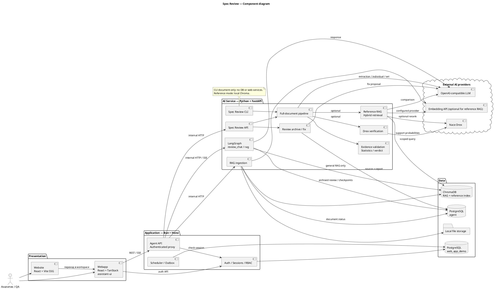

[Исходник PlantUML](uml/01-components.puml) · [Открыть PNG в полном размере](uml/01-components.png)

### 18.2. Последовательность проверки ТЗ (Sequence Diagram)

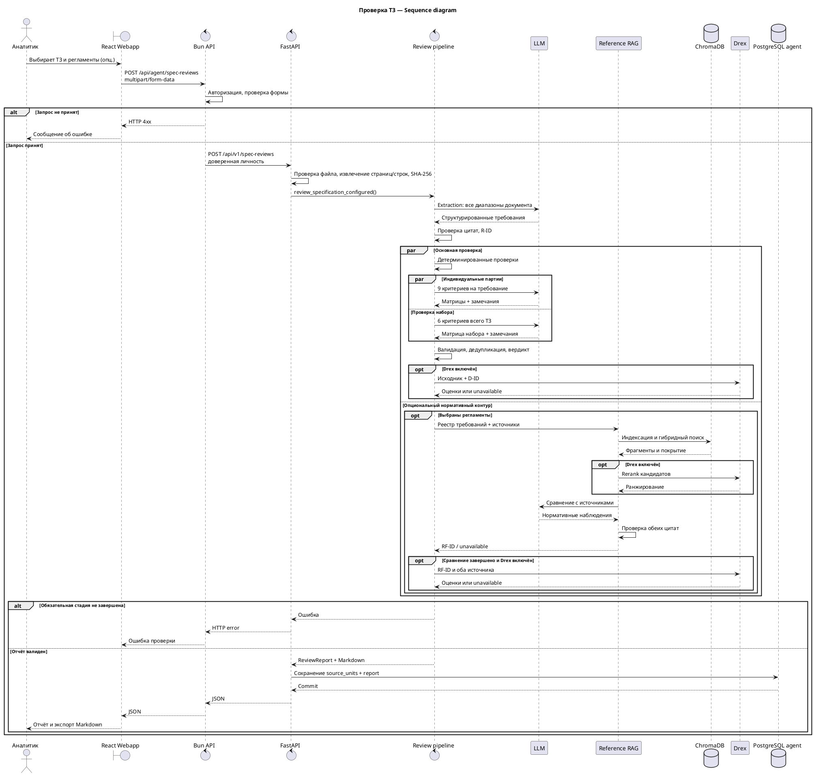

[Исходник PlantUML](uml/02-review-sequence.puml) · [Открыть PNG в полном размере](uml/02-review-sequence.png)

### 18.3. Полный AI-пайплайн (Activity Diagram)

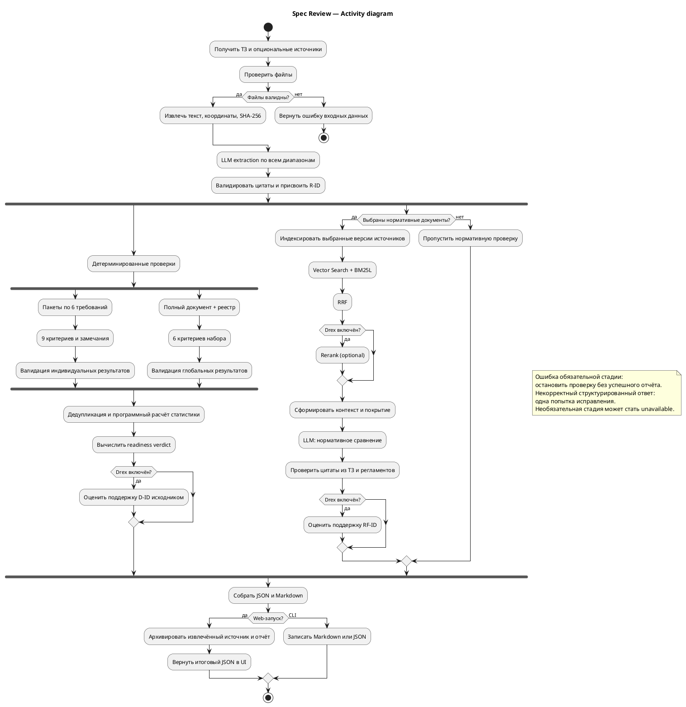

[Исходник PlantUML](uml/03-review-activity.puml) · [Открыть PNG в полном размере](uml/03-review-activity.png)

### 18.4. Модель данных отчёта и архив (Class Diagram)

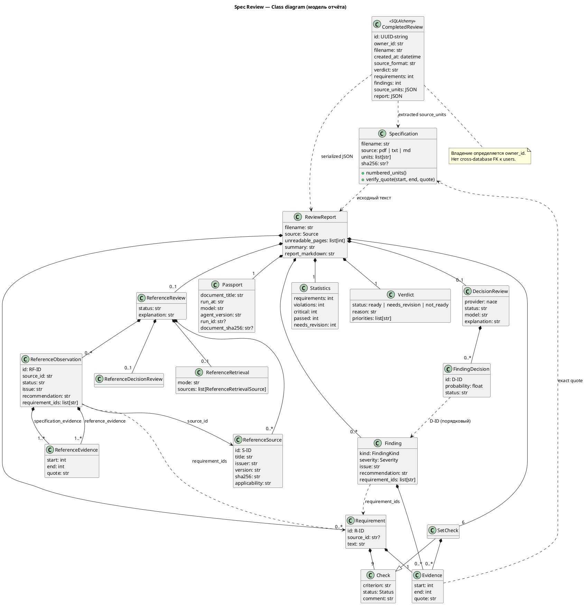

[Исходник PlantUML](uml/04-report-classes.puml) · [Открыть PNG в полном размере](uml/04-report-classes.png)

### 18.5. Доработка и повторная проверка (Sequence Diagram)

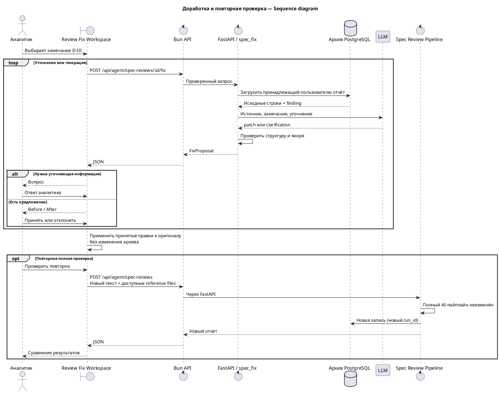

[Исходник PlantUML](uml/05-fix-sequence.puml) · [Открыть PNG в полном размере](uml/05-fix-sequence.png)

### 18.6. Чат по завершённой проверке (Sequence Diagram)

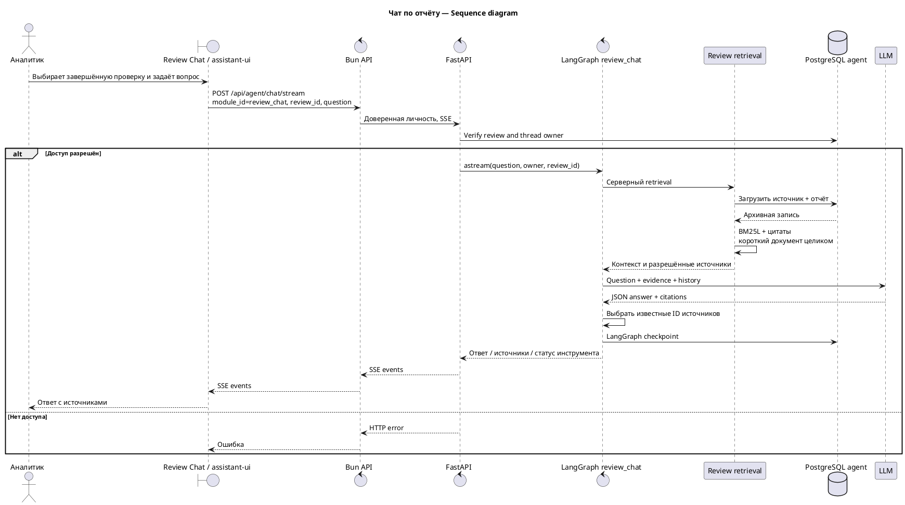

[Исходник PlantUML](uml/06-review-chat-sequence.puml) · [Открыть PNG в полном размере](uml/06-review-chat-sequence.png)

### Дополнительные обзорные схемы (Graphviz)

[Общая архитектура SVG](uml/spec-review-overview.svg) · [PNG](uml/spec-review-overview.png)

[AI-пайплайн SVG](uml/spec-review-pipeline.svg) · [PNG](uml/spec-review-pipeline.png)

## 19. Карта исходников

| Файл или каталог | Назначение |
| --- | --- |
| [webapp](../webapp/) | Рабочее пространство, авторизация, отчёт и чат |
| [website](../website/) | Публичный статический сайт |
| [Backend agent routes](../backend/src/modules/agent/transport/routes.ts) | Защищённый proxy |
| [API contracts](../packages/contracts/src/agents.ts) | Общие контракты |
| [Spec document](../services/agent/src/agent/services/spec_document.py) | Парсинг и доказательства |
| [Spec review](../services/agent/src/agent/services/spec_review.py) | Основная оркестрация, проверки и вердикт |
| [Drex](../services/agent/src/agent/services/spec_decision_review.py) | Независимые оценки |
| [Reference RAG](../services/agent/src/agent/services/spec_reference_rag.py) | Нормативный гибридный поиск |
| [Reference review](../services/agent/src/agent/services/spec_reference_review.py) | Сравнение и двойные цитаты |
| [Report renderer](../services/agent/src/agent/services/spec_report.py) | Markdown |
| [Review archive](../services/agent/src/agent/services/review_archive.py) | История и контекст чата |
| [Review fix](../services/agent/src/agent/services/spec_fix.py) | Предложения исправлений |
| [LangGraph workflow](../services/agent/src/agent/graphs/workflow.py) | Чат и инструменты |
| [CLI](../services/agent/src/agent/spec_review_cli.py) | Автономный запуск |
| [Evaluation](../services/agent/scripts/evaluate_spec_report.py) | Независимые структурные проверки |
| [Docker Compose](../docker-compose.yml) | Локальная инфраструктура |

## 20. Ключевая идея для защиты

> Мы разработали многоэтапную AI-систему статической проверки требований. Генеративная модель анализирует весь документ по девяти индивидуальным и шести общим характеристикам качества. Детерминированный программный слой проверяет цитаты, структуру и рассчитывает готовность ТЗ. Nace Drex независимо оценивает обоснованность замечаний, а гибридный RAG сопоставляет требования с выбранными нормативными источниками. Аналитик получает проверяемый отчёт, может обсудить его с AI, исправить документ и выполнить повторную проверку.

Основная ценность — объяснимый полный цикл управления качеством требований, а не один непрозрачный ответ модели.

Дополнительные материалы: [Spec Review](SPEC_REVIEW.md), [оценка качества](QUALITY_EVALUATION.md), [архитектура Vibe](ARCHITECTURE.md), [нормативные источники](REGULATORY_CONTEXT.md), [Nace RAG](NACE_RAG.md), [тестирование](TESTING.md), [деплой](DEPLOYMENT.md).

Материал основан на текущем коде и сохранённых результатах evaluation; новые модельные прогоны и тесты для этого документа не выполнялись.
